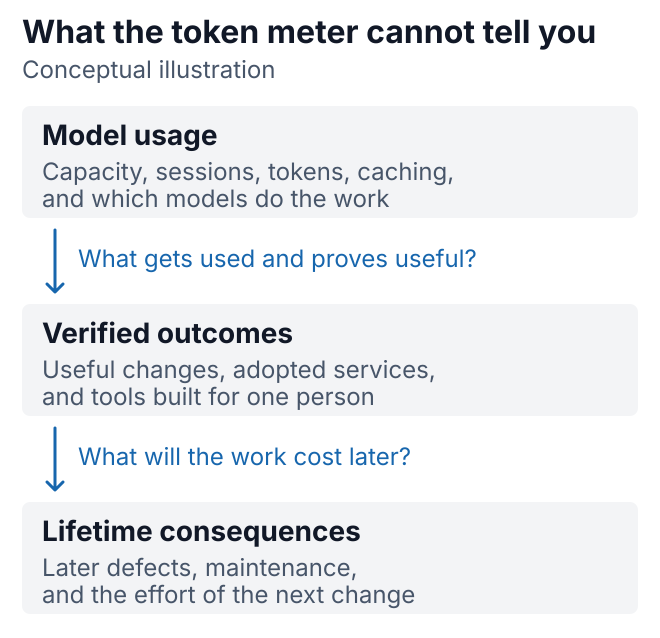

# After the Peak

*Why the lasting AI revolution may use intelligence differently from the boom that financed it*

The next stage of the AI economy may be shaped as much by learning to use intelligence sparingly as by making intelligence abundant. Today's providers sell tokens and computing capacity; their customers ultimately want useful, verified outcomes. Those are not the same market. Early adopters can spend more and more on agents while discovering that writing code is no longer the thing holding their businesses back. Mature adopters may learn to produce better, longer-lived software with less computation per useful change. That would be a technological triumph, but it would complicate the forecasts of anyone financing infrastructure on the assumption that token consumption will grow in step with economic value.

This is not a forecast of an imminent crash. Nor is it an argument that tokens have already peaked. It is a proposal to measure the gap between how much AI activity we buy and how much lasting value that activity creates, a gap that may widen during technological enthusiasm and narrow as organisations learn. [A01](https://github.com/JKershaw/LinearViewer/blob/68b5d8f3a8c6ee3d4d3dfea87a705d703c7a0192/docs/papers/harbour/the-price-of-tomorrow.md#L84)

## The boom and the wrong unit

A token is a small unit of text processed by a language model. It is convenient to count because every provider produces one. A finished product, a sound decision, a useful feature or a safe rewrite is harder to count. We have consequently acquired exquisite instruments for measuring the activity of AI and much poorer ones for measuring the result.

OpenRouter, a marketplace routing requests to many AI models, reported that 790 trillion tokens passed through its platform in October 2026, 37% more than in September and almost twenty-five times January's volume. It classified 76% of October tokens as coming from agentic API keys, up from 8% a year earlier. Its effective billed price per token had fallen sharply since January. These numbers describe one platform, whose customer mix may itself be changing, and its agentic classification is an inference from usage patterns. Traffic on that platform was still rising in October. They tell us almost nothing about how much useful work the traffic completed. [A02](https://openrouter.ai/data/newsletter/october-monthly-recap)

The phrase 'AI demand' conceals at least four distinct things: the number of people using AI, the number of tasks attempted, the computation consumed by each attempt, and the value of the outcomes that survive into real use. All four can move in different directions. A new agent that repeatedly rereads its context might multiply tokens without multiplying output. A cheaper model might cut the bill without reducing tokens. A reusable application might make a sophisticated AI capability available to millions of users without teaching each one to operate an agent.

Tokens are not even uniform units of economic cost. A cached prompt reused many times is not priced like a fresh calculation; a token from a small model is not priced like one from a frontier model. And increasingly, one human instruction can launch a long loop of model calls and tool use. Anthropic's own February 2026 analysis measured how long Claude Code works before stopping: across interactive turns, the 99.9th percentile went from under 25 minutes to over 45 minutes between October 2025 and January 2026. The median stayed near 45 seconds. That is an observation of longer-running activity, not a measure of the value produced. OpenRouter also finds that repeated agent contexts make caching important to the economics. The accounting must distinguish raw tokens, billed or cache-adjusted tokens, model prices, and the human and maintenance costs outside inference. [A15](https://openrouter.ai/data/newsletter/cache-is-crucial) [A19](https://www.anthropic.com/research/measuring-agent-autonomy)

## How growth and flattening can coexist

In October, a study of engineering teams offered an apparently contradictory picture. Jellyfish Research analysed 878,167 weeks in which a developer used Cursor or Claude Code, tracking tokens and merged pull requests between May and August 2026. In firms with 200 or more engineers, the fitted relationship between tokens and merged pull requests flattened near three merged PRs per developer-week, with half of its fitted gain reached around 70 million tokens per developer-week. At smaller firms, the curve continued rising farther into the observed range. More importantly, the data showed association, not causation: developers with harder jobs might use more tokens, and merged PRs are not an economic measure of good software. [A03](https://jellyfish.co/blog/tokenomics-2027-rd-budget/)

The same research found that the median company in its AI-cost panel had roughly tripled the estimated list-price value of Cursor and Claude Code usage per weekly active user between March and August. Yet among companies with both usage-cost and work-allocation data, the split among new features, maintenance, and support had barely changed. More capacity had not visibly reorganised what those companies chose to do. It may have accelerated familiar work, but the study cannot tell how much of the output customers valued. [A03]

These observations can both be true. Total market activity expands as new users and workloads arrive. In the larger companies in the Jellyfish sample, another million tokens at the high end went with little additional merged work. Beyond that, another merged change may offer little value to the people who must use, operate, and pay for the software. The constraint can move from coding to review, integration, product decisions, legal or commercial approval, training, procurement, or executive appetite for change. A solo builder with authority may move faster than a large organisation with plentiful developers but slow decisions. The ceiling can be organisational rather than computational.

This is not yet evidence that mature firms are cutting total tokens. Nor does it prove that the first observed flattening is caused by wasted agent activity. It is evidence that the next question belongs outside the token meter: what happens to useful output when the meter climbs?

*Figure 1. Token use, useful outcomes, and the condition of what is left behind are different quantities. OpenRouter’s platform traffic rose in October while Jellyfish’s separate sample showed a flatter relationship between usage and merged work at larger firms. The diagram illustrates the distinction [A02] [A03].*

## The factory is the software team

The most useful analogy may be older than the software industry. Early factories drew power from waterwheels or central steam engines, passing motion through shafts and belts to the machines on the floor. Installing electric motors was one thing. Rearranging the layout, work practices, skills, and management around them took longer. [A22](https://gwern.net/doc/economics/automation/1990-david.pdf#page=4) Economists call part of this delay a productivity J-curve: a new technology arrives, firms spend time and money reorganising, measured gains initially look disappointingly flat or may dip, and benefits emerge later if the investment works. That curve is a proposed mechanism, not a promise that every company eventually prospers. [A06](https://doi.org/10.1257/mac.20180386)

Here the factory is the small software team. Electricity is AI. A developer supervising a couple of coding agents resembles a factory that attaches an electric motor to its old machinery: the power source has changed, but the workflow largely has not. A genuine redesign reaches beyond the developers. Senior leadership must decide what to stop doing, product teams must find the right work, customers and other stakeholders must be able to use the results, and finance, governance, reporting, and training must accommodate a different pace. A fast technology team inside a slow organisation remains a fast team waiting at the same old gates. A small team with the authority to make decisions may have a much easier time changing the whole factory.

The metaphor has limits. Software can often be rewritten at a speed unimaginable to the owner of a physical factory, and the machinery that builds it is also made of software. That makes replacement more plausible, but it does not make judgement free. Teams have to learn when a clean rewrite is safer than repeated patching, how to demonstrate preserved behaviour, which risks deserve deep checking, and where cheap changes create expensive future obligations. These problems are already apparent in sophisticated agentic workflows, not merely speculative possibilities.

Harbour shows what such a reorganisation can expose. It gives different agents distinct jobs and records much of their activity. It found that orchestration could grow elaborate and expensive, that closed tickets could spawn more work than they finished, and that code could become harder to change even while each immediate request was met. Its September analysis found substantial model effort outside implementation. A separate November study found that a fixed process cost could explain why larger changes cost less than proportionately more. [A17](https://github.com/JKershaw/LinearViewer/blob/68b5d8f3a8c6ee3d4d3dfea87a705d703c7a0192/docs/papers/harbour/task-size-and-cost.md#L14) The task study found tickets being created faster than they were closed. These are measured problems in one unusually intensive system, not a universal price list for other teams. [A09](https://github.com/JKershaw/LinearViewer/blob/68b5d8f3a8c6ee3d4d3dfea87a705d703c7a0192/docs/papers/harbour/cost-mix.md#L14) [A10](https://github.com/JKershaw/LinearViewer/blob/68b5d8f3a8c6ee3d4d3dfea87a705d703c7a0192/docs/papers/harbour/tasks-generate-tasks.md#L14)

The emerging answer is not simply more agents. Harbour has already used the Theseus Method to consolidate scattered decisions and rebuild targeted code: eight related tickets merged and the targeted code became structurally simpler. Six production changes showed no differences in the original independent comparisons on tested inputs. A focused rerun found a field-order change that the original sorted comparison missed. Survey is testing how ordinary development can leave the surrounding code with very little new mess, while larger cleanups address the debt already there. Local blind readings were encouraging, though subsequent broad area comparisons could not establish overall improvement or stability. [A23](https://github.com/JKershaw/LinearViewer/blob/68b5d8f3a8c6ee3d4d3dfea87a705d703c7a0192/docs/plans/survey/area-read-reports/comparison-302edafc3-vs-4b5001ddf.md#L3) [A24](https://github.com/JKershaw/LinearViewer/blob/68b5d8f3a8c6ee3d4d3dfea87a705d703c7a0192/docs/plans/survey/area-read-reports/comparison-49776653d-vs-e8e92d50a.md#L3) The question is no longer whether this sort of work can be done at all. Harbour has demonstrated that it can, on limited targets. The open question is how consistently it can be repeated and whether it makes later work cheaper. [A11](https://github.com/JKershaw/LinearViewer/blob/68b5d8f3a8c6ee3d4d3dfea87a705d703c7a0192/docs/papers/harbour/consolidate-then-rebuild.md#L45) [A12](https://github.com/JKershaw/LinearViewer/blob/68b5d8f3a8c6ee3d4d3dfea87a705d703c7a0192/docs/papers/harbour/cleaner-than-it-started.md#L46) [A18](https://github.com/JKershaw/LinearViewer/blob/68b5d8f3a8c6ee3d4d3dfea87a705d703c7a0192/docs/papers/harbour/the-place-became-somebodys-job.md#L25)

## Cheap intelligence can preserve bad habits

There is a paradox at the centre of the transition. If inference prices keep falling, bad software may remain surprisingly affordable to work around. Imagine a decision repeated in a dozen modules. An agent can cheaply read every version, change a few, run tests, and move on. The bill is small enough that nobody pays to put the decision in one home. The next change then repeats much of the search. Harbour has measured this kind of scattered decision and the extra change and review work associated with it. A cheaper model makes the workaround more tolerable; it doesn't make the underlying architecture sound. [A14](https://github.com/JKershaw/LinearViewer/blob/68b5d8f3a8c6ee3d4d3dfea87a705d703c7a0192/docs/papers/harbour/coherence-as-it-grows.md#L100)

Harbour has already used a cheaper model for routine implementation. All 45 implementation dispatches in the window reported on 5 November went to Haiku, while some follow-up assessments used Opus. Four earlier short Haiku tickets each went through one implementation and one review, and a longer routing change went through one implementation. How much the switch saves after review, retries, and repairs is still open. [A20](https://github.com/JKershaw/LinearViewer/blob/68b5d8f3a8c6ee3d4d3dfea87a705d703c7a0192/docs/plans/survey/log.md#L2055) [A21](https://github.com/JKershaw/LinearViewer/blob/68b5d8f3a8c6ee3d4d3dfea87a705d703c7a0192/docs/papers/harbour/how-the-charter-got-complicated.md#L67-L80)

Harbour's small-work replay found dramatic token savings, but two of four reruns without hindsight went from better to worse, and a reliably equivalent lean production workflow has not been demonstrated. The operator reports that apparently successful inexpensive runs have sometimes required expensive cleanup later. Until those outcomes are counted, the extra rigging may be doing important work. [A13](https://github.com/JKershaw/LinearViewer/blob/68b5d8f3a8c6ee3d4d3dfea87a705d703c7a0192/docs/papers/harbour/replay-small-work.md#L57)

This gives three different ways to save. One comes from selecting cheaper adequate models for unchanged work. The other comes from redesigning the work so that less intelligence is required. A third is less visible: code that becomes simpler today may make hundreds of future changes easier. But its price includes the tidying itself, the supervision, and any defects discovered later. The economics of the software's whole lifetime, not the sticker price of this afternoon's prompt, determines whether the third dividend is real.

Harbour's research on scattered decisions already supplies a strong mechanism. Changes touching one decision implemented in several places were markedly larger and more often returned for review, as older software-engineering research also predicts. Consolidating those decisions is a demonstrated way to simplify targeted code. The remaining measurement is longitudinal: after that simplification, how many tokens, review rounds, and human decisions did the next comparable change actually require? [A14] [A17]

## Two clocks, and perhaps two different revolutions

Carlota Pérez describes technological revolutions in terms of an installation phase, often fuelled by enthusiastic finance, and a later deployment phase in which production and institutions adapt to make fuller use of the new system. Her account is historical interpretation, not a cycle that predicts the next market peak. But it gives language to a distinction that stock-price charts obscure: the infrastructure boom and the productive reorganisation need not peak together. [A05](https://carlotaperez.org/books/)

The internet offers an accessible illustration. Pets.com and Amazon both belonged to the first commercial internet era, but internet adoption did not guarantee that every company using it would prosper. The dot-com crash did not remove the networks or the demand for useful online services. Nor did Amazon survive merely because it possessed the better idea in 1999; financing, operations, distribution, customers, and time mattered.

Our possible AI analogue is not simply that today's speculative agent companies perish and tomorrow's sensible ones prosper. It is that token volume and agent autonomy may be the visible metrics of the installation phase, whereas the deployment phase may be measured by useful, maintained products and organisational capability. A model lab can sell extraordinary amounts of computation even as its customers struggle to translate that activity into durable economic value. Conversely, a financially disappointing model provider can still have delivered technology on which others build flourishing businesses.

Another Harbour essay, Learning While the Tools Change, adds a different clock. An experienced engineer, someone experienced at directing AI, and someone arriving after the tools have become easier do not follow the same learning path. Early operators discover methods through costly mistakes; later teams may inherit those methods invisibly inside their tools. This is why professional experience, proficiency with AI, and model capability must be treated separately. The research suggests that organisational learning can spread just as model capability does. [A08](https://github.com/JKershaw/LinearViewer/blob/68b5d8f3a8c6ee3d4d3dfea87a705d703c7a0192/docs/papers/harbour/learning-while-the-tools-change.md#L30)

Stanford's 2026 AI Index makes the separation tangible. Its survey synthesis reported AI use somewhere in 88% of surveyed organisations in 2025, while agent deployment was still in single digits across nearly all individual business functions. Wide adoption is not yet deep integration. The figure is based on surveyed organisations rather than a census of every business, and deployment definitions vary. It is a useful warning against treating a chatbot in every department as the completion of an industrial revolution. [A04](https://hai.stanford.edu/ai-index/2026-ai-index-report/economy)

## Three plausible futures

### The efficiency dividend

Firms learn that they can maintain more useful software with fewer tokens per accepted change, cheaper models and bounded workflows. They cap or redirect consumption. New workloads arrive, but not enough to offset the savings at the prices investors projected. Software grows more valuable while some infrastructure investments earn disappointing returns. That outcome depends on demand growing more slowly than investors assumed when they financed new capacity.

### The rebound

Cheap, reliable AI unlocks so much previously uneconomic work that aggregate compute demand continues accelerating even while tokens per outcome fall. A small company can build custom tools for every department; a person can build an application used only by themselves. The historical warning comes from William Stanley Jevons. In 1865 he argued that more efficient steam engines could increase total coal consumption because cheap power made many more uses profitable. Economists now call such responses rebound effects. Rebound is possible for AI too, but neither Jevons nor the energy literature tells us its size in tokens. [A07](https://doi.org/10.1002/wcc.782)

### An uneven economy

Both tendencies operate together. Mature coding teams plateau, but embedded AI in consumer software, research, science, and newly served markets expands. Some users make and discard personal tools simply because doing so is enjoyable and useful; others embed intelligence in products serving millions. Some providers specialise in efficient or cached inference, others sell frontier capability, and still others own infrastructure whose utilisation changes as demand shifts. The most efficient model supplier may not capture the most value, and the largest token user may not create the best product. The forecast differs by industry, type of user, and layer of the AI supply chain. [A01]

None of these futures says AI is worthless, and none can be selected by finding a familiar-looking stock-market chart. Strong demand at one provider does not prove profitable demand for every data centre. A slowing bill at one software team does not prove world token demand has peaked.

## A better dashboard for the next decade

What should we count instead? Start with a plain question: what did the AI help someone accomplish? Perhaps a company deployed a feature that people actually use. Perhaps a researcher completed a checked investigation. Perhaps someone built a personal tool that made their own life easier, even though it had exactly one user. Record whether that outcome worked and mattered. Then ask what it cost in tokens, money, attention, and correction. Finally, ask what it left behind: is the software now easier or harder to change?

Consider two agent runs. One produces ten pull requests and a product nobody wants. The other produces a single small tool used every day, or simplifies a component that dozens of future changes depend on. Counting pull requests rewards the first. Counting usage and later maintenance might reward the second. A cheaper model can reduce the bill without improving the code; better architecture can reduce future work without making the present bill look impressive. These differences are why the measurement has to follow outcomes beyond the day a task was marked complete.

A successful task is not necessarily a useful product, but usefulness does not require paying customers. Personal, disposable software can be an absolute delight: an application written for one person's particular need, used for a while, and thrown away when that need passes. For a business system, the harder question may be whether the team has removed a constraint for the people who depend on it: customers, employees, leadership, suppliers, or regulators. Did better code make their work faster and more reliable, or did the bottleneck simply move into the next department? AI may ultimately help organisations solve those needs without software delivery itself remaining the constraint.

For 2027–2030, the important trends would be token consumption within stable cohorts; cost, reliability, and human effort for comparable tasks; changes in the structural health of maintained software; and whether users or organisations actually get value from what is built. Measure where the bottleneck moved, not just how quickly the engineering team shipped. Then compare those gains with the realised profits and long-term commitments of the companies selling the computing. A platform total and a count of merged pull requests are starting points, not the answer.

## After the peak of what?

We may indeed be near a peak in expectations for some kinds of agent activity or AI infrastructure. We may not. The aggregate token evidence available in November 2026 does not demonstrate a general ceiling, and the engineering evidence showing diminishing returns does not demonstrate that all firms will respond by cutting usage. The correction could be in market valuations, software workflows, business priorities, model pricing or simply the assumptions with which analysts estimate future demand.

The durable transformation might be more interesting than any one correction. A software team that once measured progress in the volume of code it produced might learn to measure how little friction it leaves for the next change. A business might learn that changing its product decisions, training, or governance matters as much as making coding faster. A person might have the freedom to build and discard software for an audience of one. And intelligence that makes all this possible might arrive not as a fleet of visible agents but as a normal feature of applications people already use.

The first era of AI asks how much intelligence we can make. The next may ask how well we can organise it. Investors will still need to know how much compute to build; users will mostly care whether the things that result are worth having. Those are different questions. The distance between their answers is where the most useful research now belongs.

## Annotated reading list

- **A01** [The Price of Tomorrow, Harbour, version 2 (29 October 2026)](https://github.com/JKershaw/LinearViewer/blob/68b5d8f3a8c6ee3d4d3dfea87a705d703c7a0192/docs/papers/harbour/the-price-of-tomorrow.md#L84). the layered financial and adoption argument this essay extends. Its October observations are a dated baseline, not automatically current November facts.
- **A02** [OpenRouter, October monthly recap, 12 November 2026](https://openrouter.ai/data/newsletter/october-monthly-recap). first-party platform usage, agentic-key classifications and effective prices. It measures one platform's traffic and billed usage; cannot establish global token demand or useful outcomes.
- **A03** [Jellyfish Research, Tokenomics for Your 2027 R&D Budget, 28 October 2026](https://jellyfish.co/blog/tokenomics-2027-rd-budget/). Sample of AI-using developer-weeks, list-priced tool usage, and work allocation. The fitted associations do not establish causation or business value.
- **A04** [Stanford HAI, AI Index 2026, Economy chapter](https://hai.stanford.edu/ai-index/2026-ai-index-report/economy). survey-based organisational adoption and agent-use estimates. Broad synthesis whose samples and definitions differ; neither a census nor evidence of deep value creation.
- **A05** [Carlota Pérez, Technological Revolutions and Financial Capital (2002)](https://carlotaperez.org/books/). installation versus deployment and the possible turning point between them. Historical and interpretive theory; does not forecast an AI crash.
- **A06** [Brynjolfsson, Rock and Syverson, The Productivity J-Curve (2021), DOI 10.1257/mac.20180386](https://doi.org/10.1257/mac.20180386). mechanism by which complementary intangible investments and organisational adaptation affect measured productivity. It is a general-purpose-technology model, not an AI-specific timeline.
- **A07** [Review of rebound effects, WIREs Climate Change, DOI 10.1002/wcc.782](https://doi.org/10.1002/wcc.782). distinguishes direct, indirect, and economy-wide responses to efficiency changes. Draws on energy economics, not measured token-demand elasticities.
- **A08** [Learning While the Tools Change, Harbour (September 2026)](https://github.com/JKershaw/LinearViewer/blob/68b5d8f3a8c6ee3d4d3dfea87a705d703c7a0192/docs/papers/harbour/learning-while-the-tools-change.md#L30). separate clocks for engineering expertise, AI experience, and tools. Explains heterogeneous learning paths, not a universal adoption order.
- **A09** [Cost Mix, Harbour](https://github.com/JKershaw/LinearViewer/blob/68b5d8f3a8c6ee3d4d3dfea87a705d703c7a0192/docs/papers/harbour/cost-mix.md#L14). Distribution of model effort by work type in Harbour.
- **A10** [Tasks Generate Tasks, Harbour](https://github.com/JKershaw/LinearViewer/blob/68b5d8f3a8c6ee3d4d3dfea87a705d703c7a0192/docs/papers/harbour/tasks-generate-tasks.md#L14). Ticket creation and closure in one unusually intensive agent workflow.
- **A11** [Consolidate Then Rebuild, Harbour](https://github.com/JKershaw/LinearViewer/blob/68b5d8f3a8c6ee3d4d3dfea87a705d703c7a0192/docs/papers/harbour/consolidate-then-rebuild.md#L45). The eight-ticket trial, behavioural replays, and limits of the original comparator.
- **A12** [Cleaner Than It Started, Harbour](https://github.com/JKershaw/LinearViewer/blob/68b5d8f3a8c6ee3d4d3dfea87a705d703c7a0192/docs/papers/harbour/cleaner-than-it-started.md#L46). Code-only readings of selected areas after Survey.
- **A13** [Replay Small Work, Harbour (October 2026)](https://github.com/JKershaw/LinearViewer/blob/68b5d8f3a8c6ee3d4d3dfea87a705d703c7a0192/docs/papers/harbour/replay-small-work.md#L57). dramatic token savings under a hindsight-affected replay, with worse no-hindsight correctness comparisons and no demonstrated equivalent live lean workflow. Later cleanup costs require separate investigation.
- **A14** [Coherence as It Grows, Harbour](https://github.com/JKershaw/LinearViewer/blob/68b5d8f3a8c6ee3d4d3dfea87a705d703c7a0192/docs/papers/harbour/coherence-as-it-grows.md#L100). Associations between scattered decisions, larger changes, and review send-backs.
- **A15** [OpenRouter, Cache Is Crucial (October 2026)](https://openrouter.ai/data/newsletter/cache-is-crucial). explanation of repeated agent context and caching economics. First-party platform interpretation, not a complete accounting of all model providers.
- **A17** [Task Size and Cost, Harbour](https://github.com/JKershaw/LinearViewer/blob/68b5d8f3a8c6ee3d4d3dfea87a705d703c7a0192/docs/papers/harbour/task-size-and-cost.md#L14). November analysis of cost and size. The snapshot cannot establish a trend in comparable work.
- **A18** [Clearing Up as It Goes, Harbour (November 2026)](https://github.com/JKershaw/LinearViewer/blob/68b5d8f3a8c6ee3d4d3dfea87a705d703c7a0192/docs/papers/harbour/the-place-became-somebodys-job.md#L25). narrative of Survey's first experiments and their costs. Its local improvements do not yet establish stable area-wide cost reduction.
- **A19** [Anthropic, Measuring AI Agent Autonomy in Practice (18 February 2026)](https://www.anthropic.com/research/measuring-agent-autonomy). agent turn duration and autonomy patterns observed in Claude Code. The extreme tail became longer; this is not a measure of economic value or ordinary median session duration.
- **A20** [Survey log, 5 November](https://github.com/JKershaw/LinearViewer/blob/68b5d8f3a8c6ee3d4d3dfea87a705d703c7a0192/docs/plans/survey/log.md#L2055). Observed implementation and follow-up routing.
- **A21** [How the Charter Got Complicated](https://github.com/JKershaw/LinearViewer/blob/68b5d8f3a8c6ee3d4d3dfea87a705d703c7a0192/docs/papers/harbour/how-the-charter-got-complicated.md#L67-L80). Examples of Haiku implementation and review rounds across different tickets.
- **A22** [Paul David, The Dynamo and the Computer (1990)](https://gwern.net/doc/economics/automation/1990-david.pdf#page=4). Factory electrification and the accompanying changes in layout and organisation.
- **A23** [Survey comparison, Runs & Dispatch](https://github.com/JKershaw/LinearViewer/blob/68b5d8f3a8c6ee3d4d3dfea87a705d703c7a0192/docs/plans/survey/area-read-reports/comparison-302edafc3-vs-4b5001ddf.md#L3). The reported code-score difference fell within the study’s threshold for detection.
- **A24** [Survey comparison, LLM & Prompts](https://github.com/JKershaw/LinearViewer/blob/68b5d8f3a8c6ee3d4d3dfea87a705d703c7a0192/docs/plans/survey/area-read-reports/comparison-49776653d-vs-e8e92d50a.md#L3). The reported code-score difference fell within the study’s threshold for detection.

## Next

Harbour follow-up: The Cost of the Next Change should distinguish two possible efficiency sources, better model routing and better code structure, using the Survey and Theseus history, matched later tasks and an honest count of intervention costs. These are proposed measurements, not findings.

Primary follow-up: monitor mature, stable cohorts rather than platform totals. Record tokens (raw, cached, and billed), model mix, cost, verified outcomes, and later maintenance. Compare teams that impose caps with those that do not, and test whether outcomes fall, hold, or improve. Include the organisation's other bottlenecks: management decisions, access, training, compliance, and time to user adoption.
