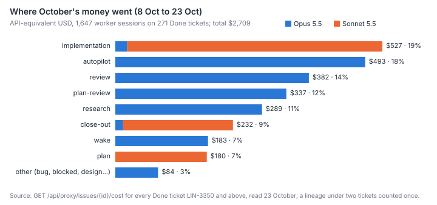
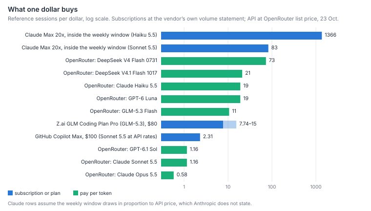
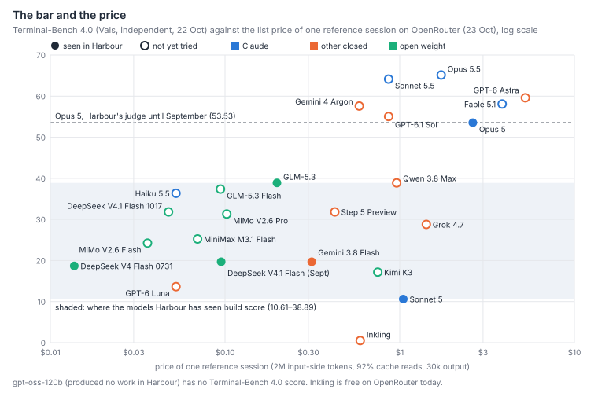
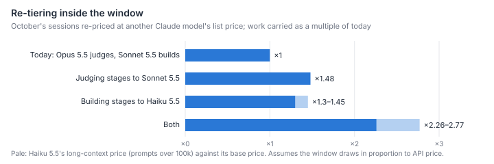

# Which models and plans could carry more of Harbour's work for the same money, and is a free lane feasible?

Harbour can carry roughly twice its October work for the same money, but the saving is
inside the Claude subscription it already pays for. A free lane does not follow from this
paper: today it is too thin to carry the backlog. Since 8 October all but two worker
sessions have run on Claude. Opus 5.5 judges and supervises (67% of the $2,709 API-
equivalent spent on 271 Done tickets), and Sonnet 5.5 plans, builds and closes out (33%).
Measured against the weekly window, that subscription is worth about 72 times its price at
list rates, so buying by the token saves nothing while the window has room. Only the
cheapest open-weight builder comes close. The window is full, though, and the bar has moved
under the fleet. On the one independent benchmark that still separates models, Sonnet 5.5
scores with Opus 5.5 and above Opus 5, Harbour's judge until September. Haiku 5.5 scores
near the top of the band where every model Harbour has seen build sits, at a seventeenth of
Sonnet 5.5's price. Re-priced at list rates, judging on Sonnet 5.5 and building on Haiku 5.5
would carry October's work in 36–44% of the window, roughly ×2.3–2.8 the capacity. Neither
move has been tried on a Harbour ticket. Beyond the window, two routes are cheap enough to
matter. The $200 a month of Claude API credit that Max 20x has included since 7 October buys
about 760–3,800 Haiku 5.5 sessions a month, and the newest DeepSeek Flash build would do
October's whole building stage for about $50. Free models are not yet a capacity source. The
ones with independent scores score near zero, the ones with vendor claims expire or go down,
and a credited OpenRouter account's 1,000 free requests a day are about 7–17 sessions,
against the fleet's 109. One extra subscription is worth a $20 trial: ChatGPT Plus, for
GPT-6.1 Sol through opencode. Most of the others are worse value than paying by the token,
or forbid unattended use.

## Findings

**October runs almost entirely on Claude, and two thirds of the cost is judging and supervising.**
The 271 Done tickets numbered LIN-3350 and above have 1,647 worker sessions with a cost
lineage, from 8 to 23 October, costing $2,709 API-equivalent at Harbour's own pricing (a
median of $7.23 a ticket). Opus 5.5 ran every review, plan-review, autopilot, research, wake
and rare-kind session ($1,808, 67%). Sonnet 5.5 ran 280 of 291 implementations, 275 of 285
close-outs and every plan with a model recorded ($901, 33%). Two sessions ran on DeepSeek
Flash, at a total of $0.29. The cheap implementer tier that `model-choice.md` dates to 25
September has gone. By stage, the money went as follows:

| Stage | Share | Model |
|---|---|---|
| Implementation | 19% | Sonnet 5.5 |
| Autopilot | 18% | Opus 5.5 |
| Review | 14% | Opus 5.5 |
| Plan-review | 12% | Opus 5.5 |
| Research | 11% | Opus 5.5 |
| Close-out | 9% | Sonnet 5.5 |
| Wakes | 7% | Opus 5.5 |
| Plan | 7% | Sonnet 5.5 |

This is the shape `steady-base.md:33` predicted: the building is a third, and the rest is
paid per ticket, per session and per wake. The figure undercounts supervision, since an
autopilot lineage reaches a ticket's cost only when it was dispatched against that ticket.

**While the weekly window has room, buying by the token saves nothing.**
`lib/weekly-budget.js` calibrated 27 points of the window to $1,070.58 of API-equivalent
spend on 14 August. That was during the +50% promotion that ran to 13 September. Limits
since 14 September are +25% over the pre-promotion baseline, so a full window is now worth
about $3,300 a week at list rates. The plan is Max 20x (John, 23 October), at $200 a month,
about $46 a week. That is a multiple of about
72. Inside the window, a reference session on Sonnet 5.5 costs an 83rd of a dollar. By the
token, the cheapest model Harbour has seen build gets 73 sessions to the dollar (DeepSeek V4
Flash 0731, at $0.014 a session). Its October successor, DeepSeek V4.1 Flash 1017, gets 21,
and Sonnet 5.5 itself gets 1.2. So the open-weight lane is a way to do more than the window
allows. It does not replace the window. One assumption carries the whole comparison: that
the window draws in proportion to each model's API price. Anthropic does not publish how it
draws, and every figure that re-prices across Claude models below rests on that assumption.

**The bar has moved under the fleet. Sonnet 5.5 now scores as the judge did, and Haiku 5.5
as the best of the builders did.** Terminal-Bench 4.0 on Vals (independent, one harness, 22
October) separates the frontier from everything else. SWE-bench Verified does not: it is
saturated, with mid-tier models at 88–96, and was archived on 1 September. The scores that
matter here:

| Model | Terminal-Bench 4.0 | Note |
|---|---|---|
| Opus 5.5 | 65.2 | Harbour's judge now |
| Sonnet 5.5 | 64.1 | |
| Opus 5 | 53.5 | Harbour's validated judge until September |
| Haiku 5.5 | 36.4 | |
| Sonnet 5 | 10.6 | builder in Harbour |
| DeepSeek V4.1 Flash (Sept) | 19.7 | builder in Harbour |
| DeepSeek V4 Flash 0731 | 18.7 | builder in Harbour |
| Gemini 3.8 Flash | 19.7 | builder in Harbour |
| GLM-5.3 | 38.9 | builder in Harbour |

The models Harbour's capability ledger saw implement to the gate's standard therefore span
10.6 to 38.9, and Haiku 5.5 sits near the top of that band, second only to GLM-5.3. Vibe
Code Bench, which grades a built web app by clicking through it, says the same: Haiku 5.5
scores 90.4, Sonnet 5 81.3 and Sonnet 5.5 92.4.

Per reference session, Haiku 5.5 costs $0.05 at its base price and $0.26 at its price for
prompts over 100,000 tokens. Sonnet 5.5 costs $0.86 and Opus 5.5 $1.73. Two facts temper
this. Terminal-Bench 4.0 is harder than Harbour's typical ticket, since Sonnet 5 scores 10.6
on it and builds to standard. And no public benchmark measures planning or judging, which
are the two things the cheap builders failed at in Harbour (Flash plans went round
plan-review twice; Flash was green and wrong on harness code).

**Re-tiered at list prices, October's work would fit in less than half the window.** Each
October session was re-priced at another Claude model's list price, by the ratio of the two
models' reference-session prices:

| Change | Capacity |
|---|---|
| Judging, supervising and research stages from Opus 5.5 to Sonnet 5.5 | ×1.48 |
| Plan, implementation and close-out from Sonnet 5.5 to Haiku 5.5 | ×1.30–1.45 (long-context and base price) |
| Both | ×2.26–2.77 |

These are ceilings on the price side, under the drawing assumption above. They say nothing
about the quality side. A cheaper judge that sends back one more round per ticket, or a
builder that needs one more review, eats the gain: `why-legs-repeat.md` puts a repeated leg
at 8–9% of dispatches.

**Beyond the window, two routes are cheap enough to matter, and Harbour already pays for
one of them.**

- **The Claude API credit bundled with Max.** Since 7 October, Max 20x includes $200 a
  month of Claude API credit. It is spendable through an API key on the Claude API and the
  Agent SDK, not in Claude Code, and expires each cycle (Anthropic's own page). An API key is
  the sanctioned route for a third-party harness. At list price the credit is about 760
  Haiku 5.5 reference sessions a month at the long-context price, or 3,800 at the base
  price: 25–125 a day, against the fleet's 109 sessions a day in October. No Harbour lane
  spends it today. The fleet's plan is Max 20x, so the credit is available to claim.
- **Open-weight builders by the token.** DeepSeek V4.1 Flash 1017 is the 17 October build of
  the model Harbour's ledger saw implement small, hour-long and thin tickets. It scores 31.8
  on Terminal-Bench 4.0 (the September build: 19.7) and 87.7 on Vibe Code (84.7). It costs
  $0.05 a reference session. October's building stages ($900 on Sonnet 5.5) would have cost
  about $50 on it. They would have cost $14 on V4 Flash 0731, the build the ledger saw land
  two small tickets and an hour-long one, or $98 on GLM-5.3 Flash. MiMo V2.6 Flash ($0.04),
  MiniMax M3.1 Flash ($0.07) and GLM-5.3 Flash ($0.09) sit in the same band and are untried.

The ledger's cautions carry over to every one of these. Review stays on a strong model.
Research goes first. Harness code gets checked against real rows. And opencode workers must
not read outside their clone.

**Free models are not a capacity source yet.** OpenRouter lists 20 free variants, 17 of
them able to call tools.

- **Independent scores:** the only free models with one are Inkling and Inkling Small, at
  0.51 and 0.00 on Terminal-Bench 4.0.
- **Vendor claims:** two models that look plausible have only their vendor's word.
  - Poolside's Laguna S 2.1 claims 70.2 on Terminal-Bench 2.1. On the same benchmark, run
    independently, DeepSeek V4.1 Flash scores 74.5. Its free variant expires on 31 October.
  - NVIDIA's Nemotron 3 Ultra claims 56.4 on the same benchmark.
- **Uptime:** three free endpoints were up less than 12% of the last day (Nemotron 3 Super,
  Nemotron 3 Nano Omni, LFM 2.5).
- **Volume:** an account that has bought $10 of credit gets 1,000 free requests a day at 20
  a minute. Harbour does not record requests per session. At 60–150 tool calls a session
  that is 7–17 sessions a day, 6–15% of the fleet's October rate, before any of them is
  known to clear the bar.
- **Data:** free providers may train on prompts. OpenRouter keeps separate training settings
  for free and paid models. Harbour's code is public, so the exposure is the secrets a
  session carries, not the code.

A free lane is a place to try models on triage and research. It cannot work through 1,274
open tickets.

**One extra subscription is worth a $20 trial. The others are worse value than tokens, or
forbid unattended use.**

- **ChatGPT Plus ($20 a month).** It buys 15–160 GPT-6.1 Sol messages per 5 hours (OpenAI's
  pricing page). GPT-6.1 Sol scores 55.1, above Opus 5. Opencode is reported, by third
  parties only, as a launch partner for "Sign in with ChatGPT". OpenAI publishes no weekly
  cap, and a September report quotes OpenAI's Codex lead calling third-party clients "not an
  approved use" unless they are open source or partners. It is the one plan whose model
  clears the judge's bar for $20, and how much work it carries is unknown until tried.
- **GitHub Copilot Max ($100 for $200 of credit at API rates)** is officially supported in
  opencode. It is 2.3 Sonnet 5.5 sessions to the dollar, worse than the bundled Claude
  credit.
- **Z.ai's GLM Coding Plan Pro ($80, a third-party price)** buys 290–580M GLM-5.3 tokens a
  week by the vendor's estimate. That is 8–15 sessions to the dollar, less than DeepSeek
  Flash by the token, and it is restricted to supported tools.
- **To avoid for unattended use:**
  - Google's consumer plans: Antigravity bans are reported for opencode.
  - Alibaba's Coding Plan: "must not be used for automated scripts … or other non-interactive
    use".
  - Chutes: automated workloads must pay as they go.
  - Kimi: changing the client identifier is a stated violation.
- **No Claude Code promotion is running.** MiniMax's half-price month ended on 14 October.

**The fleet's own use of the subscription is permitted, but its limits are not promised.**
Anthropic's Claude Code legal page allows "an end user … signing in to the unmodified
Claude Code binary with their own Claude subscription". It also says advertised Pro and Max
limits "assume ordinary, individual usage of Claude Code and the Agent SDK", and that each
end user of a hosted product must bring their own credentials. The first sentence covers
John's fleet. The second means a fleet that lives on one window has no promise the window
stays its size. The third bears on running strangers' tasks (`runner-for-strangers.md`).
Moving building work to API credit or open weights lowers both exposures.

**Most of what "benchmarking by experience" needs is already recorded.** The cost endpoint
gives model, kind, effort, cost and duration for every worker session, joined to its ticket.
The October read above came from it in 291 calls. Four gaps remain:

- the review verdict is prose in a comment, not a field on the session;
- requests per session are not recorded, so a rate limit cannot be turned into sessions;
- `lib/model-pricing.js` has no rows for Haiku 5.5, DeepSeek V4.1 Flash 1017 or GLM-5.3
  Flash, so their sessions would price as unknown;
- the opencode telemetry relay is off by default (`OPENCODE_TELEMETRY_RELAY`,
  simple-dispatcher `config.js`).

With a verdict field and the price rows, the capability ledger (`capability-ledger-method.md`)
becomes a query over this endpoint rather than an essay rewritten by hand.

## Method

**Internal.**

- **Data read.** On 23 October, over the read-write proxy, every issue in the workspace was
  read (3,758; 1,274 open: 982 backlog, 287 unstarted, 5 started), along with the cost
  endpoint for every Done ticket numbered LIN-3350 or above (291; 20 with no lineage).
- **Deduplication.** Worker sessions were deduplicated by `rootItemId`, because a lineage
  under two tickets appears under both. Sessions were then grouped by kind and model.
- **Window.** LIN-3350 was chosen as the first ticket of October's regime. The earliest
  session in the read is 8 October.
- **App calls.** The app-side LLM calls on these tickets came to $54 and are left out.

**Reference session.** One reference session is 2.0M input-side tokens (92% cache reads, the
share `lib/model-pricing.js` measured; 6% cache writes; 2% uncached) plus 30,000 output.
Sonnet 5.5 prices it at $0.86, close to October's median Sonnet 5.5 implementation session
($0.92). A model with no cache price is charged its input price for those tokens. A
long-context override is priced as a second figure.

**External.**

- **Prices** are OpenRouter's list prices from `/api/v1/models` on 23 October, and the free
  variants' endpoints from `/api/v1/models/{id}/endpoints`.
- **Benchmarks** are Vals AI's independent boards (Terminal-Bench 4.0, Vibe Code Bench v1.1),
  copied with every source and date into `cheaper-capacity-benchmarks.csv`. Vendor-reported
  numbers are marked and never mixed with independent ones.
- **Subscriptions** were read from vendor pages where they loaded. Third-party reporting is
  marked as such in the text.

**Window value.** The window's value is `lib/weekly-budget.js`'s calibration (27 points =
$1,070.58), scaled by 1.25/1.5 for the end of the promotion.

**Reproducing it.** `scripts/survey-capacity-fetch.mjs` (needs a proxy token for the
internal half), then `scripts/survey-capacity-analyse.mjs`, which writes
`cheaper-capacity-data.json`, and `scripts/survey-capacity-figures.mjs`.

## Limits

- **The drawing assumption.** Every cross-model figure inside the window assumes the window
  draws in proportion to API price. If Haiku draws more than its price share, the re-tiering
  gain is smaller. The direction for Sonnet is unknown.
- **The window's dollar value** rests on one calibration day in August and a stated, not
  measured, change of limits.
- **The October read sees only Done tickets with a lineage.** It undercounts supervision,
  which runs against parents and epics, so judging's share is a floor.
- **Benchmarks are not Harbour's bar.** Terminal-Bench 4.0 ranks the models Harbour has seen
  build in a different order from Harbour's own record. Sonnet 5 is the builder with the
  most evidence (97 of 115 implementations approved first pass) and the lowest scorer. No public benchmark tests planning or review. The two re-tiering
  moves are therefore hypotheses with a price attached, not findings about quality.
- **The reference session is one mix.** Long research and autopilot sessions carry more
  cache reads per output token than the reference mix does. That favours models with cheap
  cache reads (Haiku 5.5, DeepSeek), so on those stages they would be, if anything, cheaper
  than shown.
- **Subscription volumes are the vendors' own statements.** Two of the cheapest offers' terms
  (OpenAI's terms page, Cerebras' FAQ) did not load. ChatGPT Plus's weekly cap is
  unpublished.
- **Free models change weekly.** The list and its uptimes are one afternoon's snapshot.

## Next

- **Try the two Claude moves first, because they cost nothing to try.** Each needs its own
  ticket, chosen to say so.
  - Route plan-review and review to Sonnet 5.5 on twenty tickets against twenty on Opus 5.5,
    and compare send-backs, later-found faults and rounds.
  - Route implementation and close-out to Haiku 5.5 on twenty small tickets against Sonnet
    5.5, the same way.
- **Claim the Max API credit, and price the four missing rows in `lib/model-pricing.js`**
  (Haiku 5.5, DeepSeek V4.1 Flash 1017, GLM-5.3 Flash, MiMo V2.6 Flash). The pricing
  sweep's proposal already asks why nothing said the series went dark.
- **Add a verdict field and a request count to the worker session record**, so that every
  run updates the capability ledger as a query.
- **Pay $20 for one month of ChatGPT Plus and run GPT-6.1 Sol** on ten review shadows
  through opencode. Count messages used against the 5-hour and weekly caps.
- **Re-read the free list in a month.** Give any free model with an independent
  Terminal-Bench 4.0 score above 18 (the floor of the cheap models Harbour has seen build)
  three triage tickets.
