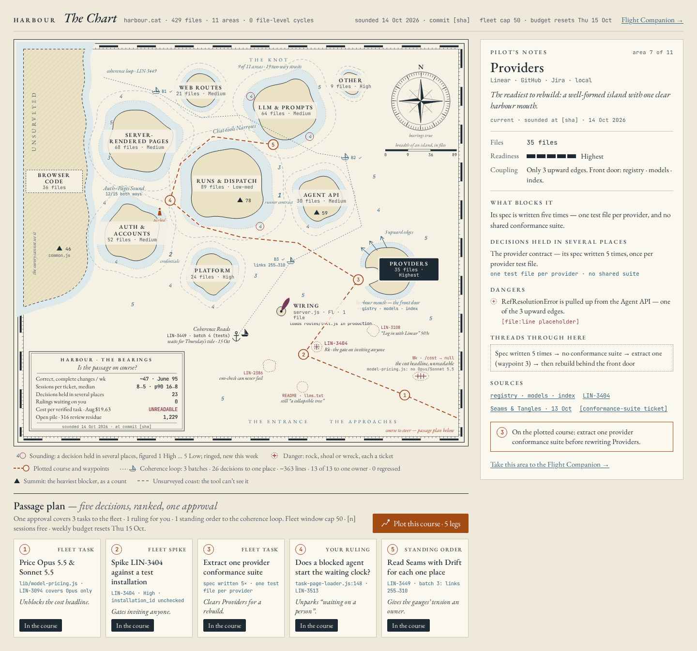
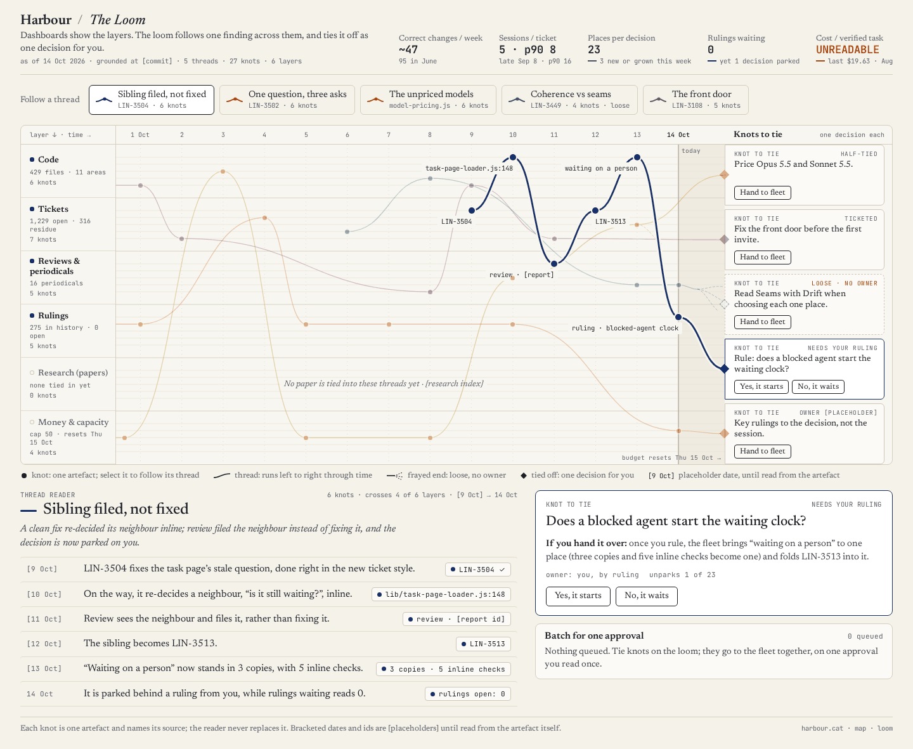
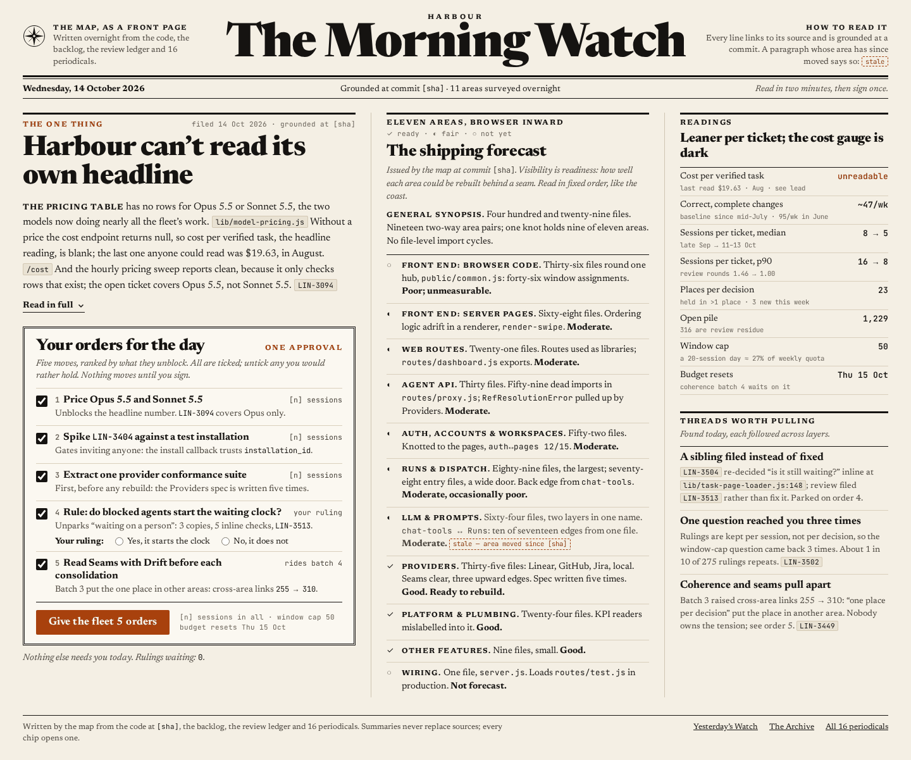
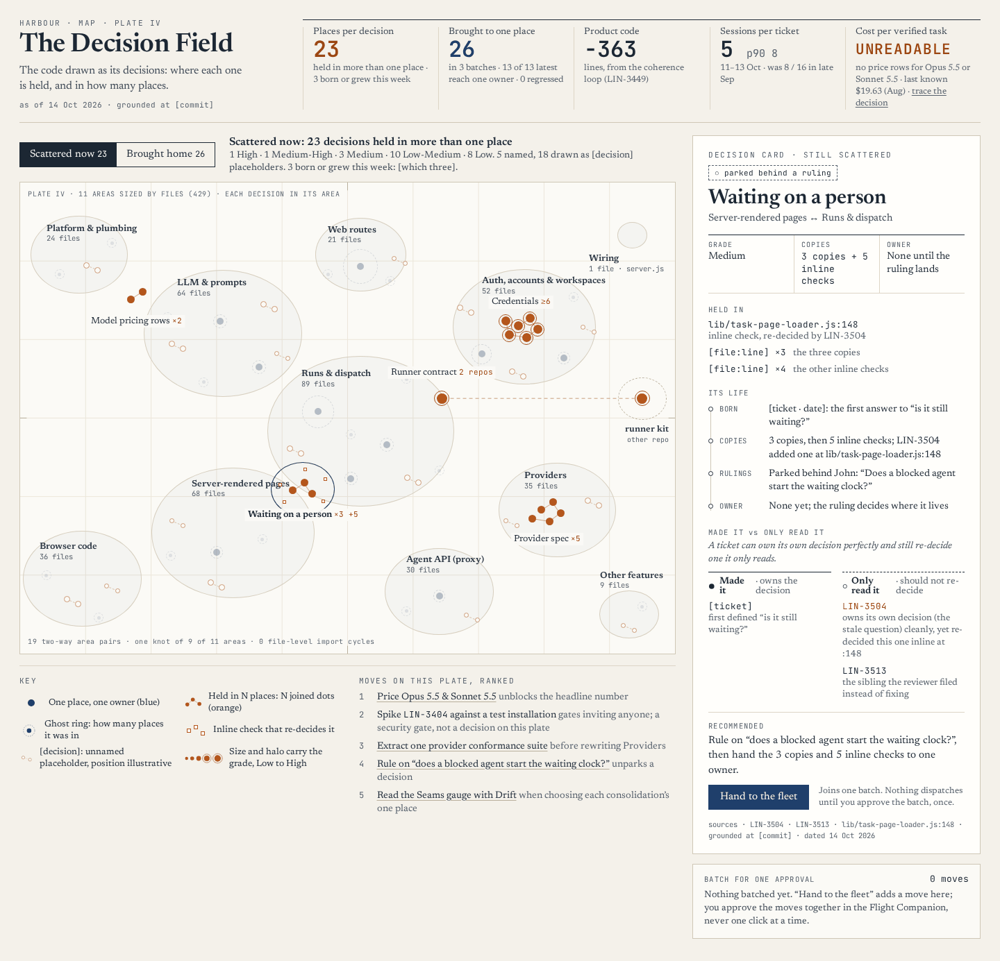
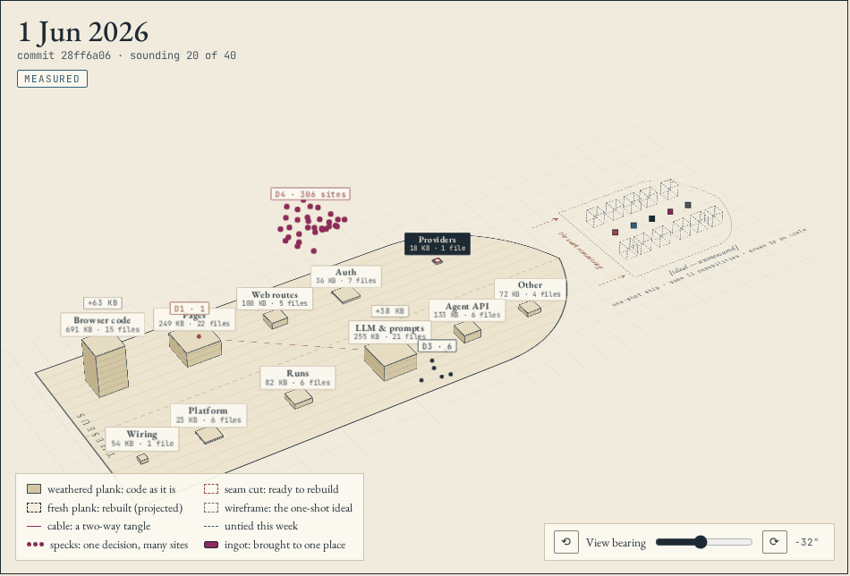
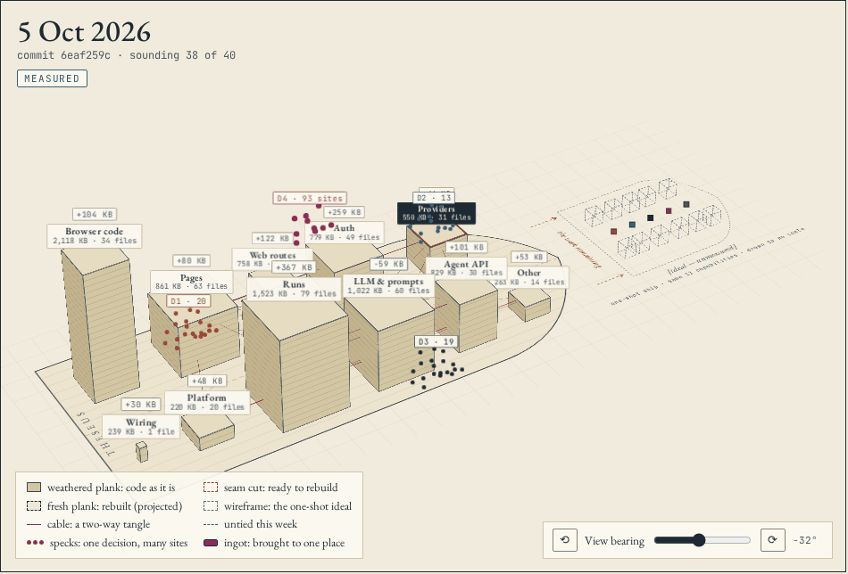
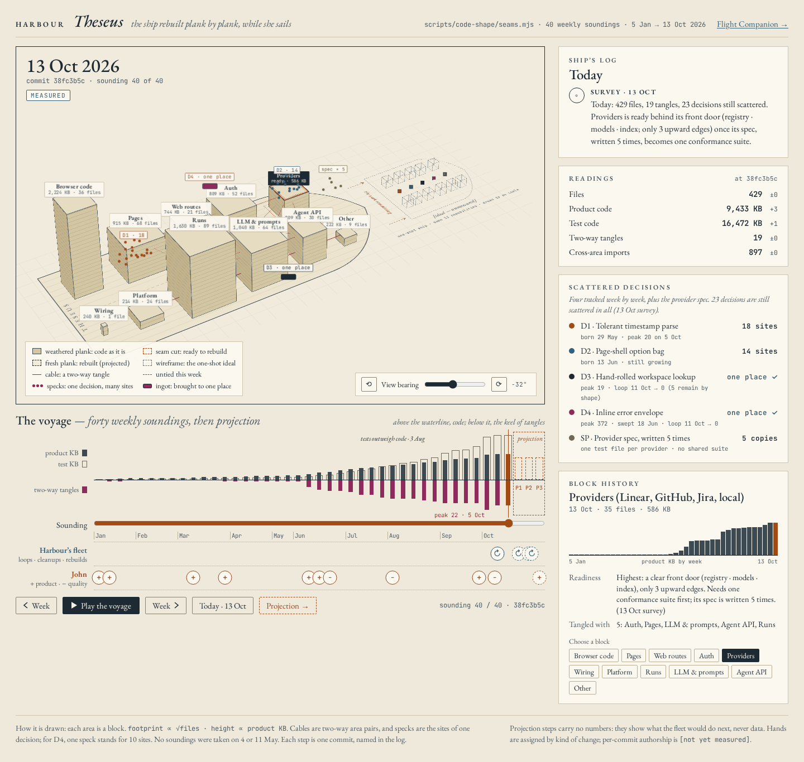

# Drawing the ship

*Five drawings of one codebase, and why the last one is the right shape.*

A map for one engineer steering a fleet that rebuilds its own code should draw the code as a
voyage, not as a place. The voyage is a ship rebuilt plank by plank, with the ghost of its clean
form sailing beside it. The decision that engineer makes each week is which plank to swap next.
That decision depends on how the code is changing, and a picture of how it stands cannot show
change. On 14 October we drew the project five ways: four from one brief, and a fifth from the
same brief plus the code's measured weekly history. The four drew a place, and all four were good.
The fifth drew a voyage, and it was the one that fitted the job. This essay records the five and
argues why the fifth won. The argument rests on what Harbour's own record says about how its code
changes [T], and on what fifty years of writing about software change say about where that leads
[L80, P72, H07, F24].

## 1 What the drawings were for

Harbour knows its work and does not know its code. It holds a first-class model of every task,
session, review and ruling. It holds no model of the decisions inside the code those tasks change.
The failures that cost most now happen *between* tasks:

- A clean change re-decides a neighbouring decision inline.
- The reviewer files the neighbour as a new ticket instead of fixing it.
- The same rule ends up written in three places.

LIN-3504 is the pattern. It re-decided "is it still waiting?" inline at
`lib/task-page-loader.js:148`, and the review filed that neighbour as LIN-3513 rather than fixing
it. A fleet sized for one engineer needs a map of the code
that shows four things: its areas, the decisions held in several places, the warnings and research
attached to each area, and a short ranked list of what to do. Every claim on it has to be traceable
to its source.

We wrote one brief with Harbour's real figures as of 14 October and asked for maps that were not a
dashboard. In-session subagents drew four boards from it. The brief and the boards' source are
committed beside this essay (`drawing-the-ship-boards/`). Bracketed values on the boards, like
`[sha]`, are placeholders the brief had no figure for.

## 2 Four drawings of a place

**The Chart** draws the project as a sea chart (Figure 1):

- Each area is an island, sized by its files.
- Decisions held in several places are soundings, numbered by grade.
- Known faults are rocks and wrecks, each one a ticket.
- The browser code is an unsurveyed coast, because the import graph cannot see how it talks to
  the server: its `fetch` calls and `window` globals.
- A dashed course runs through five waypoints, the ranked actions, which a passage plan below the
  chart turns into one approval.

It is the most beautiful of the five and the closest to Harbour's own voice. It also puts the
hazards and the course on the same surface, which no dashboard does.

*Figure 1. The Chart. Mock-up, 14 October; figures from the brief, placeholders in brackets.*

**The Loom** follows one finding across six layers through time (Figure 2). The layers are code,
tickets, reviews, rulings, research and money. Its first thread is LIN-3504:

1. A fix lands.
2. It re-decides a neighbour at `lib/task-page-loader.js:148`.
3. The reviewer files the neighbour as LIN-3513.
4. The decision stops behind a ruling.

The Loom's insight is that the best findings this session were all threads. None was a single cell
of a table.

*Figure 2. The Loom. Mock-up, 14 October.*

**The Morning Watch** is a front page (Figure 3). It has one lead story, a shipping forecast for
the eleven areas, the readings, and the threads worth pulling. It is meant to be read in two
minutes, with its orders signed once. It is built around approvals: five moves batched into one
signature rather than a stream of clicks. The brief asked for that because people stop reading a
stream of approvals.

*Figure 3. The Morning Watch. Mock-up, 14 October.*

**The Decision Field** draws the code as its decisions rather than its files (Figure 4). Each
decision held in more than one place is a cluster of joined dots inside its area. A card shows its
copies, its life, and which tickets *made* it and which only *read* it. That is the distinction the
LIN-3504 thread turns on. The unit is right: Parnas argued in 1972 that each module should hide a
design decision that is difficult or likely to change, and a decision is what the second copy
splits [P72, SC].

*Figure 4. The Decision Field. Mock-up, 14 October.*

All four answer the same question: *what is it like now?* Each draws a place. Even the Loom's time
axis is the time of one finding, not of the code. John's verdict was that they "all show views of a
thing." The thing he wanted to see was a process.

## 3 The ship

John's picture was the code in three dimensions:

- Clean-ups pull scattered pieces together into blocks.
- The project is rebuilt block by block, with seams worked until a block can be lifted out and
  rebuilt from scratch.
- Over time the software simplifies and stabilises.
- Harbour runs the fleet that does most of it, and he runs product work and quality alongside.

Beside all this sits a hypothetical: the same product built in one go, with the same capabilities,
almost perfectly clean inside. The process, made visible by measuring the code, is what moves one
towards the other.

**Theseus** draws that (Figures 5 to 7):

- **Blocks.** Each area is a block on the deck. Its footprint grows with its file count and its
  height with its product code.
- **Cables.** A cable is a two-way tangle between areas.
- **Specks and ingots.** Specks are the scattered sites of one decision. An ingot is a decision
  that has been brought to one place.
- **The ghost.** Off the bow sits a wireframe of the ghost ship, drawn to no scale.
- **The voyage.** Below the deck is a timeline of forty weekly soundings, measured from `main` [T].
  Above its waterline is the code; below it, the tangles.
- **The two hands.** Two lanes show who changes the ship: Harbour's fleet with its loops and
  rebuilds, and John with product work added and quality improved.

*Figure 5. Theseus at the 1 June sounding (`28ff6a06`). Measured: 94 files, 1 tangle [T].*

*Figure 6. Theseus at the 5 October sounding (`6eaf259c`). Measured: 400 files, 22 tangles, the
most on record [T].*

*Figure 7. Theseus at the 13 October sounding (`38fc3b5c`), the full board. Measured: 429 files,
19 tangles [T].*

The three frames tell a story the four place-maps could not:

- **1 June.** The ship is small, with one tangle. The inline error envelope floats over it as a
  cloud of 306 scattered sites. The board reads that series from the same lineage *The Second
  Copy* reports from, which has 306 at the end of May [SC-L, SC].
- **5 October.** The blocks are tall and twenty-two cables run between them.
- **13 October.** Three cables are gone. The board marks two of its four tracked decisions as
  brought to one place by the coherence loop on 11 October, one of them with five sites left.
  Those marks come from the brief, not from [T].

The question the frames answer is not "where are we?" It is "what kind of change did that, and is
it working?"

## 4 Why the voyage is the picture

The original ship of Theseus is a story about exactly this. The Athenians kept the galley Theseus
had sailed home in for centuries. "They took away the old timbers from time to time, and put new
and sound ones in their places", so that the ship became the philosophers' standing example of the
puzzle of growth: was it still the same vessel [P]? For software the puzzle that matters is not
whether the ship is the same. It is whether each replacement leaves it sounder. That can only be
judged across replacements, never at one of them.

**Lehman: change raises complexity unless work is spent against it.** In 1980 he summarised the
laws of program evolution he had been stating since the mid-1970s [L80]. A program in use must keep
changing or become less useful. As it changes, its complexity rises unless work is done to maintain
or reduce it. Harbour's record is that law in miniature, with one twist:

- From January to 13 October the code's areas tied 24 two-way tangles and untied 5 [T].
- None came undone between 20 January and 6 October [T].
- The work that reverses the drift arrived in October.
- The twist: some of the work done to reduce complexity tied knots of its own. Six of the 24 were
  tied by consolidations, one of them a coherence-loop batch [T].

A place-map shows the 19 tangles that are there. Only the voyage shows that they built up from
June, with none undone for eight months, and that they began to fall in one week. Followed to
its commits, the voyage also shows what kind of change did each. Features and consolidations tied
22 of the 24, and only taking something away untied them [T].

**The replacement loop ends with deletion, so the drawing must show it.** That is the second
reason. Every migration pattern in the practitioner literature ends the same way:

- Hammant's branch by abstraction has as its sixth step "delete the first implementation" [H07].
- In Fowler's strangler fig, the host tree may die once the fig has grown around it [F24].

*The Second Copy* collects the evidence that this last step is the one that gets skipped [SC]. A
place-map has no way to show a deletion: the thing is simply no longer there. On the ship a
deletion is an event. A plank goes, a cable drops, a cloud of specks becomes an ingot. That is the
moment the loop is finished, and it is the moment the engineer most needs to see happen, or fail to
happen.

**Readiness to rebuild is a trajectory, not a state.** That is the third reason, and the one the
map exists for. `theseus.md` finds the read and write half of Providers close to rebuildable, the
one block it measured in depth [T]. The Chart says the same thing in one word, "readiest". The
Providers history on the Theseus board says something the Chart cannot. The area was flat through
September, at 27 files and about 516,000 bytes. Then it grew 16% in the first two weeks of
October, to 35 files and about 600,000 bytes [T].

Read on its own, that growth looks like a spec still moving. Followed to its commits, it is
something else: the adapters barely moved. `lib/providers/` stayed at 19 files and grew 2%, from
465,181 to 475,266 bytes. The area grew because eight files were filed into it from elsewhere:

- the PR-state store and the GitHub PR readers (LIN-3311);
- the starter seed (LIN-675);
- the sample data (LIN-3472).

One of those newcomers holds a tangle: `lib/pr-state-store.js` → `lib/run-evidence.js` [T].

So what the voyage shows is the block's boundary moving, not its spec. That changes the decision:
the plank to rebuild is `lib/providers/`, and whether the PR-state store and the sample data belong
in that block is a question to settle first. A snapshot shows a block of 35 files. Only the voyage,
followed down to its commits, shows which of them arrived last week and why.

## 5 The ghost

The ghost is the part of the drawing that is still a promise. It is a wireframe, labelled "drawn to
no scale", because nothing yet measures how far a block is from its clean form. Honesty there is
the point. The distance becomes measurable one block at a time. Once Providers has a written schema
and a conformance suite, the smallest code that passes the suite is that block's ghost. The
rebuild either comes in near it or does not; scoring that is the first of the paper's proposals
(`proposals.md`). Each block measured that way gets solid edges on
the ghost. Each block not yet measured stays a wireframe. The drawing should never imply a
measurement that has not been made.

The same goes for the two hands. The board assigns them by kind of change and marks per-commit
authorship as not yet measured. It should stay that way until someone measures it.

## 6 What the other drawings keep

Theseus is the hull. The other four are instruments to mount on it:

- **The Chart's passage plan** becomes the command centre's ranked actions, five moves on one
  approval.
- **The Loom's thread reader** becomes how a single finding is followed down to its sources.
- **The Morning Watch** becomes the daily ritual: read in two minutes, sign once.
- **The Decision Field's card** becomes what opens when a speck is clicked: its copies, its life,
  and which tickets made it and which only read it.

Put Theseus in the middle, the chat that flies the fleet beside it, and those four around the
edge, and that is the shape of the command centre this session set out to find.

## 7 What this does not show

- **The drawings are mock-ups.** Their figures are the brief's of 14 October, and some read
  differently in the paper written the next day:
  - The Chart's "only 3 upward edges" for Providers became, in `theseus.md`, three single-import
    tangles that tie Providers to areas above it.
  - The paper's credentials finding (53 references outside the block) is on no board.
  - The Theseus board's fleet lane credits the fall from 22 to 19 tangles to the coherence loop.
    The record says otherwise: removals untied the knots, and a coherence-loop batch tied one [T].
    The board's hands are assigned by kind of change, not measured per commit.

  Where a board and the paper differ, the paper is the record.
- **This version is unchecked.** An in-session fact-check found errors in version 1, corrected
  here, but no independent check has been made.
- **Only Theseus's soundings are measured.** Its blocks, cables and timeline are drawn from the
  measured weekly history. Its projection steps and its ghost are not measured, and the board says
  so.
- **Nobody has steered with any of them.** Whether a voyage view changes which plank an engineer
  picks is untested. That a drawing is beautiful is not evidence that it helps.
- **The outside sources are analogies.** Plutarch is a story about identity, not a measurement, and
  Lehman's laws were drawn from large systems maintained by people in the 1970s. Section 4 uses
  both as mechanisms that fit the record, not as estimates of it.

## Annotated reading list

- **[T]** `docs/papers/harbour/theseus.md@06e90ff5` and its data (`theseus-weekly.json`,
  `theseus-events.json`, `theseus-tangles-head.json`). Supports the measured Harbour figures here:
  the growth, the 24 tangles tied and 5 untied, which kind of change did each, the three soundings,
  and Providers' readiness and the area's October growth. It does not support the decision counts
  the board draws (those come from the brief and the lineage file), or any claim about whether a
  drawing helps.
- **Providers' October growth, followed to its commits.** `git ls-tree` of `lib/providers/` and of
  the Providers area at `b0751689` and `38fc3b5c`, and the commits that filed the eight new files
  in: `cd25bce5` (LIN-3311), `39ca28a6` (LIN-675), `5705d1ee` (LIN-3472). Supports that the
  adapters grew 2% while the area grew 16%.
- **LIN-3504** (`5cb05987`) and `lib/task-page-loader.js@38fc3b5c:148`, and **LIN-3513** in
  Harbour's tracker. Support the thread the Loom follows: the inline re-decision and the sibling
  ticket filed in its place. LIN-3513 can be landed on only in the tracker.
- **[SC-L]** `coherence-as-it-grows-lineage.json@06e90ff5`. The decision series the Theseus board
  draws, including the inline error envelope's 306 sites; *The Second Copy* reports from the same
  lineage, so the two are one source, not two.
- **[SC]** `docs/papers/harbour/the-second-copy.md@06e90ff5`. Supports that the last, deleting step
  of a migration is the one skipped (line 57 onward), and the inline error envelope's 306 sites at
  the end of May (line 109). An essay; its own sources carry its evidence.
- **[P]** Plutarch, *Life of Theseus* 23.1, trans. Perrin (Loeb, 1914). Supports the story of the
  ship whose timbers were replaced, and its use by philosophers as the puzzle of growth. A story
  from antiquity: it is a frame for the question, not evidence about software.
- **[L80]** Lehman (1980). Supports continuing change and increasing complexity unless work is done
  against it. Drawn from large systems maintained by people. It does not estimate rates for a
  codebase built by agents, and it is used here as a mechanism, not a number.
- **[P72]** Parnas (1972). Supports the decision as the unit a module should hide, and so the
  Decision Field's choice to draw decisions rather than files. Says nothing about drawing.
- **[H07]** Hammant (2007) and **[F24]** Fowler (2024). Practitioner essays. They support the shape
  of a replacement that ends in deletion, not any rate of how often the step is taken.
- **The boards.** `drawing-the-ship-boards/@c395fe34` holds the brief and the five boards' source
  as drawn, in the design canvas's `.dc.html` format. `figures/drawing-the-ship/` holds their
  renders at 1440 px wide; Figures 5 and 6 are cropped to the ship, and Figure 7 is the full board.
  The board shows sizes in KiB, which is why its Providers figures (504 and 586) differ from the
  bytes quoted here. They are mock-ups and support only what
  each looked like.

## Next

- **Build Theseus as a page in Harbour from the committed data.** It can read
  `theseus-weekly.json` and `theseus-events.json` now, and the Seams & Tangles periodical's weekly
  run later. Then test what this essay could not: give the page to the engineer for one plank-swap
  cycle and record whether the plank chosen, and the reason given, differ from the choice made
  from the Seams review alone. That test is a line in `proposals.md`.
- **Draw the ghost only where it is measured.** When the Providers rebuild is scored
  (`theseus.md` Next), give that block's ghost solid edges, and leave every other block a wireframe.
