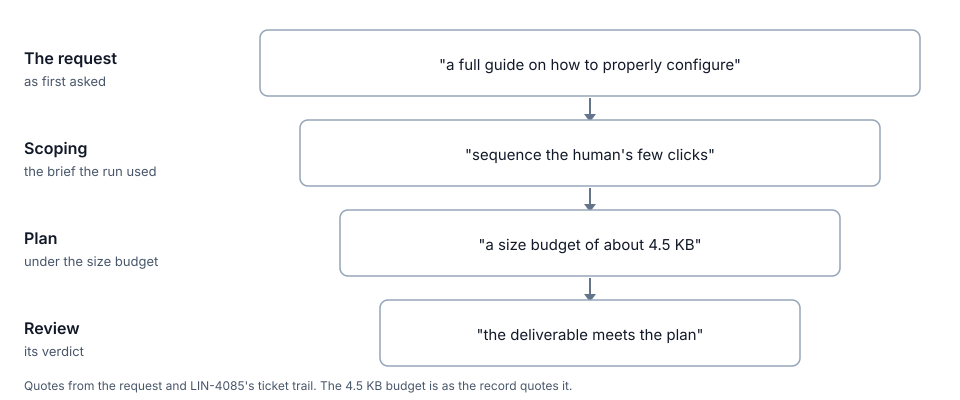

# One feature, built twice

Harbour was built to make AI agents capable. With today's agents, its more useful job is to make them accountable. On 1 November one feature was built twice, once by a single fast session and once by Harbour's own pipeline, and the two results bear out both halves of that sentence. The fast session built the better feature. It also left in a flaw of exactly the kind Harbour's four-minute independent review is there to catch, and a fresh reviewer found it.

## The moment

John had an idea for Harbour's homepage. Software often puts a copyable install command on its front page. He wanted the same thing for an AI coding agent, a short prompt that a person pastes into their own agent, pointing it at a guide written for agents, so the agent can set Harbour up for that person's situation.

He spoke the idea into a Claude Code session meant only for talking it through. Twenty-one minutes later the feature was built, tested and pushed to a branch, and nobody had asked for the push. Cloud sessions start with instructions to commit and push their work, and an end-of-turn check flags any unpushed commit, so the push landed before John's message to stop reached the session. He deleted the branch. A second discussion session pushed a one-line change of its own the same afternoon [1].

His first thought was to merge it. His second was that he shouldn't, since it hadn't been through the process Harbour uses for work like this. His third was that it had taken minutes where he expected hours. So he gave Harbour the same words, as a feedback item, set its autopilot going and asked for a comparison.

Some Harbour terms first. Harbour takes a ticket from the team's tracker and runs it to a merged, checked change, and it does that in stages. Each stage is a fresh AI session that reads the ticket and does one job, and the stages run in order. Scoping turns the request into the brief the rest of the run works from. The plan is written, and then plan-review, a second reader, checks it before anyone builds. Implementation builds the change and opens a pull request, which is a proposed change to the code. Review reads that change. Close-out fixes what review asked for, merges, and checks production. Autopilot is the mode in which Harbour runs all of this without a person at each step. When a stage cannot settle a question alone, it raises a ruling, a question for a person whose answer is recorded.

## Two runs, one request

The fast session's build took 20.7 minutes and cost $21.51 at list price, measured from its own usage record. One session held the whole picture, with two research helpers working alongside it. It wrote a guide of about 3,700 words, a homepage box with a copyable prompt, and tests that tie the guide's facts to the source. Its checks were its own, and they covered the full unit suite, the browser tests, and screenshots on phone and desktop. Nobody else looked at it [1].

Harbour took 45 minutes to an open pull request, 59 minutes to merge and 71 to checked in production. Its guide was 577 words. Its cost was not measured. None of the stage sessions reported usage, so the cost was rebuilt from tool-call counts at about $19, with a range of $12 to $38 [1]. One number was measured and the other rebuilt, so neither run can be called cheaper.

Taken to the same point, a pushed branch with green tests, the fast run took about 21 minutes and Harbour about 45. The rest of Harbour's time went to merging, to continuous integration (the automatic tests a host runs on every change), to deployment and to checking production. The fast session did none of that [1].

Harbour's run had one moment worth describing. At 17:37 scoping raised a ruling, a question about where on the homepage the prompt should sit. Plan kept working while the question waited, and John answered five minutes later, directly under the hero sign-in buttons. The run did not stop for it. Plan-review and review together took about six minutes of the 71 [1].

## The reveal

A blind reviewer then judged the two. A fresh session got both changes as unlabelled copies, the original request and a seven-part rubric, with instructions not to guess which was which. It ran both test suites, started real servers, sent them altered requests, checked the guides' claims against the source, and made 46 deliberate breakages to see which tests would notice. It scored the fast session 30 out of 35 and Harbour 27 [2].

The fast version won on fidelity to the request (5 to 3), the accuracy of the guide's claims (5 to 4), agent usability (5 to 3) and simplicity (4 to 3). Harbour won on security (5 to 4) and on fit with the codebase (5 to 3). Test quality was level at 4 each. The result rests on one task and one reviewer, and the blinding was partial, since Harbour's side mentions its ticket 31 times [2].

The fast session's worst defect was a homepage prompt built from the raw Host header. That header is the part of a web request that names the site the request was meant for, and a client can set it to whatever it likes. A forged value could put an attacker's address into the prompt a person copies into their agent. The reviewer rated this medium-low, and noted that other layers limit it. The fast code was pushed to a branch and never merged, so the flaw never reached users [2][3]. What survives is narrower and matters more. A strong session checked its own work thoroughly and still left this in.

Harbour's own review found something in its build too. It took 3 minutes 43 seconds, and it approved on one condition, that close-out fix two tests that did not test what they claimed. One was the homepage prompt's origin check, which had no test with a forged Host header. So review did not find the same vulnerability in Harbour's build. It found that the test which would have shown it was missing. Close-out added the test and showed that it fails when the validation is broken. Harbour's merged code validates the origin [4].

## The turn

Harbour's guide came out thin, and the record shows how. The request asked for "a full guide on how to properly configure" Harbour for whatever the person's situation was. At scoping, that became "sequence the human's few clicks". The plan then put the guide under a size budget of about 4.5 KB, by the record's figure. That limit was meant for prompt text that every run pays for, and it was applied to a public guide read once per onboarding. Review checked the result against the plan and approved it, finding that "the deliverable meets the plan" [1]. The figure below shows the narrowing hop by hop.

Each stage did its job well against what its ticket said. The intent was lost at the first handoff. The request's own words stayed on the ticket, but every later stage checked against scoping's brief and the plan, because that is what each stage is set up to check against. Nothing pointed a judge back at the original. The guide also made three misleading claims, one of them about when a key is needed. It said writing prompts needed a paid model key when the free tier was off, though the template prompts need no AI at all [2].

Harbour's own research points the same way. The held-or-fresh paper studied supervisors, the sessions that watch over a task. It found that no sampled decision rested on a fact that only a session's memory held, and that a fresh step saved money when it read a small, good handoff [5]. Here the handoff was the problem. This is a record problem more than a memory problem. The paper did not study builders, and it did not study requests narrowed at scoping, so here the pattern is plausible rather than proved.

The first fix is cheap. Keep the request as filed on the ticket, give it to every judge, and turn any narrowing into a ruling for a person [1].

## The idea

John's question at this point was whether a smart agent could simply be faster and better than Harbour, or whether this was an efficiency problem in the pipeline that could be fixed more easily. The answer is both, seen from two sides. The efficiency problem is the capability half of the pipeline, the half a strong agent no longer needs.

Harbour's stages do two jobs that come bundled together. The first is making an agent capable. That means splitting a task into research, plan and build, each a fresh session that does one part well. The second is making it accountable, which means independent judges, rulings, landing with production checks, and a record of every run. The August review of Harbour's lanes, which are long single sessions that work through many tickets, found a related split. Harbour's process had been "two layers welded together", judgment (templates, ledger, checks) on one side and delivery machinery (dispatch, queue, prompts) on the other [6]. That line falls in a slightly different place from the one in this essay, and both point at the bundle as the problem.

With today's agents the first job costs more than it gives. Splitting is what lost the intent in this run, and every hop paid again for orientation. Each worker is a fresh session with no memory of the last [7]. That makes its judgment independent, and it also makes it start cold. In an earlier Harbour sample, about a quarter of a session's weighted tokens went before its first productive call, and more than half of what sessions read while orienting was something an earlier session on the same ticket had already read [8].

The second job still pays. A strong agent working alone built the better product and still left in the flaw that a fresh review caught. The August review found the same gap from the other side. In eight of fifty lane tickets the work did not do what the ticket said, although CI was green and the lane had reviewed it [6]. Its summary was "Production is continuous; verification is independent", and it judged that the stepper's "capability-substitution half is plausibly unnecessary at the frontier" [6].

Harbour already has a shape for one warm session. The stepper drives one session through three to six ordered beats, the parts of one task, and judges each beat before it moves on. It never chains into review, so that review stays a separate session that has not seen the building [9]. The record names the shape it would need *spine and branches*. One builder stays warm from research to fixes, keeping the things records rarely hold, such as dead ends, approaches already ruled out, and a feel for the code. Fresh judges branch off at the gates, after the plan and on the pull request, each given the original request. Judges report and do not converse. Harbour lands the work [1].

John described the same shape as two ideas. One is to save the task's information better. The other is to hold the task in one continuous session that works almost like a cache over the record. The second depends on the first. If the warm session dies, a fresh one has to pick up from the record, so the record has to be complete either way. That is why fixing the record comes first and stands alone [1].

This shape is a proposal and has not been tried. It costs more per step as its history grows, it can keep beliefs the code no longer supports, and it drops one cross-check, a fresh builder distrusting the plan. It is as safe as today's pipeline only if the judges stay fresh and their verdict, not the builder's, decides whether work lands [1].

## What it means

Building is becoming a commodity, and every vendor's agent is getting better at it. Independence is structural. A model reviewing its own work is still self-review, however good the model is. Harbour's own adoption ladder names verification cost as the gate holding agents back, unchanged since March [10].

So Harbour's value shifts from helping agents do the work toward making their work trustworthy. That means keeping the intent intact, judging independently, landing with proof, measuring across runs, and, as a proposal, accepting work from any builder. The landing page already says it, in the words "keep human intent in command of AI execution" [11]. What would shrink under this reading is the splitting of production across fresh sessions, much of the scaffolding around building prompts, and the number of sessions a single ticket needs.

## What we don't know yet

- Whether the result holds beyond one task and one blind reviewer, with partial blinding, and whether vendors will build independent review into their own agents [1][2]. The fast session had John's words and no ticket to read, while Harbour's stages read the ticket as it changed, so the two runs did not start from identical inputs either.
- Harbour's cost is an estimate. Stage costs were not measured, and fixing stage cost reporting is an engineering job rather than a question for a paper [1].
- Whether the thin guide would have been caught with the original request attached has not been tested. It is the cheapest test of whether the miss was in the record or in the judge.
- In a replay, a lean pipeline cost a tenth to a twentieth of the full one, and it matched the full one only with hindsight [13]. In Harbour's own backtest of a lighter path for small, low-risk changes, very little escaped the light groups. The full process still caught faults on changes whose paths looked safe, most of them at plan review [14].

## Next

- Replay LIN-4085's review with the original request attached, and see whether it catches the thin guide. This is the first line added to `proposals.md`.
- Trial the spine-and-branches shape against today's relay on a handful of matched tickets, scored on Harbour's throughput measure. This is the second line added to `proposals.md`.
- Ask whether a rule applied outside its purpose costs more than it protects, using the size budget on the public guide. This is the third line added to `proposals.md`.
- Engineering rather than research: fix stage cost reporting, so the next comparison can be measured. This stays out of `proposals.md`.
- Engineering: LIN-4090 brings the fast guide and its drift tests onto Harbour's code, fixes the three misleading claims, and rules on whether the size budget covers public guides.

## Reading list

1. **The record.** [docs/reviews/lin-4085-ab-run-2026-11-01.md](../../reviews/lin-4085-ab-run-2026-11-01.md), landed in this PR. Supports the timings, the costs, the stage table, the ruling, the stray pushes, the like-for-like comparison and the rebuilt cost. Does not support a measured cost for Harbour, since that figure is a reconstruction from tool-call counts priced at the fast session's observed rate. The record states 71 minutes to production. Its own stage timestamps put the production check about 70 minutes after triage, and the essay keeps the record's figure.
2. **The blind review.** [docs/reviews/_evidence-2026-11-01-lin4085/blind-review.md](../../reviews/_evidence-2026-11-01-lin4085/blind-review.md), verbatim. Supports the scores, the claims checked, the defects, the medium-low rating, and the list of what each version did that the other missed. Does not support a rating beyond one reviewer's judgment, or any claim about how far the flaw reached. One task, one reviewer, partial blinding.
3. **The fast session's change.** Commit `2bebcc03` on the unmerged branch `claude/cool-rubin-6acj5j`, [github.com/JKershaw/LinearViewer/commit/2bebcc03](https://github.com/JKershaw/LinearViewer/commit/2bebcc03). Supports the scope of the build, 17 files and about 1,200 added lines. It lives on an unmerged branch and was never in `main`. Does not show that the code reached users.
4. **Harbour's merged build.** PR #2221, squash commit `4f247b68`, [github.com/JKershaw/LinearViewer/pull/2221](https://github.com/JKershaw/LinearViewer/pull/2221). Supports what Harbour merged, including the origin check and the tests close-out added. Does not support anything about the fast session's code, which never merged.
5. **Held or fresh.** `docs/papers/harbour/held-or-fresh.md@27ae64ad:15, 24, 28, 35`. Supports the record-problem point: no sampled decision rested on memory alone, in 48 blind-coded wakes that acted, and a fresh step saved money only when it read a small, good handoff. Does not support anything about builders or about requests narrowed at scoping, since it studied supervisors.
6. **The August lane review.** `docs/reviews/lane-run-review-2026-08-23.md@27ae64ad:350, 383, 406-407, 545`. Line 350 supports the reading that Harbour's process was two layers welded together. Line 383 supports "Production is continuous; verification is independent". Lines 406-407 are the stepper's capability-substitution half, which is a prediction and not a measurement. Line 545 supports the finding that green CI and in-lane review did not establish that eight of fifty tickets did what they said. It is a review of lanes, not of this task, and it does not measure the cost of either layer.
7. **The operating manual.** `docs/autopilot-operating-manual-v2.md@27ae64ad:27`. Supports the statement that each worker is a fresh session with no memory of the last. It describes the design. It is not evidence that the design is the best one.
8. **Starting context.** `docs/papers/harbour/starting-context.md@27ae64ad:30, 33`. Supports the orientation share and the re-finding figure. The orientation share depends on how it is defined, and the sample covers sessions from 31 August to 30 September in both repositories.
9. **The stepper.** `docs/autopilot-kickoff.md@27ae64ad:276, 292, 311`. Supports the description of one warm session through three to six beats, each judged before the next, and the rule that it does not chain into review. It describes the mechanism and reports no results.
10. **Where Harbour joins.** `docs/papers/harbour/where-harbour-joins.md@27ae64ad:26`. Supports the statement that the ladder names verification cost as the gate, unchanged since 31 March 2026. It is a judgment about one rung, not a measurement of verification cost.
11. **The landing page.** `lib/render-landing.js@27ae64ad:334`. Supports the landing title quoted in the essay. A title states a purpose. It does not show what the page does to its readers.
12. **The fast session's own run record.** [docs/reviews/_evidence-2026-11-01-lin4085/fast-run-record.md](../../reviews/_evidence-2026-11-01-lin4085/fast-run-record.md), verbatim. Supports the session's own account of its run, including the push that came before its own check finished. Its estimate of the guide length, about 3,000 words, is lower than the 3,727 words counted from the commit.
13. **Replay of a lean pipeline.** `docs/papers/harbour/replay-small-work.md@27ae64ad:27-28`. Supports the tenth-to-a-twentieth cost figure, and the point that the lean pipeline matched only with hindsight. It establishes no correctness result. It is one replay.
14. **Proportional process backtest.** `docs/papers/harbour/proportional-process-backtest.md@27ae64ad:34, 40`. Supports the point that very little escaped the light groups, and that the full process caught faults on changes whose paths looked safe, most of them at plan review. It is a backtest on Harbour's past changes, not an experiment.
