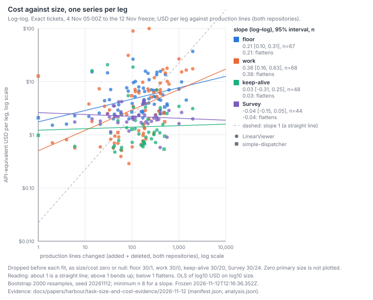

# How does the size of a task relate to its cost?

Cost rises with size, but slowly. Across 98 exact tickets (dollars at API prices), the planning, review and close-out part of a ticket (the floor) grows about 16% for each doubling of production lines changed (slope 0.21, 95% interval 0.10 to 0.31, n 67), and the implementation grows about 30% (slope 0.38, interval 0.16 to 0.63, n 68). Thirty tickets with only test lines are not plotted. Keep-alive, the time a ticket was kept running, and the Survey, its pre- and post-work readings, do not follow size. No interval reaches a slope of 1, so no leg is a cost that scales in proportion to size, and no interval lies above 1. The points scatter widely about each line, so a ticket's size predicts its cost only roughly. These data cannot tell a cost that flattens from a large fixed part with a smaller part that grows with size: both give slopes below 1 on these axes. The reading the data allow is a large fixed cost per task plus a smaller part that rises with size, which is not the same as a cost that grows in step with size. The implementation slope is the least settled figure: across the cuts we ran it lies between 0.20 and 0.53.

## Findings

**1. Cost rises with size, and every leg's slope is below 1.** The slope is the exponent: on the fitted line, a doubling of size goes with 2 to the power of the slope more cost. Every interval in Tables 1 and 2 lies below 1.

| Leg | n | Slope, dollars | 95% interval | Slope, tokens | 95% interval | Dropped (zero size / zero cost) |
|---|--:|--:|--:|--:|--:|--:|
| Floor | 67 | 0.21 | [0.10, 0.31] | 0.22 | [0.11, 0.33] | 30 / 1 |
| Work (implementation) | 68 | 0.38 | [0.16, 0.63] | 0.31 | [0.17, 0.49] | 30 / 0 |
| Keep-alive | 48 | 0.03 | [−0.31, 0.25] | 0.03 | [−0.29, 0.24] | 30 / 20 |
| Survey | 44 | −0.04 | [−0.15, 0.05] | 0.04 | [−0.11, 0.17] | 30 / 24 |

*Table 1. Log–log slopes per leg, 98 exact tickets. Zero-size tickets are the 30 with only test lines; they are absent from every fit.*

**2. A slope below 1 does not show whether the cost bends.** The evidence's rule reads an interval entirely below 1 as "flattens", and an interval above 1 as "bends up". The fits are straight lines in log–log space, so they test the slope, not curvature. A cost made of a large fixed part and a smaller part that grows with size (cost = fixed + a small part × size) also gives a log–log slope well below 1 across tasks that span small and large changes. So "flattens" is a statement about the slope, not about curvature; the chart's legend prints the word beside each point estimate, so it reads as a description of the slope. The September comparison in `cost-mix.md` made the same point with a linear fit: an intercept of 7.8M weighted tokens against an 8.8M mean (`cost-mix.md@f57cc7e99:249-255`). No `a + b·size` fit exists in the frozen analysis, and this paper does not add one.

**3. The work slope depends on how it is cut, so it is given as a range.** Table 2 lists each cut of the two legs that carry a slope, against the pooled primary fit. Across them the slope runs from 0.20 to 0.53. The LinearViewer-marked subset is the steepest reading, but its marker is chosen from the same line counts, so it describes a subset and is not a separate test.

| Cut | Leg | n | Slope | 95% interval |
|---|---|--:|--:|--:|
| Pooled (primary) | Work | 68 | 0.38 | [0.16, 0.63] |
| Haiku-only work | Work | 32 | 0.31 | [0.18, 0.60] |
| Opus-only work | Work | 35 | 0.20 | [0.03, 0.43] |
| Tests counted (sensitivity size) | Work | 98 | 0.52 | [0.31, 0.82] |
| Custom sessions moved to keep-alive | Work | 67 | 0.44 | [0.29, 0.62] |
| First dispatch on or after 8 Nov | Work | 25 | 0.48 | [0.26, 0.73] |
| LinearViewer-marked tickets | Work | 63 | 0.53 | [0.39, 0.71] |
| Tests counted | Floor | 97 | 0.18 | [0.04, 0.36] |
| Custom sessions moved to keep-alive | Floor | 67 | 0.18 | [0.08, 0.27] |
| First dispatch on or after 8 Nov | Floor | 25 | 0.12 | [−0.08, 0.35] |

*Table 2. Cuts of the two legs that carry a slope. Simple-dispatcher-marked tickets (1 to 5 per leg) are too few for a slope and are not reported.*

**4. The build is separated from the follow-ups, and within one model the work slope is 0.31 for Haiku and 0.20 for Opus.** Each dispatch is counted to its own leg, so a Survey after-answer no longer sits in the implementation (Method, Legs). On the same 22 tickets as version 1, $23.97 of Survey after-answers now sits in the Survey leg, where version 1 had it in the build or in keep-alive. The one-model strata hold 32 Haiku tickets and 35 Opus tickets. The pooled work fit's 68 are those 67 plus one ticket whose implementation spans two models. Token slopes in Table 1 read the same way as the dollar slopes.

**5. Keep-alive and the Survey show no trend with size.** Their slopes are 0.03 and −0.04, with intervals of [−0.31, 0.25] and [−0.15, 0.05]. Keep-alive is time a ticket was kept running, and the Survey is the pre-work and post-work readings, so neither is expected to scale with the change. Each leg drops tickets with zero cost (20 and 24 of the 98), so these two rest on fewer points than the floor and the work.

**6. Review rounds do not account for the floor's rise, but the test has little power.** Plan-review and review round trips are rare: 17 review round trips across 15 tickets, and 3 plan-review round trips across 3 tickets. The floor's size slope is 0.214 without rounds and 0.217 with them. The round coefficient is 0.19 per round trip, with an interval of [0.00, 0.31] at n 67. A null here shows only that the record has too few rounds to test, not that rounds have no effect.

**7. The later cohort gives the same reading, with a steeper work leg.** Tickets whose first dispatch was on or after 8 November, the cohort fixed in `inputs.json` before the freeze, have a floor slope of 0.12, with an interval of [−0.08, 0.35] (n 25), and a work slope of 0.48 (n 25). Starting later does not bring the work leg down, though the intervals are wide and the cut covers a quarter of the tickets.

**8. On the same 22 tickets, version 2 moves cost between legs.** Table 3 compares version 1's 22 exact tickets with their version 2 reads. Keep-alive falls by $40.71 and the Survey rises by $23.97, which equals the after-answers moved into it: version 1's keep-alive held every custom session, including the Survey's after-answers and custom-founded builds, and version 2 moves each dispatch to its own leg. The matched lineages fall $12.08 in total with no new lineages. Haiku lineages are unchanged. Opus lineages rise by $3.96 (median ratio 1.00). Sonnet lineages fall by $16.04 (median ratio 0.75). That Sonnet fall is suspected to be repricing and is not shown: it is the only systematic move among the models, and the time-of-day price tiers (LIN-4358) make dollars depend on when they are read. The ratios are lineage-row ratios across two reads, not price-list ratios.

| Leg (22 tickets) | Version 1 (5 Nov) | Version 2 (12 Nov) | Change |
|---|--:|--:|--:|
| Floor | $96.70 | $95.07 | −$1.63 |
| Work | $60.35 | $66.65 | +$6.30 |
| Keep-alive | $67.20 | $26.49 | −$40.71 |
| Survey | $7.50 | $31.47 | +$23.97 |
| Total | $233.81 | $221.73 | −$12.08 |

*Table 3. Version 1's 22 exact tickets, re-read. The totals change only by the matched lineages' re-reads; no lineage is new.*

**9. The natural experiments are still anecdotes.** Two tidy-first pairs are now complete, and each is one ticket against one.

| Pair | Ticket | Total | Floor | Note |
|---|---|--:|--:|---|
| Tidy-first 1 | LIN-4253 (tidy) | $10.68 | $4.05 | |
| | LIN-4251 (follow-on) | $11.19 | $4.58 | |
| Tidy-first 2 | LIN-4252 (tidy) | $9.80 | $3.84 | |
| | LIN-4246 (follow-on) | $9.70 | $3.67 | Incomplete in version 1; complete here |
| Tidy-after | LIN-4255 | $34.13 | $5.25 | Keep-alive $27.05 |
| Tidy-after | LIN-4254 | $16.52 | $7.19 | Keep-alive $6.50 |
| Control | LIN-4247 | $7.34 | $2.44 | Tidy folded in |
| Split-off | LIN-4201 | $39.13 | $7.23 | Work $26.69 |
| | LIN-4226 | $26.02 | $15.59 | |

*Table 4. Natural-experiment tickets, re-read last at 12:17:24Z. Anecdotes: they do not bear on the rate question.*

The tidy-after tickets' totals are dominated by keep-alive, which is waiting, not size. A tidy's effect on the follow-on cannot be read without a counterfactual, so the pairs stay anecdotes.

## Method

**Population.** The window is 4 November 2026, 05:00 UTC, to the freeze. Candidates are the ticket ids named in either repository's commits since then, plus every `LIN-` id from LIN-4170 to the newest seen (4431): 276 candidates, 158 worked in the window. LIN-4257 (version 1) and LIN-4275 (the parent) are excluded, leaving 156 analysed.

**Exact.** A ticket is exact when it is Done, its total is non-null, every lineage has dispatch records, no lineage is incomplete, and it lands production or test lines in either repository. Result: 98 exact of 156. Nine are approximate (a lineage with no dispatch split), three are unpriced (LIN-4177 and LIN-4178, Haiku, unpriced in both reads; and LIN-4427, in progress).

**Legs.** Cost is read from `/cost` with `perDispatch`, which builds each records lineage's dispatch split (`lib/cost-read.js@f57cc7e99:432,466`; `dispatchesOf` at `lib/cost-read.js@f57cc7e99:518-563`). Each dispatch is counted to its own leg. Survey after-answers and `survey-*` sessions go to the Survey. Keep-alive is autopilot, wake and periodical sessions. A custom follow-up that is not an after-answer goes to its lineage's leg; the sensitivity moves it to keep-alive instead. A lineage founded by a custom prompt is coded by its founding prompt's words; ten lineages were coded this way and the quotes are in `inputs.json`. The floor is planning, plan-review, review and close-out. The work is the implementation.

**Size.** Primary size is production lines (added plus deleted) over the ticket's merged PRs in both repositories, using the LinearViewer census's production rule and the simple-dispatcher code rule. Tests and docs are not in the primary. The sensitivity adds test lines and removes test files whose basename matches `*.golden.*`; the ask's glob is used, not the census's broader rule.

**Tokens.** Summed over a leg's rows: input, output, cache-creation and cache-read tokens. The one-hour cache-creation field is part of cache creation and is not added again (`lib/model-pricing.js:48-51`). Dollars are priced when read, and time-of-day tiers put a calendar term in them (LIN-4358), so the token fit is reported beside the dollar fit.

**Fit.** Ordinary least squares of log10 cost on log10 primary size, per leg. The 95% interval is a percentile bootstrap over tickets: 2,000 resamples, seed 20261112, mulberry32. A slope needs n of at least 8. The reading is the rule in the evidence: an interval that holds 1 reads as proportional (a straight line on these axes), one entirely below 1 flattens, and one entirely above bends up.

**Rounds.** `computeIssueRoundTrips` (`lib/plan-review-round-trips.js:481`), unchanged, counts review passes (gate `review`, re-pass `implementation`) and plan-review passes (gate `plan-review`, re-pass `plan`) as of the freeze. The floor is regressed on log size with and without the round trips.

**Bridge.** `bridge.json` matches each of version 1's 22 exact tickets to its lineages in both reads. Per-model ratios are per lineage row.

**Checks.** The analysis's own self-checks all pass (`analysis.json` `checks`): every reported slope has n of at least 8 and an interval that brackets its estimate, exact tickets are Done, priced and complete with no null leg, the worker legs plus app calls reconcile to the total, each lineage's dispatch split sums to its cost, and the population matches the manifest. Two fresh readers were run as separate subagents, each given only this paper and the 2026-11-12 folder. Reader A, a second-document check, confirmed about 125 numbers against the folder (slopes, intervals, n, counts, dollar amounts, table cells and arithmetic); every one matched, and the self-checks pass. It flagged five sentences the folder does not support. Each is now sourced to the ticket or to the folder's README, or softened: the calendar dates (now attributed to the ticket), the largest-move sentence on LIN-4201 (no longer claims it explains the gap), the Sonnet suspicion (now given its reason), and the status of LIN-4246 in version 1. Reader B, a fresh reader given only the paper and the folder, stated the answer as this paper does: cost rises with size, slowly, with every slope below 1. It could not tell from the file whether the line bends or flattens, which Finding 2 now says outright. Its other points were answered in the text: unglossed terms (now glossed in the answer and under Method), the two uses of "straight line" (now separated), "none bends upward" (now "no interval lies above 1"), and 98 against 67 and 68 (now explained). One point is left open: the chart's legend prints "flattens" beside every leg, including keep-alive, whose point estimate is 0.03 with an interval spanning 0. That is the rule's word, and the chart is generated code that this change does not touch; it is a follow-up for John. The shelf row stays "unchecked": no separate check document has been written.

**Reproduce.** The commands and the rules' reasons are in `task-size-and-cost-evidence/2026-11-12/README.md`. The analysis reads its folder alone and writes byte-identical output on re-run.

## Limits

- **The calendar confounds the window.** The ticket records that after-answers ran 4 to 7 November, the Surveys began on 5 November, `leftover` sessions appear from 8 November, most beats fell on 4 and 5 November, and no dispatches happened on 9 November. These dates are not traced to a figure here. The later cohort's work slope (0.48) is not lower than the pooled one, so the early calendar does not obviously steepen it. The interval is wide, and this does not settle the question. The direction of the calendar's effect on the work slope is not known.
- **The population has a hole.** It is found by commit mention, so a ticket that no commit names is missed. This is unbounded, the same as in version 1, and its effect cannot be signed.
- **Dollars are priced when read.** The median Sonnet lineage ratio between reads is 0.75, and that fall is suspected to be repricing; the token fit is the price-free check, and it gives the same reading (Table 1). The bridge's ratios are not price-list ratios.
- **Custom fixes are invisible as re-passes.** Rounds come from the review and plan-review gates' history. A custom session that re-does a review is not counted as a round, so the rounds are, if anything, undercounted, and the rounds test leans toward a null.
- **The custom sensitivity moves one ticket by the most.** LIN-4201's work is $26.69 in the primary and $0.62 when its custom founding session moves to keep-alive: the largest single move in the work leg. The sensitivity's work slope (0.44) is not recomputed without it, so how much of the gap from 0.38 that one ticket accounts for is not shown. The primary keeps the founding build in work.
- **Thirty test-only tickets are absent from every fit.** The chart and the slopes describe tickets that land production lines. The test-counted sensitivity (work 0.52) is the nearest view of them.
- **The strata are small and there are many cuts.** Table 2 holds nine cuts. Each is named in `inputs.json` or in the ticket, and no multiplicity correction is applied. The simple-dispatcher markers are too few for any slope.
- **Association, not cause.** Each slope describes how cost varies across tickets. It does not say what would change if one ticket were made larger.
- **The floor is a lower bound on the fixed part.** It is the cost the wire attributes to planning, review and close-out; fixed work recorded under other kinds is not in it.

## Next

- Re-read `/cost` monthly from November for a trend in time, since the cost of a same-sized change needs more than one window to show.
- Fit `cost = a + b·size` on the exact tickets as a post-freeze analysis, labelled as such, to test the fixed-part reading directly.
- Count review and plan-review rounds again after another two weeks of records, when the round test can have more than 17 round trips.
