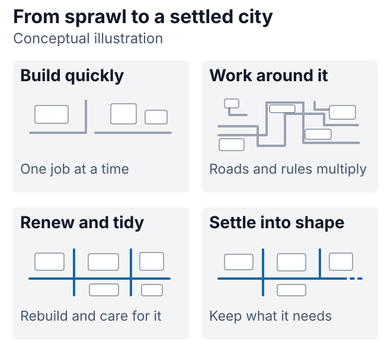
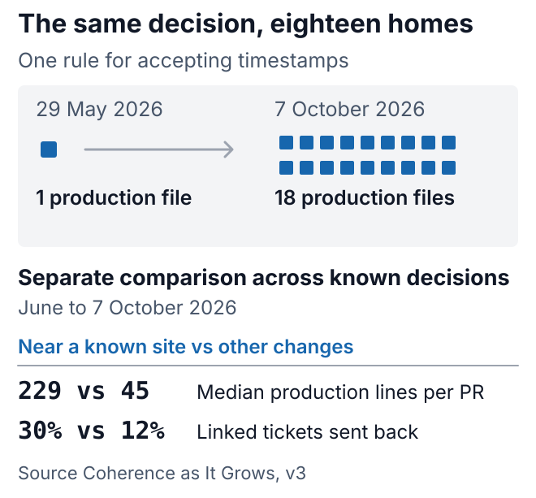
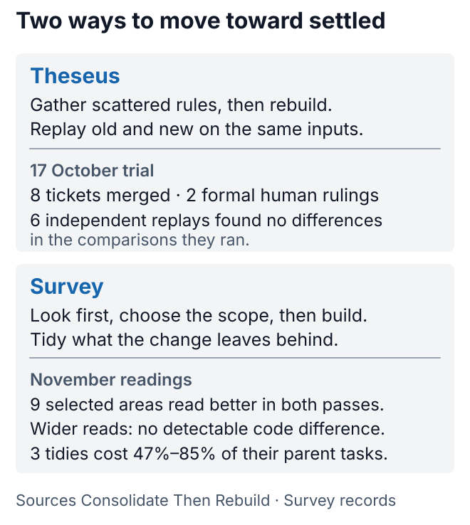

# The City That Builds Itself

*From agent-generated sprawl to software that can renew its foundations*

Software agents have made it astonishingly cheap to add another building to the city of software. They have not, by default, made anyone responsible for its streets. Harbour, a small system that coordinates AI agents to build itself, has lived through the difference: successful jobs, a growing codebase, elaborate checks, and new tasks born from old ones. Its recent experiments suggest a different kind of development, in which finishing a job includes improving the place where the next job will happen. The goal is not merely to keep the city from getting worse. It is a city that can lose redundant buildings, gather its scattered infrastructure, and settle into the size and shape its residents actually need.

## The city rises

Picture a small town in which builders have suddenly become almost free. A resident requests a shop; a team erects one. Another wants a bridge; it appears. The builders are clever, diligent, and very quick. They follow the planning permission. Then they depart.

For a while the town looks miraculous. There are more buildings every week. Everyone can point to progress. The trouble is barely visible from the opening-day photographs. Each builder has made local choices about drainage, road access, wiring, and signs. Nobody has quite the same map. The shop works and the bridge stands, but the route between them acquires another awkward turning. The next builder must discover the arrangements the previous one left behind.

*Figure 1. A possible evolution of agent-built software. The first three panels draw on Harbour’s experience. A settled codebase is the goal. Conceptual illustration.*

This is not an allegory for careless machines. Harbour's earlier investigation found that its agent pipeline generally preserved the requested work surprisingly well. In a check of 254 completed tickets, the records for individual pieces of work, Harbour delivered 94.7% of the requests those tickets contained. The wider inquiry described coding agents as capable contractors. [H21](https://github.com/JKershaw/LinearViewer/blob/68b5d8f3a8c6ee3d4d3dfea87a705d703c7a0192/docs/reviews/_evidence-2026-11-02-ticket-intent/investigation-notes.md#L51) The difficulty was the boundary of the contract. The agent that noticed a problem in the surrounding code would often record it as out of scope and move on. The job had an owner. The place did not. [H01](https://github.com/JKershaw/LinearViewer/blob/68b5d8f3a8c6ee3d4d3dfea87a705d703c7a0192/docs/papers/harbour/tasks-are-tasks.md#L14)

Harbour is a working example at unusually high intensity. Separate agent runs research, plan, build, review, and close out work; the system records much of what they do. That makes it possible to see problems that a developer supervising one or two agents by hand might encounter much later, and to experiment with fixes before those problems become ordinary.

## When building becomes cheaper than planning

The first thing the records make clear is that construction quantity and delivered value can part company. Between 1 June and 28 September 2026, Harbour's production code grew about 3.7-fold, while its test code grew about 9.3-fold. The fleet machinery itself expanded particularly quickly. The product was growing, but so was the machinery for producing and checking it. These are line counts. They say how much code was added. [H02](https://github.com/JKershaw/LinearViewer/blob/68b5d8f3a8c6ee3d4d3dfea87a705d703c7a0192/docs/papers/harbour/growth-atlas.md#L14)

Nor did the work queue simply shrink as more agents worked. In sixty days to 12 September, Harbour recorded 1,484 tickets created and 701 closed. Most new tickets named another ticket as their origin. Many remained unworked. A hand reading of forty stranded findings found 34 still described true problems and 23 belonged to their parents' unfinished scope. We should not wave these away as imaginary work. The town had learned to file reports about its broken paving faster than it could repair the paving. [H03](https://github.com/JKershaw/LinearViewer/blob/68b5d8f3a8c6ee3d4d3dfea87a705d703c7a0192/docs/papers/harbour/tasks-generate-tasks.md#L23) [H19](https://github.com/JKershaw/LinearViewer/blob/68b5d8f3a8c6ee3d4d3dfea87a705d703c7a0192/docs/papers/harbour/never-worked-pile.md#L24)

One analysis uncovered a seeming contradiction that becomes clearer when you ask which tickets are counted. Across all work units, including those never started or never finished, the system generated 0.74 new independent units for each existing one. Among units that actually reached Done, however, each finished unit generated 1.52 more on average. Those are different populations, not competing accounts of the same result. The lower overall ratio partly reflected how much work sat untouched. Closing a ticket was not reliably the same as closing the work it had discovered. [H04](https://github.com/JKershaw/LinearViewer/blob/68b5d8f3a8c6ee3d4d3dfea87a705d703c7a0192/docs/papers/harbour/root-task-ratio.md#L24)

Supervision became an industry of its own. In September, in the recorded Claude sessions, the stages supervising tickets used 35% of weighted tokens, a measure that counts different kinds of model activity relative to their price. Writing the code used 24%, and checking the plan, reviewing the change, and closing the ticket used another 24%. A separate study traced a rise from 7.6 to 20.0 dispatches per correct change in adjacent July fortnights, largely because agents were called back to follow up. A dispatch starts or resumes an agent session. More activity was not a reliable measure of more useful production. [H05](https://github.com/JKershaw/LinearViewer/blob/68b5d8f3a8c6ee3d4d3dfea87a705d703c7a0192/docs/papers/harbour/where-the-effort-goes.md#L17) [H06](https://github.com/JKershaw/LinearViewer/blob/68b5d8f3a8c6ee3d4d3dfea87a705d703c7a0192/docs/papers/harbour/what-doubled-the-dispatches.md#L17)

A city can become costly through its building inspectors as well as its buildings. Harbour's stage prompts and procedural rules accumulated in much the same way as its code. A new failure invited a new sentence, a new gate, or another step. Some protections earned their keep; others became permanent without ever proving their benefit. The corrective lesson is not to abolish inspection. It is to ask which controls prevent meaningful failures, and to make the inspection system itself maintainable. [H18](https://github.com/JKershaw/LinearViewer/blob/68b5d8f3a8c6ee3d4d3dfea87a705d703c7a0192/docs/papers/harbour/flow-and-convergence.md#L15)

## The second copy

The most striking problem was not simply that AI-written code contains bugs or repeated text. Bugs are old, and the agents were not mainly copying and pasting. Harbour's textual duplication actually declined, from 2.5% of production lines in May to 1.2% in early October, even while its codebase grew. The problem was duplicated decisions. A rule for accepting different timestamp formats had been implemented in one file, then two, then eighteen, sometimes as `toMillis`, sometimes `toMs`, sometimes `_epoch`. Each new module solved the same question independently. One project instruction, 'no frameworks, no build step', had even been read as a reason not to share code between browser and server, though browser modules did not require a build step. The words differed; the obligation to keep the behaviour consistent did not. [H07](https://github.com/JKershaw/LinearViewer/blob/68b5d8f3a8c6ee3d4d3dfea87a705d703c7a0192/docs/papers/harbour/coherence-as-it-grows.md#L40)

Among 190 recorded escaped defects examined in that study, 86 involved decisions that had not been reconciled across their sites. Changes near known multi-site decisions had a median of 229 production lines changed per pull request, the proposal to merge a change. The median elsewhere was 45 lines. The share of tickets sent back at least once was 30%, compared with 12% for the other tickets. The causal mechanism is familiar from decades of software-engineering research: a decision repeated in several places makes later changes more diffuse and easier to leave half-finished. Harbour supplied unusually concrete measurements of that older problem. [The Second Copy](the-second-copy.md) follows the evidence in detail. These observations do not prove that each extra copy causes a proportional token bill. They show where the bill can arise, when a later builder must find every place holding one rule. [H07]

*Figure 2. The file count follows one timestamp rule. The size and review figures cover changes near any of the decisions studied between June and 7 October 2026. The comparison is observational. [H07]*

Tests offered another surprise. It would be easy to declare the expanding test estate mostly waste. Harbour investigated that suspicion and found the claim was too strong. Many tests caught something no other test file caught, while about half of sampled one-line faults survived the entire unit test suite. There was surplus, but there was also thin protection. Deleting tests indiscriminately would have been as crude as solving traffic congestion by demolishing every road. The right question was what each piece of infrastructure actually did. [H08](https://github.com/JKershaw/LinearViewer/blob/68b5d8f3a8c6ee3d4d3dfea87a705d703c7a0192/docs/papers/harbour/test-surplus.md#L14)

The cost of the next change is becoming the meaningful unit. A cheap change that leaves a scattered decision may force ten future changes to rediscover it. An expensive change that gives the decision one home may repay itself repeatedly. That future saving is plausible, but it is not established simply because the code looks tidier today.

## A demolition that keeps the lights on

The city metaphor can suggest a solution that software engineering rarely has the luxury to attempt: rebuild the awkward district. For years, the danger and expense of replacing working software made this a daunting option. Agents change the price of the labour, although not the consequences of a bad replacement.

Harbour's Theseus Method is deliberately unromantic. First gather scattered decisions into a place that owns them. Loosen tests that depend on where code sits rather than what it does. Rebuild from a fresh design. Then run the old and new behaviour side by side on the same inputs and compare what an outsider can observe. The ideas owe much to older work on information hiding, refactoring, and gradual replacement; the interesting change is that a serious rebuild may now be affordable. [H09](https://github.com/JKershaw/LinearViewer/blob/68b5d8f3a8c6ee3d4d3dfea87a705d703c7a0192/docs/papers/harbour/theseus-method.md#L24)

On 17 October, Harbour put the complete method to work on its own code. All eight related tickets merged. Six production changes were checked by independent replays, which found zero differences in the behaviour they compared on the test inputs. A separate rerun caught one change in the order of fields in a stored argument that the original comparison had ignored. John answered two formal requests for a ruling that day. In the code that hands work to an agent, the 24 decisions being gathered went from 95 sites to 26. The most complicated function went from 63 decision points to 29 after consolidation and 13 after the rebuild. Within the tested scope, that is a decisive success. The cost of changing those areas again still needs measuring. [H10](https://github.com/JKershaw/LinearViewer/blob/68b5d8f3a8c6ee3d4d3dfea87a705d703c7a0192/docs/papers/harbour/consolidate-then-rebuild.md#L45)

The distinction between rebuilding code and rebuilding a decision matters. A new façade is easy. If the old wiring still runs behind the wall and each room keeps its own switch, the district has only been repainted. Theseus works by relocating responsibility before rebuilding its expression.

## Give the town a planning department

In November a second experiment added everyday town planning alongside Theseus's larger rebuilds. Survey asks which parts of the code a proposed change will touch, what will make it difficult, and whether a small tidy first will make the real job easier. A person, or an agent acting under their authority, chooses the scope. After implementation, the team examines what the change left behind and may tidy it immediately. Larger targeted renewals and continuous 'clean as you go' development are complementary, not rival strategies. The operator described two dials: make no new mess, and decide how much to tidy. [H20](https://github.com/JKershaw/LinearViewer/blob/68b5d8f3a8c6ee3d4d3dfea87a705d703c7a0192/docs/plans/survey.md#L39) [H12](https://github.com/JKershaw/LinearViewer/blob/68b5d8f3a8c6ee3d4d3dfea87a705d703c7a0192/docs/papers/harbour/the-place-became-somebodys-job.md#L43)

The early readings were encouraging. Nine selected stretches of work, spanning fifteen tickets, were judged better by two separate agents that saw only the code. They were looking for code that would be easier to understand and change. In a comparison set from before Survey, one of four pairs of consecutive changes in one area was judged better by both readers, and that pair was itself a consolidation. A tracked list of hand-written stand-ins for browser pages in tests dropped from 56 to 6. The list covers one class of test code. Ordinary Survey tickets, read one at a time, did not read better than their November comparison group. The favourable results came from finishing a move and deleting its old copies. [Clearing Up as It Goes](the-place-became-somebodys-job.md) follows the Survey evidence. [H11](https://github.com/JKershaw/LinearViewer/blob/68b5d8f3a8c6ee3d4d3dfea87a705d703c7a0192/docs/papers/harbour/cleaner-than-it-started.md#L46) [H12]

*Figure 3. Theseus renews selected structures. Survey brings tidying into ordinary work. The October trial and November Survey readings answer different questions. Lifetime costs remain to be measured. [H10] [H11] [H13](https://github.com/JKershaw/LinearViewer/blob/68b5d8f3a8c6ee3d4d3dfea87a705d703c7a0192/docs/plans/survey/area-read-reports/comparison-302edafc3-vs-4b5001ddf.md#L3) [H14](https://github.com/JKershaw/LinearViewer/blob/68b5d8f3a8c6ee3d4d3dfea87a705d703c7a0192/docs/plans/survey/area-read-reports/comparison-49776653d-vs-e8e92d50a.md#L3)*

And the cleaning had a price. In three recorded examples, the estimated model cost of a tidy-after task was 47% to 85% of the cost of the change it followed. [H11] The question is whether today's cleanup makes enough of tomorrow's work cheaper to justify the bill. [H12]

The later area-wide readings tell an important part of the story. Two broader comparisons found differences smaller than their threshold for detection. Their sampling missed much of the work, their readers varied, and some controls changed. The broader readings leave both overall improvement and stability open. The local successes answer a narrower question. The earlier tendency was for completed tasks to add structural burden; the emerging possibility is to keep doing work without leaving much additional burden behind. In that historical context, even holding the line would be a major advance. [H13] [H14]

The desired destination is more ambitious than zero growth. Survey's own working document calls it 'settled': a codebase whose size and organisation reflect what the product does, rather than every abandoned idea and historical workaround. When new functionality warrants more code, the city grows. When duplicated decisions and obsolete structures can disappear, it shrinks toward the right shape. A stable score while the system continues delivering work could be a turning point on the way there, not the finish line. [H20]

## Smaller engines, better roads

There is a further twist. Harbour has put considerable effort into choosing which model does which kind of work. In a window reported on 5 November, Harbour routed all 45 implementation dispatches to Haiku, a lower-priced model. Some follow-up assessments used Opus, a more expensive one. [H22](https://github.com/JKershaw/LinearViewer/blob/68b5d8f3a8c6ee3d4d3dfea87a705d703c7a0192/docs/plans/survey/log.md#L2053) That shows what Harbour was willing to give the cheaper model in that period. The economics depend on whether it meets the same standard once retries and repairs are counted.

The distinction has a mischievous implication. Cheaper model calls may let a messy codebase survive economically for years. Imagine a change touching the same timestamp rule in several files. A low-cost agent may read each implementation, patch the relevant ones, adjust the tests, and still cost less in cash than yesterday's frontier model. The broken street layout remains, but commuting across it gets cheaper. Harbour's measured timestamp parsers and scattered review rules show that this is not an invented kind of tangle. Consolidating the rule could make later changes cheaper still, although the saving must be compared with the cost of the consolidation itself. [H07]

Attempts to run a much leaner process underline the danger of declaring victory from the token bill. Harbour's small-work replay did produce dramatic estimated savings, but two of four reruns without hindsight dropped from better to worse, and the other two stayed where they were. The replay could not establish equivalent correctness in real production. [H24](https://github.com/JKershaw/LinearViewer/blob/68b5d8f3a8c6ee3d4d3dfea87a705d703c7a0192/docs/papers/harbour/survey-check-11.md#L14) The operator has also seen apparently glowing assessments of lean runs overturned by the cleanup they required later. A cheap implementation followed by expensive repair is not cheap software. The trials have not yet demonstrated a broadly reliable lean substitute for the more elaborate rigging. [H17](https://github.com/JKershaw/LinearViewer/blob/68b5d8f3a8c6ee3d4d3dfea87a705d703c7a0192/docs/papers/harbour/replay-small-work.md#L27)

Harbour's own UI work shows how immediate the concern is. In one November round, five planned groups became seventeen tickets as prerequisites emerged. Individual pieces took 80 to 256 minutes, with unreliable browser tests a major source of delay. The library grew by about 1,900 lines, and the unit tests by about 13,000, while work intended as tidying progressed. That is a concrete episode of delay and growth. To find out how much the same work costs over time would take comparable tasks and a fuller record. If an easier codebase pays off, future comparable changes should need less context, fewer review rounds, less repair, and lower total model and human effort. [H20] [H16](https://github.com/JKershaw/LinearViewer/blob/68b5d8f3a8c6ee3d4d3dfea87a705d703c7a0192/docs/papers/harbour/task-size-and-cost.md#L14)

## The part of the future we can actually see

It is tempting to turn this story into a prophecy. Harbour has been pushed toward levels of autonomy most teams have not reached. Some of its problems may appear elsewhere later; others may be particular to Harbour's own design, its dense process, or the sorts of tasks it has undertaken. The tools will change again. The methods will change too.

That uncertainty fits another Harbour essay, Learning While the Tools Change. It distinguishes three clocks: years of software-engineering experience, experience directing AI, and the capability of the available tools. Later adopters can inherit practices and guardrails that earlier experimenters had to discover, while experienced engineers still contribute judgement about systems, risks, and consequences. No single adoption ladder predicts everyone's route. [H15](https://github.com/JKershaw/LinearViewer/blob/68b5d8f3a8c6ee3d4d3dfea87a705d703c7a0192/docs/papers/harbour/learning-while-the-tools-change.md#L30)

The larger historical comparison helps explain why adoption is unlikely to proceed evenly. A century ago, a factory built around a steam engine and shafts carrying power through belts could not gain all the advantages of electric motors merely by swapping one machine for another. Its floor plan and way of organising work had to change too. [H23](https://gwern.net/doc/economics/automation/1990-david.pdf#page=4) In this analogy, the factory is the small software team and electricity is AI. One firm attaches an agent to its existing process. Another redesigns research, delivery, verification, and maintenance around the capability. Some adapt, while others struggle. Software walls can be rebuilt more easily than factory floors, but that does not abolish the need for judgement about what to keep and what to remake.

The next experiment should therefore be demanding rather than grandiose: follow comparable changes into areas that were consolidated or surveyed, and measure their full cost, quality, and maintenance burden. Include cleanup costs, model routing, changing scope, and the consequences of defects discovered later. Compare against areas without the intervention. The question isn't whether people can make a tidy change once. Harbour has already shown that they can. It is whether the method makes the next change easier, and then the one after that.

A city that builds itself is not impressive because no person ever lays a brick. It is impressive if its residents can add what matters, remove what no longer matters, and keep its roads and services comprehensible. Harbour's Theseus experiments demonstrated that even substantial reconstruction can succeed on real targets. Survey is exploring how to make such care an ordinary part of building. The greater achievement will be a city that becomes better fitted to its residents because yesterday's work was finished properly.

## Annotated reading list

- **H01** [Tasks Are Tasks, and the Codebase Is a Place](https://github.com/JKershaw/LinearViewer/blob/68b5d8f3a8c6ee3d4d3dfea87a705d703c7a0192/docs/papers/harbour/tasks-are-tasks.md#L14). The contractor-versus-resident diagnosis and where work goes when an agent notices a problem outside its assigned task.
- **H02** [Growth Atlas](https://github.com/JKershaw/LinearViewer/blob/68b5d8f3a8c6ee3d4d3dfea87a705d703c7a0192/docs/papers/harbour/growth-atlas.md#L14). Source and test-line growth in both repositories. It measures size.
- **H03** [Tasks Generate Tasks](https://github.com/JKershaw/LinearViewer/blob/68b5d8f3a8c6ee3d4d3dfea87a705d703c7a0192/docs/papers/harbour/tasks-generate-tasks.md#L23). Ticket creations, closures, and recorded parent links in the sixty-day window.
- **H04** [Root Task Ratio](https://github.com/JKershaw/LinearViewer/blob/68b5d8f3a8c6ee3d4d3dfea87a705d703c7a0192/docs/papers/harbour/root-task-ratio.md#L24). Independent work units and the distinction between all units and those marked Done.
- **H05** [Where the Effort Goes](https://github.com/JKershaw/LinearViewer/blob/68b5d8f3a8c6ee3d4d3dfea87a705d703c7a0192/docs/papers/harbour/where-the-effort-goes.md#L17). Distribution of price-weighted model activity in retained Claude transcripts.
- **H06** [What Doubled the Dispatches](https://github.com/JKershaw/LinearViewer/blob/68b5d8f3a8c6ee3d4d3dfea87a705d703c7a0192/docs/papers/harbour/what-doubled-the-dispatches.md#L17). The comparison of July fortnights and the contribution of calls to resume work.
- **H07** [Coherence as It Grows](https://github.com/JKershaw/LinearViewer/blob/68b5d8f3a8c6ee3d4d3dfea87a705d703c7a0192/docs/papers/harbour/coherence-as-it-grows.md#L40). Timestamp implementations, escaped faults, and the association between review send-backs and changes near known scattered decisions.
- **H08** [Test Surplus](https://github.com/JKershaw/LinearViewer/blob/68b5d8f3a8c6ee3d4d3dfea87a705d703c7a0192/docs/papers/harbour/test-surplus.md#L14). Which tests uniquely catch sampled faults, and which one-line faults survive in this codebase.
- **H09** [The Theseus Method](https://github.com/JKershaw/LinearViewer/blob/68b5d8f3a8c6ee3d4d3dfea87a705d703c7a0192/docs/papers/harbour/theseus-method.md#L24). The sequence for gathering decisions, freeing tests, rebuilding, and replaying behaviour.
- **H10** [Consolidate Then Rebuild](https://github.com/JKershaw/LinearViewer/blob/68b5d8f3a8c6ee3d4d3dfea87a705d703c7a0192/docs/papers/harbour/consolidate-then-rebuild.md#L45). The 17 October trial, including structural gains, the limits of replay, and two formal human rulings.
- **H11** [Cleaner Than It Started](https://github.com/JKershaw/LinearViewer/blob/68b5d8f3a8c6ee3d4d3dfea87a705d703c7a0192/docs/papers/harbour/cleaner-than-it-started.md#L46). The selected code-only readings, ordinary comparison pairs, test census, and three API-priced tidy-after costs.
- **H12** [Clearing Up as It Goes](https://github.com/JKershaw/LinearViewer/blob/68b5d8f3a8c6ee3d4d3dfea87a705d703c7a0192/docs/papers/harbour/the-place-became-somebodys-job.md#L43). How Survey, scope selection, and a tidy-after can work together.
- **H13** [Runs & Dispatch area-read comparison](https://github.com/JKershaw/LinearViewer/blob/68b5d8f3a8c6ee3d4d3dfea87a705d703c7a0192/docs/plans/survey/area-read-reports/comparison-302edafc3-vs-4b5001ddf.md#L3). A broader Survey reading, with limited coverage and variability across readers.
- **H14** [LLM & Prompts area-read comparison](https://github.com/JKershaw/LinearViewer/blob/68b5d8f3a8c6ee3d4d3dfea87a705d703c7a0192/docs/plans/survey/area-read-reports/comparison-49776653d-vs-e8e92d50a.md#L3). The broader comparison in a second area. Its code result was within the report’s threshold for detection.
- **H15** [Learning While the Tools Change](https://github.com/JKershaw/LinearViewer/blob/68b5d8f3a8c6ee3d4d3dfea87a705d703c7a0192/docs/papers/harbour/learning-while-the-tools-change.md#L30). The three clocks of engineering experience, AI experience, and tool capability.
- **H16** [Task Size and Cost](https://github.com/JKershaw/LinearViewer/blob/68b5d8f3a8c6ee3d4d3dfea87a705d703c7a0192/docs/papers/harbour/task-size-and-cost.md#L14). The uncertain relationship between change size and recorded cost. Its November snapshot cannot establish a trend for comparable tasks.
- **H17** [Replay Small Work](https://github.com/JKershaw/LinearViewer/blob/68b5d8f3a8c6ee3d4d3dfea87a705d703c7a0192/docs/papers/harbour/replay-small-work.md#L27). Cost and correctness results for a lean replay, with the limits of generalising to live work.
- **H18** [Flow and Convergence](https://github.com/JKershaw/LinearViewer/blob/68b5d8f3a8c6ee3d4d3dfea87a705d703c7a0192/docs/papers/harbour/flow-and-convergence.md#L15). An interpretation of how rules accumulate and what kept parts of Harbour’s process lean.
- **H19** [Never-Worked Pile](https://github.com/JKershaw/LinearViewer/blob/68b5d8f3a8c6ee3d4d3dfea87a705d703c7a0192/docs/papers/harbour/never-worked-pile.md#L24). Hand reading of forty stranded findings.
- **H20** [Survey working plan](https://github.com/JKershaw/LinearViewer/blob/68b5d8f3a8c6ee3d4d3dfea87a705d703c7a0192/docs/plans/survey.md#L39). The definition of settled and the operator’s record of the November UI round.
- **H21** [Ticket-intent investigation notes](https://github.com/JKershaw/LinearViewer/blob/68b5d8f3a8c6ee3d4d3dfea87a705d703c7a0192/docs/reviews/_evidence-2026-11-02-ticket-intent/investigation-notes.md#L51). The 94.7% coverage result comes from 1,856 requests in 254 completed tickets.
- **H22** [Survey log, 5 November](https://github.com/JKershaw/LinearViewer/blob/68b5d8f3a8c6ee3d4d3dfea87a705d703c7a0192/docs/plans/survey/log.md#L2053). Implementation and follow-up routing in the observed window. The last model recorded in a chain can differ from the model used to write the code.
- **H23** [Paul David, The Dynamo and the Computer (1990)](https://gwern.net/doc/economics/automation/1990-david.pdf#page=4). The historical account of factory electrification and organisational changes. It supplies an analogy for software teams.
- **H24** [Independent check of Replay Small Work](https://github.com/JKershaw/LinearViewer/blob/68b5d8f3a8c6ee3d4d3dfea87a705d703c7a0192/docs/papers/harbour/survey-check-11.md#L14). Corrections to the replay’s headline claims, including its comparison without hindsight and what its cost ratio includes.

## Next

**The Cost of the Next Change.** Extend the [existing consolidation follow-up](../proposals.md#the-cost-of-the-next-change) to comparable Survey work. Count the work of consolidation and tidying, changes in model routing, model use and expenditure, human supervision, review rounds, verified outcomes, and defects or structural burden found later.
