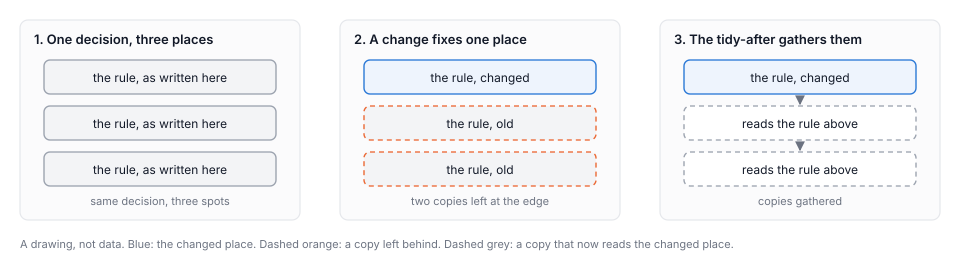
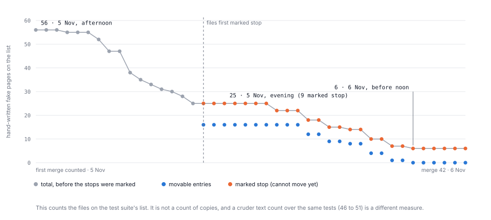
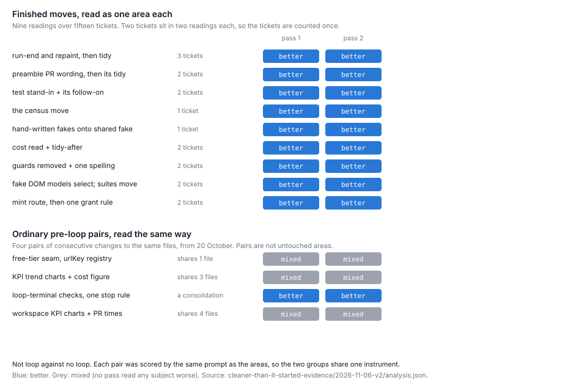

# Clearing up as it goes

Have we found a way for Harbour to tidy the codebase as it works? Yes, with plenty of room to improve. When a change was looked at first, sized on purpose, and followed straight away by a tidy of whatever it left behind, the code around it ended cleaner: all nine stretches of work done that way, covering fifteen tickets, were judged better by two separate readers who saw only the code [1]. Ordinary tickets, done one at a time, did no better than changes made before. It is a small result and a real one. This essay tells how we got there, what overturned our first answer, and what we noticed about ourselves on the way. It is a waypoint, not a verdict.

Harbour is a tool that hands software work to AI agents. Each piece of work is a ticket, and for each ticket Harbour starts a fresh agent that reads it, does the job, and leaves. Harbour is built this way too, so most of the code in this story is Harbour's own.

A word on how "judged better" works, since everything leans on it. Each change was shown to two separate agents who saw only the code, with no ticket and no story. Each wrote one verdict on the change: better, neutral, mixed or worse. We call them the blind readers, and they worked from the same written instructions [1, 8]. Where a change was followed by a tidy, or split into pieces, the readers also judged the whole stretch as one unit, which we call an area. The nine above are areas.

## Two pipelines

Picture a kitchen where each cook makes one dish and goes home. Every dish goes out on time and nobody washes the pans, so each new cook works around the last one's mess. Kitchens that run well have a rule against this: clean as you go.

*Figure 1. A drawing, not data. Top, the old line; bottom, the new pipeline.*

**The old line.** Tickets ran one after another. Each agent finished its own ticket and left, and a ticket was judged on whether its own job was done. But a change often leaves something behind: the same rule now written in two places, a list that should have learned about the new thing and didn't, a new helper added beside the old way without the old way being removed. The commonest kind is a copy, one decision written in several places, so that a later change fixes one and leaves the others saying something else (Figure 2) [1]. The agent that made the leftover had gone. The next agent was there for a different ticket. Clearing it was no one's job. The earlier paper in this series put it this way: the tasks had owners, and the codebase they happen in did not [3]. So leftovers piled up between tasks, and every later change paid a little more to work around them.

*Figure 2. A drawing, not data: a copy. A change that fixes one place leaves two behind, and a tidy gathers them.*

**The new pipeline** gives every change four steps, each with an idea behind it.

*Look first.* Before the work starts, a separate agent reads the code, changes nothing, and posts a short note on the ticket: what the code there is like, where the change will be hard, and the ways to go about it, from just doing the task to changing the area so that tasks like it become easy. One look is at the task up close, a second at the surrounding code [4]. You cannot size a job you have not looked at, and an agent that heads straight into the work sees only its ticket.

*Decide the size.* Then someone picks from those options how big the move should be. This is a person's call, and it stayed one. On several tickets John handed it to Claude with a standing instruction to "err on the side of larger tidies" [1]. John describes two dials: "make no new mess", always on, and "how much to tidy", a budget the person sets [4]. Two rules of thumb sit here: do the big moves early, and where the change would catch on messy code, tidy that first, as its own small ticket, so the change lands on clear ground [4].

*Make the change.* The work itself, as before.

*Tidy what it left.* Straight after the change is merged, the copies it left at its edges become a small follow-on ticket of their own, looked at first like any other [4]. The cheapest moment to clear a leftover is now, before anything else is built on top of it. These follow-ons are not free: three of them cost between 47% and 85% of the change they tidied after [1].

Two more pieces hold it together. When a tidy can only go part of the way, it leaves behind a count of the copies still to move, and a test that fails if the count ever rises: like a ratchet on a winch, which lets the rope come in and stops it slipping back. Without one, a half-finished tidy drifts; the notebook records a shared helper that went unused while a new file wrote its own copy beside it [5]. And now and then a review agent reads the whole codebase, without seeing the blind readers' instructions, and reports which areas have improved and which have slipped [6, 7].

That is the new pipeline. John's phrase for it is a network of tasks rather than a line [4].

## One change, followed through

One ticket split a cost figure so that each agent run got its own share. It worked, and the blind readers both judged it mixed: it had added a private way of sorting rows beside the one the code already had, and written a list of keys out twice [1]. Under the old line, that is where the story ends. Under the new one, the leftovers became the next ticket. The tidy removed the private sort and wrote the list once, and both readers judged it better; judged together, the change and its tidy were better too. The tidy cost less than half as much as the change, $6.77 against $14.37 [1].

## Finished, or only started

That pattern came back again and again, and it is the centre of what we found. A move that finishes, deleting the old copies, reads better. A move that only starts, adding a new owner beside copies that keep running, reads mixed (Figure 3).

*Figure 3. A drawing, not data: the pattern in eleven single changes, a hypothesis rather than a law.*

Eleven single changes, each judged on its own, point this way. Six that deleted or merged copies were judged better by both readers; five that added code beside the old copies were judged mixed by both [1]. The clearest pair: a shared test helper was added while seventeen hand-written copies of it were still in use, and it was judged mixed. Its follow-on moved those copies onto the helper, and the two together were judged better [1]. Same idea, same area. The difference was finishing.

The same work gives a picture of finishing at scale. The test suite keeps a list of the files that still build their own fake web page by hand instead of using the shared one, and a test stops the list growing. On the afternoon of 5 November it had 56 entries. By midday on 6 November it had 6, each marked as unable to move yet, because it needs a browser behaviour the shared fake does not imitate (Figure 4) [1, 2]. That is a count of files on the list, not proof that every copy is gone; a cruder count over the same tests rose during part of those days [7].

*Figure 4. The test suite's list of hand-written fake pages, counted at each of the 42 merges where it was taken [1, 2].*

The work also turned up a silent fault: the route Harbour uses to read a ticket returned only its first 50 comments, so anything that read a long ticket could miss its latest word. After the fix, a ticket with 143 comments came back whole [1].

## How our first measure was overturned

We were not right first time, and how we found out matters as much as the result.

At first the person running the pipeline kept score by hand, and the tally read 17 better, 3 mixed, 1 neutral and none worse [1]. It looked like a clear win. Then the blind readers judged the same ordinary tickets alongside eight changes made just before, without the new pipeline. The ordinary tickets did no better: level with one reader, a little behind with the other, a gap too small to lean on either way [1]. The hand tally was the hopeful eye of someone inside the work, and we dropped it.

What the blind readers did judge better was narrower: areas where a move was finished. All nine were better with both readers (Figure 5) [1]. To check that this was not just an effect of judging two changes as one, we took four ordinary pairs of consecutive changes to the same files from October, chosen by a rule written down before any of them was judged, and had them judged the same way. One of the four came out better, and it was itself a tidy that gathered scattered rules into one place [1]. So what reads better is consolidation, and the finished moves are consolidations. The notebook's own correction puts the claim the same way: areas ending better when a move is finished, not tasks on average [5].

*Figure 5. Nine finished moves beside four ordinary pairs, each judged as one area by the same two blind readers [1, 2]. This is not a comparison with code nobody touched.*

The whole-codebase reviews, which never saw the blind readers' instructions, broadly agree on the direction: better, by a small margin [1, 6, 7]. They also caught what the blind readers missed. Every codebase has a junk drawer, the files that belong to no particular area. One early tidy added a new file to it; the blind readers liked the change and never saw the drawer grow, and the review still rates that drawer worse than before [1, 6]. Another review found a handle added to live code that only the tests use, and calls that area mixed [7]. Being corrected by readers who had not seen our instructions is the checking doing its job.

How sure are we? The blind readers' instructions ask every change whether it added a copy and what it deleted, and a tidy is exactly the change that answers that question well, so the instrument leans towards what it measures [1, 8]. The numbers are small: nine areas, four pairs, eleven single changes. The comparison pairs were ordinary changes, not an area left alone [1]. And the reviewers are agents of the same kind as the builders [7]. What keeps the direction honest is that the reviews, which do not share the blind readers' instructions, agree on it.

## What we noticed about ourselves

The pipeline was not designed on paper. It was run by hand, by John and Claude deciding as they went, and the hand made mistakes. One ticket's own wording invited a new copy. One sweep was drawn around a list of names rather than the behaviour itself, and needed a second pass that evening [5]. One description written into a ticket was copied into the code as a comment that was not quite true [1]. John's reading is that these are the mistakes you would expect from someone "holding the reins", and the reason to build those decisions into Harbour, leaving the truly human calls with people: how big a move should be, the rulings, and granting authority [5].

This morning we noticed two more things. They are observations, not results [9].

The first is that each hand-off between agents loses some of the original intent and gains detail, like a photocopy of a photocopy. A ticket becomes a brief, the brief becomes a plan, the plan becomes code and comments, and by the end what the person wanted can be faint while the specifics have multiplied. The comment that was not quite true may be one small example [1, 4].

The second is closer to home. Whenever something went wrong, we added a rule to the briefs. The notebook's instructions for deciding the size grew a line at a time, many tagged with the ticket that taught them [4], and we rarely went back to fold them together. That is the same habit we were trying to stop in the code: adding beside instead of finishing. We had been building copies in our own instructions.

There was friction, too. Harbour's default is to move straight on to the next ticket, and we kept pushing it off that default to stop and tidy. We felt the same pull in ourselves. We take the friction as a sign it is working: it is what changing a default feels like.

The next thing we will try follows from both observations: plain briefs, written once, which every step reads directly, instead of each step reading the last one's retelling.

## Why this is exciting

The result is modest, a direction rather than a transformation. What excites us is how we found it, because the method does not depend on tidying.

We stepped back from single tickets, looked at the shape of the work, and found the gap in it: no step whose job was the leftovers. We added steps, and checked them with readers who had not seen the tickets. When they disagreed with us, we changed the claim, not the readers. And we learned to notice our own habits, the hopeful tally and the rule added beside, and to put checks against them. We have done this once, on one codebase, over a few days, but nothing in it is special to tidying, and we expect to use it again.

The paths from here are many. Plain briefs, against the photocopy effect. Larger standalone tidies aimed at the areas the reviews call worst, which John suspects is what really moves the needle [5]. A fair comparison with an area nobody touched. Lists the code works out for itself, in place of lists kept by hand, which go stale. The pipeline run on a codebase that is not Harbour's [4]. And above all, these steps built into Harbour, so the shape holds without a person holding it. As John put it, even a small gain "still means the trend is towards a better, simpler, easier to maintain codebase" [5].

## Next

1. **Plain briefs.** One line is added to the Library's list of proposed studies (`proposals.md`): whether a plain brief, written once and read directly by every step, keeps a ticket's intent better than briefs handed from step to step, and whether folding rules together does better than adding to them.
2. **Already proposed, not filed again:** larger standalone tidies on the worst areas; a blind reading against an area nobody touched; and whether a check, or a list the code works out for itself, at the moment the size is decided, would have stopped the copies the pipeline later removed.
3. **Not this essay.** The last few changes, made after both reviews' most recent reading, still need a review of their own before anyone calls them better [1].

## Where to check

The body describes changes in plain words. This table gives each one's ticket and source.

| As the body describes it | Ticket | Source |
|---|---|---|
| The look-first step, from two angles | LIN-4248 | [4] |
| "Err on the side of larger tidies", Claude on John's delegation | LIN-4048, 4143, 4151, 4234 | [1], Finding 9 |
| Tidy first as its own small task | LIN-4253, LIN-4252 | [1], Finding 4 |
| Tidies after cost 47%, 65% and 85% of their parent | LIN-4276/4263, LIN-4277/4251, LIN-4304/4292 | [1], Finding 8 |
| The shared helper that went unused while a new file wrote its own copy | — | [5] line 2030 |
| The cost split and its tidy | LIN-4263, LIN-4276 | [1], Finding 7 |
| Six deleting changes better; five adding changes mixed | LIN-4253, 4276, 4277, 4293, 4296, 4304; LIN-4246, 4247, 4248, 4252, 4263 | [1], Finding 5 |
| The shared test helper with seventeen copies left, and its follow-on | LIN-4252, LIN-4255 | [1], Findings 2 and 4 |
| The list of hand-written fake pages, 56 to 6 | LIN-4265 to LIN-4312 | [1] Finding 6; [2] |
| The 50-comment cap, and the ticket with 143 comments | LIN-4322, LIN-4150 | [1], Findings 6 and 10 |
| The hand tally, and the eight earlier changes | — | [1], Finding 1 and Method |
| Nine areas over fifteen tickets; four ordinary pairs | — | [1], Finding 2; Figure 5's rows are named in [2] `analysis.json` |
| The junk drawer that grew | LIN-4253 | [1], Finding 3; [6] |
| The handle in live code that only tests use | LIN-4309, LIN-4310 | [7] |
| The wording that invited a copy; the sweep drawn by names; the comment not quite true | LIN-4178; LIN-4292; LIN-4255 | [1], Finding 9; [5] line 2386 |

## Reading list

1. **Paper: *Can a task finish with the codebase cleaner than it started?*, version 2** (`docs/papers/harbour/cleaner-than-it-started.md@aec9e16b`). Supports every number in this essay, the findings and the limits. Does not show that a task on average finishes cleaner, and its blind scores were not re-scored by a second reader: its own fresh readers checked the paper, not the scores.
2. **The paper's evidence folder, version 2** (`docs/papers/harbour/cleaner-than-it-started-evidence/2026-11-06-v2/`). `git/census-by-merge.json` gives Figure 4; `analysis.json` gives Figure 5. Supports the counts. Does not explain them: a reading is a sign from a prompt, not a reason.
3. ***Tasks are tasks, and the codebase is a place*** (`docs/papers/harbour/tasks-are-tasks.md@aec9e16b`). The earlier essay that diagnosed the problem: an agent held to its ticket, and tidying with no owner. Supports the account of the old line. It predates the new pipeline, so it supports no result.
4. **The notebook** (`docs/plans/survey/notes-2026-11-05.md@1c894016`, lines 132 to 152 for the pipeline as it ran and its working rules, 182 to 185 for John's two dials and "a network of tasks rather than a line", 112 to 121 for the possible next steps; `docs/plans/survey/prompt.md@1c894016:7-14` for the two angles of the look-first step). Supports the description of the pipeline, John's words as recorded, and the growing list of rules. Does not supply evidence of effect.
5. **The notebook's log** (`docs/plans/survey/log.md@1c894016`): line 2030, the ratchet, and the helper whose use "stayed flat" while a fresh file wrote raw copies beside it; 2386, the sweep that needed a second pass; 2419, the correction of the headline; 2430, John on "holding the reins", on larger standalone tidies, and on the trend. Supports John's words as recorded and the operator's own corrections. Its clock headings drift from git times, so the essay cites lines.
6. **Seams & Tangles review, run 9** (`docs/reviews/seams-tangles-review-2026-11-06-run9.md@509f797e:9,107-109`). No area worse in its window; the junk drawer unchanged at 17 files, so the earlier run's worse reading stands. Does not cover merges after its window, and reads only what changed since the run before.
7. **Drift & Coherence review, run 5** (`docs/reviews/drift-coherence-review-2026-11-06.md@509f797e:9,17,47,238`). Better, by a small margin; the one mixed area, live code shaped for tests; the cruder count rising from 46 to 51. Does not cover merges after its window. Both reviews are written by the same kind of agent that wrote the code.
8. **The blind readers' prompt** (`docs/papers/harbour/cleaner-than-it-started-evidence/2026-11-06/prompts/blind-read-prompt.md@aec9e16b`). It asks each change whether it added a copy and what it deleted. Supports the limit named in the body. Read it before weighing any verdict in Figure 5.
9. **LIN-4340, the ticket's description (7 November 2026).** The two morning observations, the photocopy and the rules added beside, and the plan to try plain briefs. Supports them as the team's observations. They were not written down anywhere before, and nothing has measured them.
10. **Versions 1 to 3 of this essay** (`docs/papers/harbour/the-place-became-somebodys-job.md` at `b76d5239`, `f90488d0` and `aec9e16b`). The story as told so far. This version keeps their argument and retires their images.
