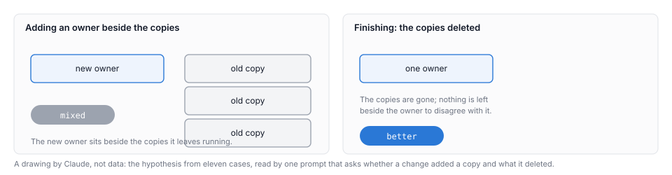

# What happened when the place became somebody's job

Between 5 and 6 November the census, the test suite's list of hand-written fake DOMs, fell from 56 entries to 6, merge by merge. When Harbour's loop finished a move, the area of code ended cleaner, by deleting copies rather than adding an owner beside them. The census counts the files on its own list, and the six left are marked stop: each needs a browser behaviour the shared stand-in does not model. The last merges have no reading by a Periodical, the standing review of the whole codebase described below.

This is the sequel to *Tasks are tasks, and the codebase is a place* [3]. That essay said nobody's job is the place, and asked what could hold it. This one tells what the days from 4 to 6 November 2026 looked like, when a loop run by a person and Claude together made the place somebody's job, and what the record can bear. The Periodicals include Seams & Tangles and Drift & Coherence [7, 8]. The direction is small, and the readings that do not share the scoring prompt agree on it, with the exceptions named below. Ordinary tickets done one at a time are not shown to make their areas better or worse.

The census is the test suite's own list of the files that still build a fake DOM by hand [9]. A DOM is a browser's model of a page, and the shared stand-in exists so that client tests need not each build their own. Figure 1 draws the count at each merge.

*Figure 1. The census count at each of the 42 merges where the count was taken [2, 9]. Before the stop marks existed, only the total is drawn.*

## The place had no one

Harbour is a control plane that runs AI coding agents over a team's work items, which it calls tickets (here, issues in Linear). Each ticket goes through stages, each a fresh AI session that reads the ticket, does one job, and leaves [3].

The prequel's point is about the place: the code as a whole, the things a later change has to work within. A copy is the same decision written in more than one spot, so a change to it has to be made several times, or it is made once and the others are left behind. The prequel's diagnosis was that the agent who feels that friction is held to its ticket, and the tidying that would make the next change easy has no owner. Kent Beck's advice was "make the change easy (warning: this may be hard), then make the easy change" [10]. Inside a ticket, Harbour did the second half. Nobody did the first [3].

The prequel used John Kershaw's images for this. Harbour is best seen, he said, as a film, and what holds its shape is a hand held out to keep a forcefield in place. Every time the hand moves, the shape dissolves [3]. The default pipeline holds a simple shape, one ticket's change; a passage holds a more complex one; John, by hand, holds a more complex one again [3]. The ball is another of his images: a change "binds" on the layers of code it has to push through [3]. These images are his, and this essay marks them as his.

The question is what could hold the more complex shape, so that the hand can move without the shape dissolving. The loop below is the sequence it examines: run on each ticket, with a person holding its authority.

## The loop, in one picture

*Figure 2. The loop as the notebook drew it on 5 November [4]: before the work, a Survey and a scope call; during it, a tidy first and the change; at merge, two blind reads and the builder's answers; after the merge, the tidy-after of the copies left at the edges. The dashed arrow returns the residues of a tidy-after to the notebook, for the next ticket in the area to pull. The Periodical reviews sit outside the loop, and the figure has no numbers.*

Follow one change through it. A ticket split the cost figure per dispatch, so each dispatch got its own. Two blind readers scored the split at merge, from its code alone, without the ticket. A **blind read** gives a commit a sign: better, neutral, mixed or worse. Each sweep of such scoring over a set of changes is a **pass** [1]. The split read mixed in both passes. The copies this pair dealt with were a private comparator, and a posting-key list that had been written twice [1].

Those copies were the next job. A **tidy-after** is the follow-on that removes what its parent left behind. This one had pre-work Surveys (a read-only note, posted on the ticket, of what the code looks like now), a scope call (the section headed "How to go about it", which says how big the move should be), and an after-answer from the session that built the change [1]. The blind readers found the comparator gone, and the list written once instead of twice. Both passes read the pair as better [1]. One case cannot separate that from the change itself (see the circularity limit under What the record cannot support) [1].

Figure 3 draws the shape the loop works to, not the data of this case.

*Figure 3. A drawing by Claude, not data: one decision written in three places. A change that fixes one place leaves two behind; the tidy-after gathers them.*

The notebook recorded the loop as it ran on 5 November [4]. Before the work: a Survey and the person's scope call. The scope rules are: big moves early; a partial move leaves a ratchet, a check that stops it drifting back; a sweep starts by writing the check it will pass; write the scope as instructions, not descriptions, because a description that is not quite true becomes a false comment. During the work: a **tidy first**, a small tidy landed as its own task ahead of a broad ticket, where the change binds. At merge: two blind reads and the builder's answers. After the merge: the copies the blind reads named at the edges become a tidy-after, Surveyed first. The **notebook** is the working record the loop keeps in `docs/plans/survey/`. The **operator** is the person who ran the loop, with Claude [1, 4].

The loop was not designed on paper first. Each step is a judgement made by someone, often by Claude on behalf of the person. Claude's reading, not the notebook's: read against the prequel's image, the scope call and the rulings are the part the hand holds. The rest asks what the loop held while it held, and what held it.

## What the four changes did

Four changes can be seen in the code, each at the commit or merge where it is true. The check table gives each one's ticket and commit.

**The hand-written fake DOMs.** Some tests still built their own browser model by hand, and the census lists the files that still do, a list that only shrinks [9]. A file marked "stop" needs a browser behaviour the shared stand-in does not model. The census began at 56 entries on 5 November at 13:18Z (all times in this essay are UTC), stood at 25 by 19:02Z that day, and reached 6 at 11:41Z on 6 November. All six are marked "stop", such as one that needs an event to bubble up the page [9]. A cruder count, of `makeContainer` and `createElement` in the test folder, rose from 46 to 51 over the Drift & Coherence window [8]. The two disagree.

**The method-presence guards.** A method-presence guard checks that a node has a method before the code calls it, such as `x.querySelector ? x.querySelector(...) : null`. A Seams & Tangles run counted about fifty of them deleted from the browser code, by a crude token match [7]. A test now holds the spelling rule, with an allow-list empty since the 11:41Z merge on 6 November [9]. The test is what keeps the guards from coming back.

**One grant rule.** The rule deciding which periodical runs may take the dispatch grant (the permission to start agent work) was written in two places. A change at 10:10Z on 6 November moved it into one function, `declaresPeriodicalGrant` [9]. Drift & Coherence run 5 reads this as better in the rule and neutral in its inputs. Its second read found that the session lane (the code path that starts an agent session) still decides from text the browser posts, an open item [8]. The rule is one rule now. What feeds it is not yet fixed.

**A silent cap.** Reading an issue's comments had no page size, and the workspace API proxy (the route through which Harbour reads Linear) returned at most 50 comments per issue [1]. The close-out gate, which reads a ticket's comments before it closes, could therefore have read a stale review and not known it. The paper found this. After the fix, at 11:57Z on 6 November, the read pages through the comments and fails if it cannot read them all [9]. After the deploy, the issue that had been cut at 50 returned all 143 comments [1].

## How the first measure was overturned

The operator kept score. The loop's own tally, kept in the notebook, read 17 better, 3 mixed, 1 neutral and 0 worse [1]. 

Then readers who saw only the code were brought in. Two blind passes, each by a separate scorer working from the code alone, without the ticket, scored the ordinary tickets against a baseline of eight earlier changes, the ones that landed before the loop. A change scores +1 for better, 0 for neutral or mixed, and -1 for worse, and a pass's score is the mean [1]:

| Blind pass | Baseline: eight earlier changes | The loop's ordinary tickets |
|---|---|---|
| Pass 1 | +0.38 | +0.39 |
| Pass 2 | +0.50 | +0.37 |

*Source [1]. The tally is the operator's own, so the table does not set it beside the blind passes.*

On the ordinary tickets the paper finds that they did not read better than the baseline [1].

What changed was the claim. The blind readers became the instrument, and the claim narrowed to what they saw read better: finished moves, not ordinary tickets. The notebook records the operator correcting the morning's headline at its own 09:20 entry: the claim was about areas ending better when the loop finished a move, "not 'tasks on average leave it better'". The earlier recap had blurred the two [5].

And it kept happening. Later readers, who did not share the scorer's view, corrected the summary again. The paper found that the loop's own posted summary of its counts, that no area the loop touched read worse, does not hold. Seams & Tangles run 8 reads one area as worse: the catch-all, the set of library files no other area claims. It grew from 16 to 17 files when a tidy-first added the stage-writes module. Both blind passes read that change as better [1, 7]. The paper itself kept a narrower reading of its four pairs than the one it had registered beforehand [1]. Claude's reading is that being corrected by readers who did not share the scorer's view is the method working, not failing.

Drift & Coherence found the same kind of case in one mixed area. The loop removed a test-side copy of the lane template, but the live-console script now publishes a second surface, `window.LiveConsoleLane`, which only the tests read [8]. The tidy removed a copy from the tests and added a surface that only the tests read.

## Finishing, not adding

John's point about the size of a move, as the notebook records it, is the centre of the finding. Big moves come early, and a partial move should still trend the right way even when it does not move the whole stack [5]. The notebook called this "Towers of Hanoi", after the puzzle in which the big disc moves early. Claude's gloss, not John's: to move a feature cleanly you first move its tidy, and to move the tidy you first move its copies.

The ratchet is what makes a partial move hold. A helper with nothing holding it can drift back: the notebook records an approach that "stayed flat" while a fresh file wrote raw copies beside the helper. A count that may only fall keeps a smaller move from decaying [5]. The census is that count. In the prequel's image, the ratchet keeps part of the shape from dissolving when the hand lets go of it. That reading is Claude's.

*Figure 4. A drawing by Claude, not data, of the hypothesis from eleven cases: a new owner beside the copies it leaves running reads mixed; deleting the copies reads better. The prompt that reads each change asks whether it added a copy and what it deleted.*

The evidence is eleven cases, read by one prompt. Six single changes that deleted or merged copies read better in both passes. Five that added code beside the old copies read mixed in both. The check table names them [1].

The prequel's ball binds a change on the layers of code it has to push through [3]. Claude's gloss, worded as a gloss: the copies a change leaves at its edges mark where it caught on that code, and the tidy-after gathers them.

Figure 5 sets the finished moves beside the baseline. An **area** is a parent with its tidy-after or its pieces, read as one unit. Nine area readings over fifteen tickets, all better in both passes, and no pass read one worse. Of four ordinary pairs of consecutive changes to the same files, from 20 October, one read better in both passes [1].

*Figure 5. Nine area readings over fifteen tickets, all better in both passes, beside four ordinary pre-loop pairs, one better in both. The same prompt scored both groups. This is not loop against no loop [1, 2].*

The one better pair was a consolidation: its first change moved loop-terminal checks into one module, and its second shared one rule for where a run stops. Reading a pair as one area does not by itself make it read better; what reads better is consolidation, and the loop's finished moves are consolidations [1]. What reads better is the move that gathers scattered decisions into one place.

One pair shows the difference. A shared fake DOM helper was added while seventeen hand-written copies were still outstanding, and read mixed in both passes. Its follow-on tidied those copies, and the pair read better in both [1]. The first move left its copies. The second took them away.

## The person's seat

The scope call is where a person's judgement sits, and where the record is thinnest. The paper counts a scope call on 22 of 68 place tickets [1]. Eight say that John asked Claude to take the human's role, with the wording "how much to tidy" ("choose a large enough option", or "err on the side of larger tidies"), so those calls were written by Claude on John's delegation. The scope call is absent on the other 46. A pre-work Survey is visible on 29 of 68 [1].

Three cases show what can go wrong in that seat. A scope rule's wording invited a new copy: the place ledger, the notebook's table of place merges, calls it "a new twin, invited by the ticket's own wording" [6]. A sweep was drawn by a method name, where the notebook says the line should be drawn by behaviour in any spelling [5]. A scope description became a false comment in the code. That seat is where a structure would have to sit, at the scope call and at a sweep's name [1].

John's reading, as the notebook records it, is that these mistakes are what one would expect when a person is holding the reins, and that the points a person holds should move into Harbour as structure, so that agents at this altitude do not need to supply judgement [5]. He also said the work should not be undersold: "even if it's small", the trend is toward a better, simpler, easier to maintain codebase [5]. The human calls stay human: how big a move is, the rulings, and granting authority. On 6 November John granted a new authority explicitly, and the grant is recorded on the ticket [5].

## Three habits the record keeps

Three patterns come up in the notebook's cases, and they are what a structure would have to hold [5]. A sweep starts by writing its check: its hit list is the work list, and the check passing is what done means; two builders reached this independently. A list kept by hand goes stale, and a list derived from the code does not. A change that replaced two hand-kept name lists with derived lists read better in both passes [1]. And fix the fake, do not bend the production code to fit it. The Drift reading's one mixed area is production code shaped for the test, `window.LiveConsoleLane` [8].

## What it cost

The paper's median cost for the 68 place rows with an exact cost is $8.16 per row, the paper's own unit [1]. Three tidy-afters cost a share of their parent: $6.77 against $14.37, which is 47%; $7.82 against $11.94, which is 65%; and $7.18 against $8.41, which is 85%. Those are three pairs, so the paper gives a range, not a rate [1]. The first is the pair followed through the loop above [1].

John's position, as the notebook records it: "Cost is measured, not optimised" [4]. The notebook's gloss is that the question for now is whether each task leaves the code cleaner, and that the premium is paid to find out.

## What the record cannot support

The limits are gathered here, in one place.

**The reading is circular.** This is the largest limit. The prompt that scored every change asks whether it added a copy and what it deleted. The tidy-after answers that question, and the same prompt judges its result [1, 12]. The Periodicals bear on direction without the prompt, but only over their own windows [7, 8].

**The numbers are small.** There are nine area readings over fifteen tickets, four pairs, three cost pairs and eleven cases for the deletion finding. The baseline is four ordinary pairs, from one day in one repository [1].

**The gap is small.** A gap of a tenth between the baseline and the forward tickets is one row's sign, given counts of eight and nineteen. Neither this essay nor the paper leans on it [1].

**The pairs are not untouched areas.** The record has no baseline for an area that nobody touched. That question is still open [1].

**Seven merges have no Periodical reading.** They come after both Periodical windows: the merge that reached 6 on the census, the comment-paging fix, a line-anchor correction, and four non-place merges, the two Periodical reports, the notebook sync and the script change [1]. The essay states them as facts about the code at their commits, not as judged better, and the line-anchor correction carries no area reading [1].

**The census is a proxy.** It falls when a file leaves the list, not when the copies behind it go, and a file can leave the list without its copies going anywhere [1]. It is not the fakes being gone. It does not see a surface added to production code for a test. Over the window of the Drift & Coherence review the census fell from 25 to 10 while the crude grep rose from 46 to 51, so the two measures point in opposite directions [8, 9].

**Nothing shows the gate read a stale review.** It could have read one before the paging fix. Nothing shows that it did [1].

**The guard count is a crude match.** The essay does not claim that every removed check was wrong [7].

**None of the four changes is a Periodical verdict.** They are read from the code at their commits. The Periodicals are the only readers with that standing [1].

**One area stays read as worse.** The catch-all's worse reading, from run 8, stands unchanged in the latest Seams run, which reads no area worse [7].

**The seat is one case each.** Each of the three seat cases is one case, and none is measured. The record does not show who wrote fourteen of the 22 scope calls, and the scope call is absent on 46 of 68 place tickets [1]. The essay does not put these mistakes on John personally, because the record does not.

**The Periodicals are the same kind of agent** as the code. They agree with each other on direction and disagree on one area [1].

**The notebook is synced by hand.** The latest such sync is named in the check table [4]. This list kept by hand is going stale, and the essay names it without fixing it. It cites commits on main, so it does not depend on the next sync [4].

## Where this points

The record shows small, real, finished moves. Each gathered scattered decisions or deleted copies, and the area readings read every such area as better in both passes. The readings that do not share the scoring prompt agree on that direction, with the exceptions named above.

What it points to is the aim John gives for the prequel's trig point, a surveyor's pillar on a hilltop: "a marble beacon on the top of a trig point, allowing us to finally leverage Harbour to bring codebases towards settled. Including our own" [3]. The prequel glosses it as "the fixed point every change can be surveyed from, and read against: toward settled, or away", and says it "is not a destination" [3]. This essay takes it as the aim the readings point toward, not a standing the blind reads or the Periodicals already have: the blind reads share a circular prompt, and the last merges have no Periodical reading.

Claude's reading, offered to John for correction: the loop was a shape of a different complexity from the pipeline's. It was the place across tickets, before, during and after, with areas and follow-ons, a ratchet that keeps a partial move from slipping back, and the film of the Periodicals and the census chart. While it was held, it held: the areas ended cleaner. It was held by hand, by John and Claude together. In Claude's reading, that is why the hand's mistakes show in it. That is John's case for structure [5].

So the question is not whether the hand can stay. It is what holds the more complex shape, so that the hand can move without the shape dissolving. Harbour does not yet hold that shape by itself, and the record does not show that it does; in Claude's reading, it shows the shape held while the hand held it. Two things in the notebook point toward that step, though neither is a result yet: the Survey as two stages, and the Periodical mint route, which starts a Periodical run by its registry id (see the check table and the notebook [5]). In Claude's reading, the hand stops holding the shape and starts shaping it, through the human calls. In Claude's reading, John's explicit grant on 6 November is the picture of that step, as a human decision [5].

## Next

1. **A new line for `proposals.md`.** The essay's own question, which the paper did not file: would a guard, or a list derived from the code, at the scope call and at a sweep's name have stopped the copies the loop later removed? The three lines the paper already filed, on the larger tidy, on one-owner changes that delete their copies, and on an untouched-area baseline, stand as the paper left them in the proposals list, which the Library keeps [1].
2. **A Periodical run of its own** for the seven merges after both windows, before any essay cites them as judged.
3. **Not this essay.** The notebook's hand sync, and the session lane's grant (the code path that starts an agent session) decided from browser-posted text [8]. Both are named here and left to their own tickets.

## Where to check

| The change, as the body describes it | Ticket | Commit | Source line |
|---|---|---|---|
| Census first count, 56 entries, 5 November 13:18Z | — | 69e8f1754 | `git/census-by-merge.json` |
| Census at 25, 5 November 19:02Z | — | af55cb73 | `git/census-by-merge.json` |
| Census reaches 6, all marked stop, 6 November 11:41Z | LIN-4312 | ce42e7217 | `tests/unit/fake-dom-census.test.js:52-59` |
| Stop marks first appear | LIN-4272 | 591bb9596 | `git/census-by-merge.json` |
| Shared fake DOM and its follow-on, with seventeen copies outstanding | LIN-4252, LIN-4255 | — | [1] |
| Method-presence guards removed (about fifty, crude count) | LIN-4292, LIN-4304 | — | [7] |
| Spelling rule and its check; allow-list empty | LIN-4304, LIN-4292 | f742e5ac | `tests/unit/public-element-method-guards.test.js:181` |
| Periodical grant rule in one function, 10:10Z on 6 November | LIN-4317 | f2816e17 | `lib/dispatch-entrance.js:1218` |
| Comment paging; read fails if it cannot read all; the issue with 143 comments (LIN-4150) read in full after the deploy | LIN-4322, LIN-4150 | badec1fb | `lib/providers/linear/index.js:1169-1182` |
| Two hand-kept name lists derived from each template; stage-writes module added | LIN-4253 | — | [1] |
| Cost split per dispatch (read mixed in both passes) and its tidy-after (read better in both) | LIN-4263, LIN-4276 | — | [1] |
| Six deleting changes read better in both passes | LIN-4253, LIN-4276, LIN-4277, LIN-4293, LIN-4296, LIN-4304 | — | [1] |
| Five adding changes read mixed in both passes | LIN-4246, LIN-4247, LIN-4248, LIN-4252, LIN-4263 | — | [1] |
| Cost pairs: 47%, 65%, 85% of their parents | LIN-4276/4263, LIN-4277/4251, LIN-4304/4292 | — | [1] |
| Consolidation pair (better in both passes) | LIN-3717, LIN-3722 | 8ddb0f3b | [1] |
| Scope-wording twin | LIN-4178 | — | `docs/plans/survey/place-ledger.md@1c894016:19` |
| Sweep drawn by a method name | LIN-4292 | — | `docs/plans/survey/log.md@1c894016:2389` |
| Scope description became a false comment | LIN-4255 | — | [1] |
| Line-anchor correction, a non-place merge after both windows | LIN-4254 | afe9074f | [1] |
| Notebook sync, the latest by hand | LIN-4332 | — | [4] |
| Session lane grant decided from browser-posted text | — | — | `docs/reviews/drift-coherence-review-2026-11-06.md@509f797e:73` |
| Survey as two stages (LIN-4248), and the Periodical mint route (LIN-4313) | LIN-4248, LIN-4313 | — | `docs/plans/survey/log.md@1c894016:1897, 2392` |
| John's explicit grant of 6 November | — | — | `docs/plans/survey/log.md@1c894016:2413` |
| Next 1's three proposal lines | — | — | `docs/papers/proposals.md:663-665` |

Figure 5's rows, top to bottom. Areas: run-end and repaint, then tidy (LIN-4247, LIN-4246, LIN-4293); preamble PR wording, then its tidy (LIN-4251, LIN-4277); test stand-in and its follow-on (LIN-4252, LIN-4255); the census move (LIN-4254); hand-written fakes onto the shared fake (LIN-4255); cost read and its tidy-after (LIN-4263, LIN-4276); guards removed and one spelling (LIN-4292, LIN-4304); fake DOM models select, suites moved (LIN-4296, LIN-4254); mint route, then one grant rule (LIN-4313, LIN-4317). Pairs: free-tier seam and urlKey registry (LIN-3706, LIN-3700); KPI trend charts and cost figure (LIN-3710, LIN-3714); loop-terminal checks and one stop rule (LIN-3717, LIN-3722); workspace KPI charts and PR times (LIN-3711, LIN-3713). Source: `cleaner-than-it-started-evidence/2026-11-06-v2/analysis.json`. Figures 3 and 4 are drawings with no data, generated by the same script as the others.

## Reading list

1. **Paper: *Can a task finish with the codebase cleaner than it started?*, version 2** (`docs/papers/harbour/cleaner-than-it-started.md@ea352306`). Supports every number in this essay, the findings, and the limits. Does not show the blind scores were checked by a second person; its own fresh readers checked the paper, not the scores. Every figure in this essay that comes from it is read in place from its evidence folder.
2. **Evidence folder, version 2** (`docs/papers/harbour/cleaner-than-it-started-evidence/2026-11-06-v2/`). `analysis.json` gives Figure 5 and the pair readings; `git/census-by-merge.json` gives Figure 1. Supports the counts. Does not explain them: the readings are signs from a prompt, not an explanation of why a change read better.
3. ***Tasks are tasks, and the codebase is a place*, version 5** (`docs/papers/harbour/tasks-are-tasks.md@ea352306`). The prequel: the diagnosis, the forcefield, the ball, the drill and the chisel, and the trig point at line 144, where it says this leads. Supports the account of the problem. Predates the loop, so it supports no result from the loop. The forcefield, the ball and the trig point are John's images.
4. **Notebook, afternoon of 5 November** (`docs/plans/survey/notes-2026-11-05.md@1c894016:126-160`). The loop as it ran, the list of its rules, the table of blind reads on the day, and the cost line. Supports the description of the loop and its rules. Does not supply evidence of effect. Its clock headings drift from git and comment times by up to about an hour and a half, so the essay cites git and comment times where it can.
5. **Notebook log, dated entries** (`docs/plans/survey/log.md@1c894016`). Lines 1966 to 2040 hold the Hanoi entry (2025 to 2031) and the ratchet (2030). Line 2389 is the sweep rule, 2413 the grant, 2419 the headline correction, and 2430 John's reins reading. Supports John's words as the notebook records them and the operator's own corrections. Its headings are unreliable; the essay cites the lines.
6. **Place ledger** (`docs/plans/survey/place-ledger.md@1c894016:19`). The scope-wording row, the one case the essay uses. Its counts are stale and the essay does not use them.
7. **Seams & Tangles, run 9** (`docs/reviews/seams-tangles-review-2026-11-06-run9.md@509f797e:9,13,109,152`). No area worse; the catch-all unchanged at 17; the guard count, which is a crude token match. Supports the Seams reading. Does not cover the merges after its window. It is a delta report.
8. **Drift & Coherence, run 5** (`docs/reviews/drift-coherence-review-2026-11-06.md@509f797e:15,17,47,73,238`). Better, small; the one mixed area; the grant rule; the session-lane item; the crude grep rising from 46 to 51. Supports those readings. Does not cover the merges after `5c63aa26`.
9. **Code at `ea352306`:** `tests/unit/fake-dom-census.test.js:52-59` (the census list); `tests/unit/public-element-method-guards.test.js:181` (the allow-list, empty); `lib/dispatch-entrance.js:1218` (`declaresPeriodicalGrant`); `lib/providers/linear/index.js:1169-1182` (the comment read that fails when it cannot read everything). Supports the code facts as they stand at this commit. Does not show the code is correct; no reviewer read it for this essay.
10. **Kent Beck, on making the change easy before making the easy change**, quoted in [3]. A practitioner's rule of thumb from software practice, not an estimate. The essay uses it for the shape of the problem and not as evidence.
11. **Papers standard** (`docs/papers/standard.md@ea352306`). How an essay is written here: the argument, the markers, the reading list and the Next.
12. **Blind-read prompt** (`docs/papers/harbour/cleaner-than-it-started-evidence/2026-11-06/prompts/blind-read-prompt.md@ea352306`, from version 1's folder). The prompt that scored every change in this essay. It asks each change whether it added a copy and what it deleted. Supports the limit the essay names. Read it before weighing any sign in Figure 5.
