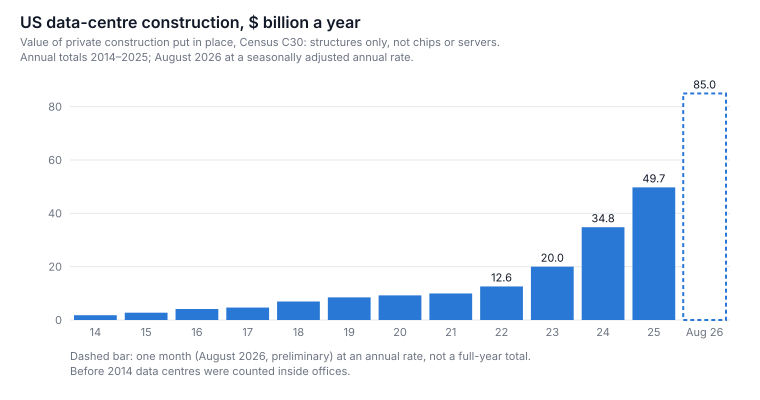
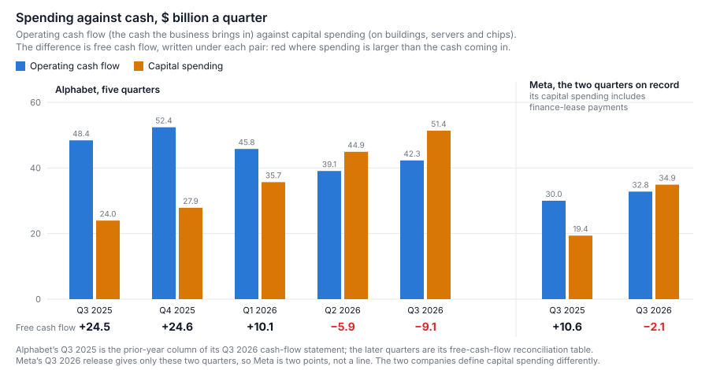
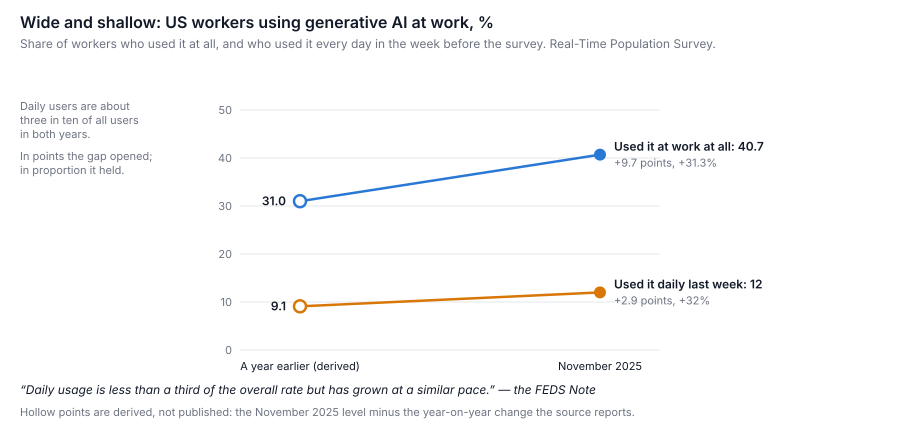
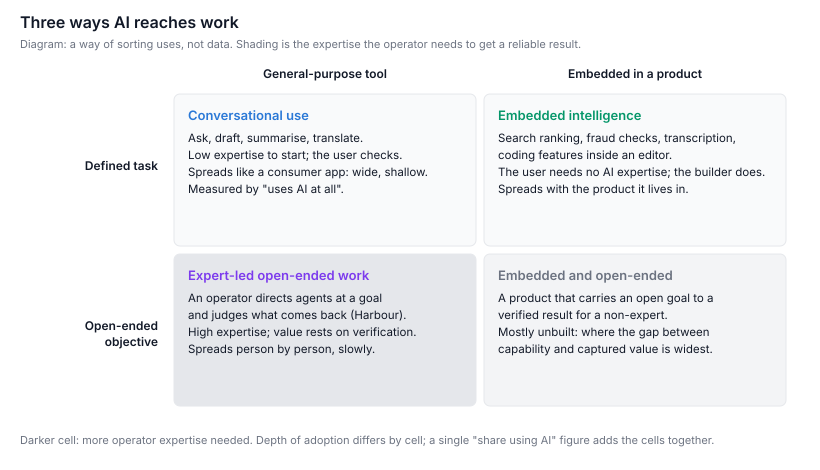
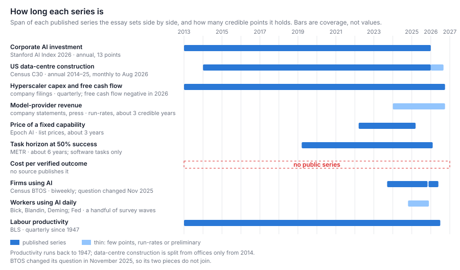
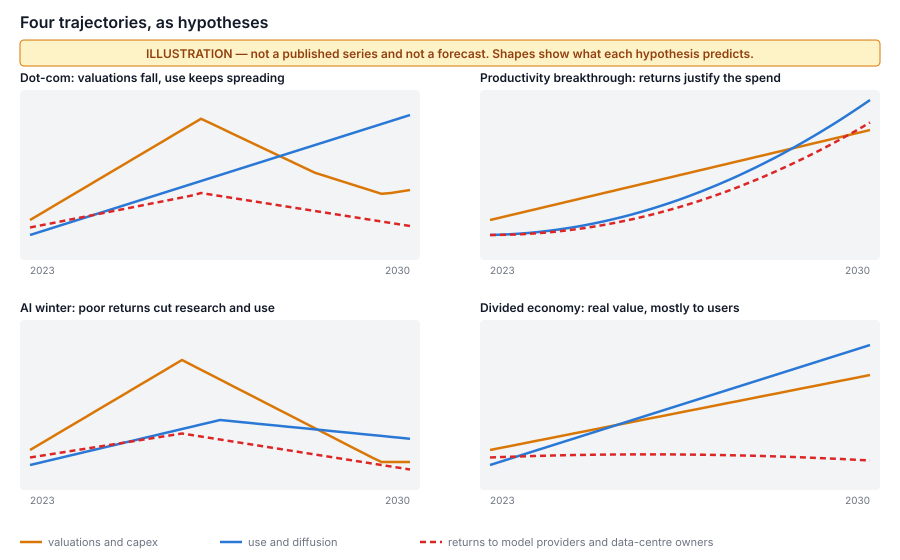
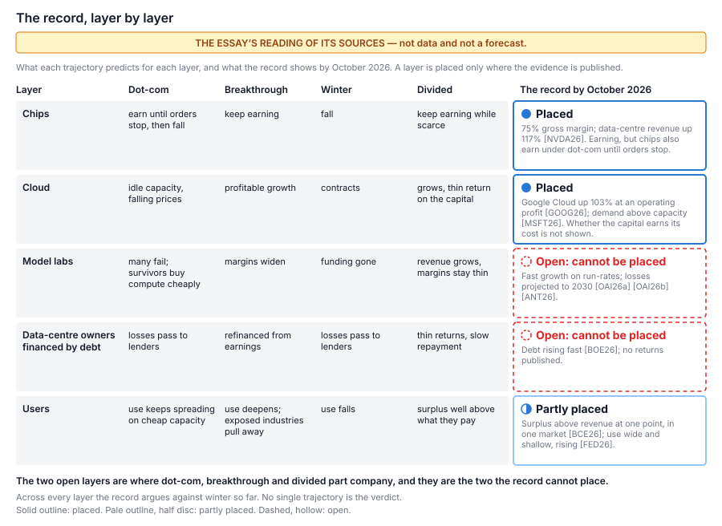

# The Price of Tomorrow

*AI investment, technological progress, and the long journey from capability to economic value*

Prepared for John Kershaw | October 2026

Financial markets have priced artificial intelligence as though new capability turns into profit for the companies that build it, and turns into it soon. The record to October 2026 does not yet support that, but it does not support a crash either. The models grow more capable and the price of that capability falls fast. Whether the cost of getting a piece of useful, checked work out of them falls as fast is unknown, because nobody measures it. Use is spreading wide but staying shallow, and national productivity is still on its long-run trend. Where value can be measured, most of it goes to the people using AI; among the suppliers, the sellers of scarce chips are the ones visibly earning. The one gap measured well enough to give a direction is widening: two of the largest buyers are spending more than their businesses bring in. So the answer to "is it a bubble?" is likely to differ by layer of the industry rather than be one verdict, and whether the money and the adoption run on separate clocks is not yet decided.

The essay in brief:

- **The money is enormous; the measured gains are small.** Spending on AI is huge and rising fast, while US productivity grows at the rate it has since 1947.
- **The build is now partly paid for with other people's money.** In 2026 Alphabet and Meta each had quarters in which they spent more on buildings and equipment than their businesses brought in, and by September AI-related borrowing this year was more than double the whole of last year's.
- **So far, most of the value goes to users.** Among suppliers, chip-makers and cloud businesses are earning; the model labs project years of losses.
- **Use is wide but shallow.** About 41% of US workers use AI at work and about 12% use it daily, a proportion that held over the past year.
- **The cost that matters is not measured.** The price of a given level of AI capability falls fast; nobody tracks what it costs to get a piece of work done, checked and accepted.
- **A crash would land differently on each layer of the industry.** The two layers that would decide the question, the model labs and the data-centre owners who borrowed to build, cannot yet be placed.
- **Whether the money and the adoption run on separate clocks is undecided.** A short list of measurements, which ends the essay, could tell by 2030.

A note on reading. A key in brackets, such as [CEN26], marks each borrowed claim and leads to the reading list, which says what the source supports and what it does not. A keyed fact is a published measurement unless marked *Inferred* (a reading, not proven), *Hypothesised* (a proposed mechanism) or *Predicted* (an outcome that would test one). It is the sequel to [Learning While the Tools Change](learning-while-the-tools-change.md) [H-LWT], which asked the same question of a team of developers that this essay asks of the economy.

## Why hasn't the money shown up yet?

Because the spending is real and fast, while the economic gains so far are either too small or too early to see, and the evidence cannot yet say which.

John asked whether this is a revolution whose financial expectations arrived too early, or a boom whose promised revolution will never fully arrive. Both can be true at once, in different layers of the same economy, and the next four years can tell them apart if the right things are measured.

Start with what can be counted. Global corporate investment in AI went from $14.6 billion in 2013 to $581.7 billion in 2025 [AII26]. In 2014 the United States put up $1.8 billion of data-centre buildings; in 2025, $49.7 billion; and in August 2026 spending ran at an annual rate (the month scaled up to a year) of $85.0 billion, 73% above a year before [CEN26]. Those are buildings only, not the chips and servers inside them.

*Figure 1. US data-centre construction, structures only. Source: Census Bureau, Construction Spending (C30), annual tables and monthly seasonally adjusted series [CEN26].*

The biggest buyers are hyperscalers, the few firms that run cloud data centres at global scale and rent out the computing. Alphabet alone spent $51.4 billion on property and equipment in the third quarter of 2026 [GOOG26]. The St. Louis Fed estimates that AI-related spending accounted for 39% of US growth in the first three quarters of 2025, against 28% in 2000 [STL26]. But much of the equipment is imported: the latest national accounts name capital goods as the largest contributor to imports in the same release that names information-processing equipment as the leader of equipment investment [BEA26]. So the boom adds less to American output than to American spending.

And yet output per hour worked in the US has grown at 2.1% a year since the end of 2019, exactly its rate since 1947 [BLS26]. That is the puzzle.

## Who is paying for the build?

Increasingly, people other than the builders: the largest buyers' spending has outrun the cash their businesses generate, and borrowing and new shares are filling the gap.

Until 2026 the standard reply to "bubble" was that the biggest spenders paid from their own pockets, unlike the telecom carriers of 1999, which borrowed. That reply weakened this year. The measure that shows it is free cash flow: the cash a business brings in from its operations, minus what it spends on buildings and equipment. Alphabet's was $24.5 billion in the third quarter of 2025 and −$9.1 billion a year later; over that year its capital spending more than doubled while the cash from its business fell [GOOG26]. Meta's turned negative in the third quarter of 2026 [META26], and a week later Meta raised $37.5 billion by selling new shares [META26b]. The Bank for International Settlements, the central banks' own bank, says the five largest hyperscalers' AI spending across 2025 and 2026, over a trillion dollars, is "outpacing earnings and the free cash flow of these firms" [BIS26].

*Figure 2. Capital spending overtook operating cash at Alphabet during 2026, and at Meta in the third quarter. Meta's figure includes finance-lease payments and Alphabet's does not. Source: Form 8-K Exhibit 99.1 for Q3 2026: Alphabet's free-cash-flow reconciliation and cash-flow statement [GOOG26]; Meta's cash-flow statement [META26].*

So the financing has moved into credit markets. The Bank of England's Financial Policy Committee, citing Morgan Stanley, recorded about $450 billion of AI-related debt issued in 2026 by early September, more than double the whole of 2025. It also cites an estimate that $700 billion of data-centre spending over 2026–28 will be financed by private credit: loans from investment funds rather than from banks or public bond markets [BOE26]. Debt changes what a disappointment does. A loss on shares falls on the people who chose the risk; a loss on loans passes to whoever lent.

The revenue at the frontier is real and rising, but much of it is reported as run-rate revenue: a recent month's or quarter's sales scaled up to a year, not a year's booked sales. OpenAI's chief financial officer reported annualised revenue above $20 billion in 2025, up from $6 billion in 2024 [OAI26a]. A company presentation seen by the Financial Times projects $350 billion of revenue in 2030, against about $856 billion of spending on computing and $278 billion of cash burned from 2026 to 2030 [OAI26b]. Anthropic reported run-rate revenue above $47 billion in May 2026 [ANT26]. These are company or press figures, not audited accounts. The bet they describe is that revenue grows about tenfold in four years, and that those who paid for the computing collect it.

Sequoia's David Cahn put the gap in one number in 2024: the industry needed $600 billion a year of revenue it did not have, and the shortfall would "cause harm primarily to investors" [SEQ24]. That is the bubble argument at its strongest. It is not that the technology fails. It is that the people financing it may not be the people paid by it.

### The case that it is not as overvalued as it looks

The public companies look less stretched than the dot-com leaders did, and their customers are queueing. In October 2025 the seven largest US technology stocks were priced at a median of 25 times the profits analysts expect of them, about half the multiple of the seven largest companies at the dot-com peak, and US AI investment was below 1% of national output, against roughly 1.5–2% at the peaks of 1920s electrification and the 1990s IT boom [GS25]. Goldman Sachs sells securities, so this is an argued position, but the arithmetic can be checked. Nvidia's data-centre revenue more than doubled in a year [NVDA26]. Google Cloud's quarterly revenue rose 103% on a year earlier and made an operating profit [GOOG26]. Microsoft says "customer demand continues to exceed available capacity" [MSFT26]. A boom in which buyers queue is not one in which capacity sits idle.

History also cautions against the word "bubble". The Richmond Fed's study of the 1990s telecom boom called it a forecasting error about demand, not a bubble that burst [CHW03]: just as costly, but afterwards the cable stayed in the ground. The BIS groups the canal and railway manias, 1920s electrification and the dot-com boom as episodes sharing "a genuine technological breakthrough that attracted capital in excess of what commercial returns could ultimately justify" [BIS26]. The breakthrough was real each time. The returns were not where the capital went looking for them.

## Who gets the value so far?

Mostly the people using AI; among the suppliers, those who sell the scarce chips and the cloud capacity.

William Nordhaus estimated that only "a minuscule fraction" of the returns to society from US technological advances between 1948 and 2001 was captured by the firms that produced them; most went to consumers [NOR04]. That is about the whole economy in another era, a base rate for the mechanism, not an estimate for AI.

For AI there is one direct attempt to measure the user side, the consumer surplus: the value people get from something over and above what they pay. Brynjolfsson and colleagues asked representative samples of US adults how much they would need to be paid to give up chatbots for a month. The total came to $116 billion in 2025 and $172 billion in 2026, which the authors say "substantially exceeds" estimated US generative-AI revenue [BCE26]. Three cautions apply. It covers one market, US consumers' chatbot use, so it should not be set against the business sales that make up much of the providers' revenue, including sales through APIs (the connections through which other software, rather than a person, calls a model). It is what people say, not what they spend. And a few heavy users carry most of it: the average valuation is $124.50 a month, the median $11.40. Still, it points the same way as Nordhaus. *Inferred*: so far, generative AI is worth more to its users than its sellers collect, and that is the normal shape for a technology many industries build on, not a sign that the value is imaginary.

Among the suppliers, the value divides again. Nvidia keeps 75 cents of every dollar of sales after the cost of making the product, its gross margin [NVDA26]. The model providers project years of losses [OAI26b]. The data-centre owners are borrowing [BOE26]. *Inferred*: whoever holds the scarce input collects, and whoever competes to sell something interchangeable on top of it may not. A technology can be transformative while most of its investors earn disappointing returns, and the two statements are not in tension.

## Why isn't it in the productivity figures?

Nobody can yet say: the gains might be delayed or might be small, use is wide but shallow, and the cost that would show whether AI work is getting cheaper is not measured.

### Strong in the experiment, faint in the economy

The evidence for gains on single tasks is solid and narrow. In a staggered rollout to 5,179 customer-support agents at one firm, an AI assistant raised issues resolved per hour by 14% on average and by 34% for novice and low-skilled workers [BLR23]. Such results measure a task done faster, inside one organisation, over months.

The evidence against easy generalisation is as solid. In METR's 2025 randomised trial, experienced open-source developers took 19% longer with AI on their own projects, having expected to be faster [METR25]. Its 2026 follow-up estimated that developers took 18% less time with AI, but the ranges around its estimates include a slowdown, and METR calls the result "only very weak evidence" because developers increasingly refuse to work without AI [METR26].

Above the single firm, the numbers shrink. Linking surveys to Danish official records, Humlum and Vestergaard rule out effects on earnings or hours larger than 2%, two years after ChatGPT's launch [HV26]. Acemoglu's model puts the ten-year gain in total factor productivity, the part of growth not explained by more workers or more machines, at no more than 0.66% [ACE24]. US workers report that generative AI assisted between 1% and 5% of their work hours [BBD24]. And national productivity sits on its 2.1% trend [BLS26].

### Delayed, or small?

The standard explanation is the productivity J-curve. A technology many industries build on needs other investment first, mostly in things that are hard to count: reorganised processes, skills, data and software. Early on, that spending is poorly measured, so output looks too low for what is put in; later, when it pays off, output looks too high. Brynjolfsson, Rock and Syverson estimate that counting the hard-to-measure investment that went with computer hardware and software puts US productivity in 2017 15.9% above the official level [BRS21]. Paul David made the older version of the argument: the electric dynamo raised factory productivity only after factories were rebuilt around it, decades later [DAV90]. In the 1990s computers did show up, accounting for about two-thirds of that decade's rise in productivity growth [OS00], and across two centuries the average lag between a technology's invention and a country's adoption was 45 years [CH10].

All of that is consistent with AI's gains being delayed. None of it shows they are. A J-curve explains how a real gain could hide; it is not evidence that one is hiding. In 2026 a flat productivity line is what both a delayed large effect and a prompt small one look like. *Hypothesised*: the difference will show first in the spread between industries. If the gains are real and delayed, the industries most exposed to AI should pull away from their own pre-2023 trends before the national figure moves; if the gains are small, they should not. About 80% of US workers have at least a tenth of their tasks exposed to language models, though that estimate says nothing about timing [ELO23].

One warning: cause can run from growth to investment as easily as the other way, and series that rose together from 2023 to 2026 share causes such as interest rates and a decade of cloud building, so their moving together shows nothing about which drives which.

### Wide and shallow

Use is spreading fast, but it is not getting proportionally deeper. In November 2025 about 41% of US workers used generative AI at work and about 12% daily; both rose by about a third in a year, so daily users stayed at about three in ten of all users [FED26].

*Figure 3. Breadth and depth of use at work, a year apart. The year-earlier points are derived as the level minus the reported change. Source: Federal Reserve Board, FEDS Notes, "Monitoring AI Adoption in the U.S. Economy", Table 2, from the Real-Time Population Survey [FED26].*

Firms give different answers depending on who is asked: 78% of firms in the Atlanta Fed's survey of executives, weighted by employment, against 19.8% in the Census Bureau's business survey in May 2026 [FED26] [BTOS26]. The Census changed its question in November 2025, so its series is two pieces that do not join [BTOS26].

The gap between "uses AI at all" and "uses it every day for work" is the one that matters for productivity. Much use is not work at all: on ChatGPT's consumer plans, non-work messages rose from 53% to more than 70% between late 2022 and mid-2025 [CHA25]. Depth also differs by channel. On Claude, 77% of conversations through the API showed automation patterns, the model doing the task rather than helping a person do it [AEI25]. That is one vendor's traffic, but it hints that depth lives in software that calls a model more than in people chatting with one.

### Three routes to work

AI reaches work by at least three routes, with different economics.

*Figure 4. Three routes by which AI reaches work, and a fourth that is mostly unbuilt. A way of sorting uses, not data. Source: the essay's own framework.*

**Conversational use**: a person asks a general-purpose model to draft or explain, and checks the answer. It spreads fast and shallow, and it is what most adoption surveys measure. *Inferred*: that may be why their headline numbers are high and their productivity numbers low. **Embedded intelligence**: a model inside a product someone else built, such as fraud checks. The user needs no AI expertise, and it spreads at the pace of software sales. **Expert-led open-ended work**: an operator points capable agents at a goal and judges what comes back. Its value depends almost entirely on the operator's ability to check the result, and it spreads person by person.

The fourth cell, a product that takes an open goal to a checked result for someone who is not an expert, is mostly unbuilt. *Hypothesised*: that is where the distance between what AI can do and the value anyone captures is widest, and where the industry's revenue projections implicitly place most of their growth. If it fills, the optimistic trajectories below become likely; if it stays empty, they do not.

### The cost that matters is not measured

Three measures of cost are easy to run together and must be kept apart. The first is the price of a fixed level of capability. Epoch AI found it falling between 9 and 900 times a year depending on the task, over about three years, with the fastest falls the least certain to last [EPO25]. The second is the task horizon: the length of task, timed by how long a skilled person takes, that models finish half the time. METR found it doubling roughly every seven months over six years, and faster in its 2026 update [METR-H]. That is software work, at a 50% success rate.

The third is the cost of a successfully verified outcome: what it costs to get one piece of work done, checked and accepted. **No public series measures it.** Kapoor and colleagues argue that AI agents should be judged on cost and accuracy together [KAP24], and leaderboards report snapshots, but nobody tracks the cost of a verified result over time, so nothing has been observed about its trend. *Hypothesised*: it falls more slowly than the price of capability, because checking, coordination and the extra work a system generates for itself do not get cheaper when the computing does. That is a reason to measure it, not a finding, and the last section proposes how.

## One operator's example

Harbour, where this essay is written, is an example of the third route, offered as an illustration, not as evidence about the economy. It is software that one experienced engineer, John Kershaw, uses to send AI coding agents to work on tickets, have other agents review what comes back, and count a change as done only when it has merged and passed review. With an expert operator and particular workflows, it says something about what the third route can do and very little about how common it will become.

**Does it raise the amount of valuable work, or only the amount of work?** Over sixty days to 12 September 2026, Harbour's tracker gained 2.1 tickets for every one it closed, most raised by the agents' own reviews, and 52% of the tickets the agents generated were never worked [H-TGT]. Units of related work that reached done caused 1.52 further units each; the rest caused 0.18 [H-RTR]. A hand reading of forty never-worked tickets found 34 still true [H-NWP]. *Inferred*: the agents raise the amount of work attempted a great deal; much of it is real; a minority is finished; and finished work generates more work than it closes. Whether the *valuable* output per attempt has risen was not measured. It goes to Next as a proposal, not to this essay as a finding.

**What does a verified change cost?** Harbour cannot say either: its cost per verified task reads empty, because its price table lacks rows for the models now doing the work [H-PROP]. Its papers do show why that cost need not follow the price of capability. A trial of cheap models found they could implement small tickets, "and the review is the cost" [H-CI]. A survey of the literature found every source that measures it naming verification as the gate on giving agents more autonomy [H-VER]. And a paper from October 2026 found that cheaper models now cleared the bar it had measured, so moving work to them could in principle carry two to three times the work for the same money, untried on a real ticket [H-CC]. Nothing has been observed about the trend in the cost of verified work, for Harbour or for the economy.

## Are the gaps widening or narrowing?

One gap is measured well enough to have a direction, spending against cash, and it is widening; the gaps that would decide who captures the value are too short to tell or not measured at all.

The series are very unequal: productivity runs back to 1947, the price of capability about three years, and the cost of a verified outcome not at all.

*Figure 5. How long each series is; bars are coverage, not values. Sources: those named on each row, all in the reading list.*

The table gives a direction only where both sides have at least two credible points that can be compared.

| Pair | Points behind it | Direction |
|---|---|---|
| Big buyers' capital spending against their operating cash | Alphabet, five quarters; Meta, two [GOOG26] [META26] | **Widening** |
| AI investment against model-provider revenue | revenue is one company's run-rate, two years [OAI26a] [AII26] | Too short to tell: narrowing as a ratio, widening in dollars |
| Value to users against what sellers collect | surplus, two years; no revenue on the same basis [BCE26] | Too short to tell |
| Price of capability against cost of a verified outcome | about three years; no series [EPO25] | Cannot be told |
| Task length models complete against daily use at work | six years; two survey points [METR-H] [FED26] | Widening, *Inferred* |
| Any use at work against daily use | two survey points [FED26] | Holding, in proportion |
| Investment and use against productivity | quarterly since 1947 [BLS26] | Widening, but it tells nothing apart |

**Spending against cash** is the best-measured gap in the essay, and it has opened in each quarter of 2026 (Figure 2). It does not say whether the spending will pay; it says two of the largest buyers now spend more than their businesses generate.

**Investment against revenue** gives two answers. In the one year with both on record, OpenAI's revenue rose about 3.3 times and private AI investment 2.3 times, so the ratio narrowed, but in dollars the gap widened by about $180 billion [OAI26a] [AII26]. One company over one year cannot settle which reading holds.

**Value against capture** is the gap the divided reading below depends on most. The consumer surplus rose by about half between 2025 and 2026 [BCE26]; OpenAI's revenue tripled in the year before [OAI26a]. The two share no year and measure different markets. If revenue keeps growing faster than the surplus, the ratio narrows, which would count against the divided reading. Two points cannot say.

**Capability against depth** widens only loosely: *Inferred*, what models can do grows by multiples while what most workers ask of them daily grows by points. **Everything against productivity** widens too, and tells least, since a delayed large effect and a prompt small one both predict it.

The result is lopsided. The one gap with a direction sits in the financing layer. The gaps that would decide who captures the value, surplus against revenue and the price of capability against the cost of verified work, are too short to tell or not measured. That is why the next two sections are hypotheses, and the last is the essay's result.

## What would a crash do?

It would push in several directions at once, and differently in each layer of the industry, which is why no single verdict fits the record.

Each effect below is *Hypothesised* unless it cites a source.

- **Spare computing could make AI cheaper.** Capacity outlasts the financing and its price falls, as the telecom bust left fibre that later carried the internet [CHW03]. How quickly is not measured.
- **Funding could dry up for frontier work and start-ups,** slowing capability a model generation later.
- **Providers could raise prices.** Today's prices sit beneath projected losses [OAI26b], and a workflow that pays at a subsidised price may not pay at a sustainable one. This pulls against the first effect.
- **Consolidation would reduce competition,** helping the surviving providers and hurting users.
- **Small, efficient models could spread capability anyway.** Prices have fallen fastest at the bottom of the range [EPO25], and a cheap model that does a defined task well needs no frontier lab.
- **A provider in distress could strand what is built on it.** Products and practices tuned to one model do not move freely; the third route is most exposed.

These effects shape the four trajectories John asked to be weighed: competing hypotheses, not predictions.

*Figure 6. The four trajectories as shapes each hypothesis predicts, 2023 to 2030: an illustration, not a published series or a forecast. Source: the essay's own hypotheses.*

- **Dot-com.** Valuations and capital spending collapse; use keeps spreading on the cheap capacity left behind. This is the telecom story [CHW03] and the most common pattern in the BIS's list [BIS26].
- **Productivity breakthrough.** Returns arrive fast enough to justify much of the spending: frontier revenue grows roughly as projected, the fourth cell fills, and exposed industries pull away from their trends.
- **AI winter.** Poor returns cut research, infrastructure and adoption together.
- **Divided economy.** The technology delivers real value, mostly to its users, while suppliers struggle to earn a return: the shape of Nordhaus's base rate [NOR04].

Stated for the industry as a whole, these cannot be told apart in 2026. But the layers of the industry already behave differently, so each trajectory is better judged by what it predicts for each layer.

*Figure 7. What each trajectory predicts for each layer, and the record by October 2026: the essay's reading, not data. Sources: those keyed in the record column.*

- **Chips and cloud are placed, and they contradict the divided economy as the brief stated it.** These suppliers are earning, not struggling. But a high chip margin today does not tell dot-com from breakthrough: under dot-com the chip layer also earns until orders stop. And a cloud business's operating profit does not yet show whether the capital behind it earns its cost.
- **Model labs and data-centre owners cannot be placed.** The labs' figures are run-rates and private projections, and the owners' returns are not published. These are the two layers where dot-com, breakthrough and divided part company.
- **Users are partly placed.** At one point in time, in one market, they get more than they pay. Whether that gap is growing is too short to tell.
- **The record argues against winter, so far.** Every adoption series rose through 2025 and the first half of 2026 [FED26] [BTOS26], and the Bank of England recorded the sharp July 2026 fall in AI and chip stocks as orderly, with no spillover to core markets [BOE26]. But a winter would begin with exactly that kind of tremor.

So the record does not sit closest to any one trajectory. It argues against winter so far, places the chip layer and users, and leaves the deciding layers open. The divided economy survives only if it is restricted to model labs and data-centre owners. That restriction is drawn after seeing the chip and cloud figures, so it carries no evidential weight until those two layers' own returns are observed. *Hypothesised*: if a correction comes, it starts in the financing layer and looks like the dot-com case there, because that is where the debt is and where the capacity would outlast it. That is a reading, not a forecast, and the indicators in the last section can overturn it.

## Can the money and the adoption run on separate clocks?

The evidence does not yet say: it shows the two coupled where computing is sold, and it is silent where organisations learn.

The brief assumed two clocks, a fast financial one and a slow one for how a technology spreads. Where computing is sold, the clocks are visibly coupled. Microsoft says demand exceeds capacity [MSFT26], and OpenAI's revenue grew in step with the computing power it could run [OAI26a]: how much AI is sold depends on how much computing is financed. *Hypothesised*: prices are coupled too, because today's prices sit beneath projected losses [OAI26b] and a provider that must service its debts will charge more. How fast a funding shock would reach users through availability and price has not been measured. The coupling would be strongest for the third route and for products that call frontier models, because both buy computing by the unit.

Where organisations learn, the evidence shows that use is shallow: daily use at 12% against 41% any use [FED26], no measurable effect on earnings and hours two years in [HV26], and 1–5% of hours assisted [BBD24]. It does not show why. Shallow use fits a limit in what organisations have learned to do, which dearer computing would hardly move. It fits equally well a limit in what they can buy and what has been built for them, which a funding shock would tighten. Money can reach organisational learning by two routes named in the previous section. Young companies build many of the embedded products through which organisations get depth without expertise, so when start-up funding dries up, those products arrive later. And practices tuned to one provider's models are stranded if it fails, so an organisation can lose what it has learned. Both routes act over a product cycle, which is why the 2026 data cannot yet see them.

The two readings predict different things, which is what makes the question worth keeping open.

- **Separable where organisations learn.** After a funding shock, prices and frontier releases move, but depth keeps its trend: daily use, assisted hours and firm use carry on rising, and embedded products keep shipping on cheaper models and open-weight ones (models whose trained parameters are published for anyone to run).
- **Coupled at both ends.** Depth stalls or dips a few quarters after a shock. Fewer new embedded products appear. Firms tied to a distressed provider report abandoned workflows.

*Hypothesised*, and no more: the clocks are coupled through the supply and price of computing; whether they are also coupled through organisational learning is undecided. *Predicted*: the first test is whether adoption depth holds through a funding shock. The 2026 sell-offs are small natural experiments. The Census's fortnightly business survey runs straight through them and, on its new basis, can be read before and after each one [BTOS26]; the worker survey adds daily use [FED26]. If depth dips after a shock, the clocks are coupled at both ends. If it holds for several quarters, the separable reading gains ground, though it cannot be confirmed until the slower start-up and stranded-tooling routes have had time to act.

## What to watch, 2027–2030

A short list of measurements would tell the trajectories apart as they unfold, because the four predict different things for each.

Lighthouse, a lean research process John runs beside Harbour [H-SB], could track all but the last two from published sources; those two are Harbour's to investigate from its own record. The first three rows matter most.

| Indicator | What it would tell apart | Published by |
|---|---|---|
| **Cost per verified outcome on a fixed basket of checkable tasks, re-run quarterly** | Falls fast under breakthrough, stalls under winter. Unpublished, yet it measures what the economy buys | nobody yet; Lighthouse would build it |
| **Productivity of AI-exposed against unexposed industries, each against its pre-2023 trend** | Opens under breakthrough and divided, lags under dot-com. The cleanest test of delayed against small gains | BLS, paired with an exposure measure |
| **Consumer surplus against provider revenue** | High and rising under divided, falling under breakthrough. Value created against value captured | repeat surplus surveys; company revenue |
| Big buyers' capital spending against operating cash; the debt share of AI financing | Rises then breaks under dot-com; falls as cash catches up under breakthrough | company filings; Bank of England, BIS |
| Model providers' booked revenue and margins (not run-rates) | Margins collapse under dot-com, widen under breakthrough, stay thin under divided | filings where listed |
| Price for a fixed capability, and the price charged for a fixed workload | Rises or stalls only under winter | Epoch; provider price sheets |
| Task length completed at 80% success, not 50% | Accelerates under breakthrough, stalls under winter | METR or a successor |
| Daily use against any use; firm use by size | Keeps rising through a crash under dot-com; falls under winter | Fed and Census surveys |
| Computing rental prices and data-centre use | Rentals collapse under dot-com; capacity idle under winter | rental indices; Census construction |
| Number of frontier providers, and how far open-weight models lag | Consolidation under dot-com and winter; many and cheap under divided | release logs; benchmarks |
| Harbour's cost per verified change, monthly since August 2026 | One operator's version of the first row | Harbour's cost record, once priced |
| Share of attempted work that reaches done and survives 30 days, per dollar | Whether agents raise valuable work or only work | Harbour's throughput and cost records |

## Annotated reading list

This is a selective essay, not a systematic review. Each entry gives the reference, the label
it carries, what it supports here and what it does not. Every figure used was read at the
source on 29 October 2026; where a source could not be opened in full, the entry says so.
*Observed* means a published measurement, an experiment or established history. *Inferred*
means a reading that explains several observations but is not causally established.
*Hypothesised* means a proposed mechanism, usually where data is missing. *Predicted* means a
development that would support or contradict a hypothesis. In the body a keyed fact is
Observed unless it says otherwise.

### The build and its financing

- **[CEN26]** Census Bureau, Construction Spending (C30), private construction, annual tables 2012–2025 and monthly seasonally adjusted series, release of 1 October 2026. https://www.census.gov/construction/c30/xlsx/privateha2.xlsx · https://www.census.gov/construction/c30/xlsx/privsatime.xlsx. *Observed.* Supports the data-centre series (2014 $1.8bn; 2025 $49.7bn; August 2026 $85.0bn annual rate against $49.1bn in August 2025) and the figure. Does not cover chips or servers; before 2014 data centres sit inside offices; monthly figures are preliminary and revised.
- **[AII26]** Stanford HAI, *AI Index Report 2026*, Economy chapter. https://hai.stanford.edu/ai-index/2026-ai-index-report/economy. *Observed.* Supports corporate AI investment of $14.57bn (2013) and $581.69bn (2025) and private investment of $344.66bn, up 127.5%. Built on a commercial deal database whose back-series is revised between editions; does not measure spending on compute directly.
- **[STL26]** Rubinton, H. and Patro, B. A. "Tracking AI's Contribution to GDP Growth." St. Louis Fed, 12 January 2026. https://www.stlouisfed.org/on-the-economy/2026/jan/tracking-ai-contribution-gdp-growth. *Observed.* Supports 0.97 percentage points and 39% of growth (first three quarters of 2025) against 0.81 and 28% in 2000. Does not net out imports, and the 2000 figure excludes data centres.
- **[BEA26]** BEA, GDP advance estimate, third quarter 2026, 29 October 2026. https://www.bea.gov/news/2026/gdp-advance-estimate-3rd-quarter-2026. *Observed.* Supports the import point: information-processing equipment led equipment investment and capital goods led imports. An advance estimate, revised in November.
- **[GOOG26]** Alphabet, Form 8-K Exhibit 99.1, Q3 2026, 28 October 2026. https://www.sec.gov/Archives/edgar/data/1652044/000165204426000080/googexhibit991q32026.htm. *Observed.* Supports purchases of property and equipment of $51.4bn (Q3 2026) against $24.0bn (Q3 2025), operating cash flow of $42.3bn against $48.4bn, quarterly free cash flow of $24.5bn, $24.6bn, $10.1bn, −$5.9bn and −$9.1bn from Q3 2025 to Q3 2026 (the Q3 2025 figure computed from the same statement's prior-year column), and Google Cloud revenue of $30.7bn, up 103% at an operating profit. Free cash flow is the company's own non-GAAP measure. For Figure 2, the free-cash-flow reconciliation table gives operating cash flow and purchases of property and equipment of $52.4bn and $27.9bn (Q4 2025), $45.8bn and $35.7bn (Q1 2026), $39.1bn and $44.9bn (Q2 2026) and $42.3bn and $51.4bn (Q3 2026); Q3 2025 ($48.4bn and $24.0bn) is the cash-flow statement's prior-year column (read at source on 29 October 2026, in $ millions, rounded here).
- **[META26]** Meta Platforms, Form 8-K Exhibit 99.1, Q3 2026, 21 October 2026. https://www.sec.gov/Archives/edgar/data/1326801/000162828026066700/meta-09302026xexhibit991.htm. *Observed.* Supports capital expenditure of $34.91bn including finance-lease principal, operating cash flow of $32.79bn, free cash flow of −$2.12bn and 2026 guidance of $135–145bn; and, from the prior-year column, $19.37bn, $30.00bn and $10.63bn for Q3 2025 (Figure 2 rounds these to one decimal). Meta's quarterly release gives only these two quarters; its capital expenditure includes finance-lease principal, Alphabet's does not.
- **[META26b]** Meta Platforms, prospectus supplements (424B5), 28 October 2026. https://www.sec.gov/Archives/edgar/data/1326801/000119312526436410/d94886d424b5.htm · https://www.sec.gov/Archives/edgar/data/1326801/000119312526436405/d133631d424b5.htm. *Observed.* Supports 40 million shares at $625 by forward sale ($25bn) and $12.5bn of 6.50% mandatory convertible preferred. Does not say what the proceeds are for beyond general corporate purposes; the link to AI spending is *Inferred* from timing.
- **[NVDA26]** NVIDIA, CFO Commentary on Q2 Fiscal 2027 Results, 26 August 2026. https://www.sec.gov/Archives/edgar/data/1045810/000104581026000073/q2fy27cfocommentary.htm. *Observed.* Supports data-centre revenue of $89.0bn, up 117%, and a 75.0% gross margin. Does not show who the end customers are or what they earn.
- **[MSFT26]** Microsoft, FY26 Q4 earnings call, 29 July 2026. https://www.microsoft.com/en-us/investor/events/fy-2026/earnings-fy-2026-q4. *Observed* as a statement by the company's CFO: "Customer demand continues to exceed available capacity"; capital expenditure of $41bn; Azure growth of 43%. A company's account of its own demand, not an independent measure.
- **[BOE26]** Bank of England, Financial Policy Committee Record, September 2026. https://www.bankofengland.co.uk/financial-policy-committee-record/2026/september-2026. *Observed* as the committee's record; the debt totals are Morgan Stanley's and JPMorgan's estimates as the record cites them ($450bn of AI-related debt in 2026 by early September; $700bn of data-centre spending over 2026–28 from private credit; $4.1tn of debt-financed AI spending over 2026–30), and the July 2026 sell-off with no spillover to core markets. Does not give its own estimate of losses.
- **[BIS26]** BIS, *Annual Economic Report 2026*, chapter I. https://www.bis.org/publications/aer-2026/progress-peril. *Observed* for the hyperscaler spending and concentration figures (over $1tn across 2025–26, "outpacing earnings and the free cash flow"; the largest 30 S&P 500 stocks at 56% of the index on 26 March 2026); *Inferred* for its historical grouping of canal, railway, electrification and dot-com booms, which is an interpretation of other eras.
- **[GS25]** Goldman Sachs Global Investment Research, *Top of Mind* issue 143, "AI: in a bubble?", October 2025. https://www.goldmansachs.com/pdfs/insights/goldman-sachs-research/ai-in-a-bubble/report.pdf. *Inferred*: a sell-side house view. Supports the valuation comparison (median 24-month forward P/E of 25 for the seven largest US technology stocks, about half the dot-com equivalent), AI investment below 1% of US GDP against 1.5–2% and 2–5% for earlier booms, and the "80% debt and 20% equity" remark. A year old; does not cover 2026's cash-flow turn.
- **[SEQ24]** Cahn, D. "AI's $600B Question." Sequoia Capital, 20 June 2024. https://www.sequoiacap.com/article/ais-600b-question/. *Inferred*: an investor's back-of-envelope calculation. Supports the method (Nvidia revenue doubled for data-centre cost, doubled again for margin) and the view that losses fall "primarily to investors". Does not measure revenue.
- **[OAI26a]** Reuters, "OpenAI CFO says annualized revenue crosses $20 billion in 2025", 19 January 2026. https://finance.yahoo.com/news/openai-cfo-says-annualized-revenue-173519097.html. *Observed* as a company statement reported by Reuters: over $20bn annualised in 2025 against $6bn in 2024; compute 1.9GW against 0.6GW. Unaudited; annualised, not booked.
- **[OAI26b]** Reuters, citing the *Financial Times*, "OpenAI forecasts cash burn near $280 billion by 2030", 19 September 2026. https://www.thestar.com.my/tech/tech-news/2026/09/19/openai-forecasts-cash-burn-near-280-billion-by-2030-ft-reports. *Predicted* by the company in a presentation the FT saw: $278bn of cash burn over 2026–30, about $856bn of compute spending, revenue from $36bn (2026) to $350bn (2030). Second-hand reporting of a private projection.
- **[ANT26]** Anthropic, Series H announcement, 28 May 2026. https://www.anthropic.com/news/series-h. *Observed* as a company statement: $65bn raised at $965bn post-money; run-rate revenue above $47bn. Unaudited.
- **[CHW03]** Couper, E. A., Hejkal, J. P. and Wolman, A. L. "Boom and Bust in Telecommunications." Richmond Fed *Economic Quarterly* 89(4), 2003, 1–24. https://www.richmondfed.org/-/media/RichmondFedOrg/publications/research/economic_quarterly/2003/fall/pdf/wolman.pdf. *Observed*, another era. Supports communications-equipment investment from about $62bn to over $135bn a year (1996 dollars, 1996–2000), the fall to 4.8% of private investment by 2002, and the authors' rejection of the "bubble that burst" reading. A mechanism to consider for AI, not an estimate of it.

### Value created and captured

- **[NOR04]** Nordhaus, W. D. "Schumpeterian Profits in the American Economy: Theory and Measurement." NBER Working Paper 10433, 2004. https://www.nber.org/papers/w10433. *Observed*, another era: "only a minuscule fraction" of the social returns from technological advances over 1948–2001 was captured by producers. The abstract was read; the paper's own percentage could not be extracted from the PDF and is not used. About the whole economy, not AI.
- **[BCE26]** Brynjolfsson, E., Collis, A., Eggers, F., Kazinnik, S. and Nguyen, D. "What is Generative AI Worth?" Stanford Digital Economy Lab, 13 April 2026. https://digitaleconomy.stanford.edu/publication/what-is-generative-ai-worth/. *Observed* as a stated-preference measurement: US consumer surplus of $116bn (2025) and $172bn (2026); 98 to 115 million users; mean monthly valuation $98 to $124.50, median $3.40 to $11.40; "substantially exceeds" US generative-AI revenue. Stated, not revealed, preferences; a working paper.

### Productivity

- **[BLR23]** Brynjolfsson, E., Li, D. and Raymond, L. "Generative AI at Work." NBER Working Paper 31161, 2023; *Quarterly Journal of Economics* 140(2), 2025. https://www.nber.org/papers/w31161 · https://doi.org/10.1093/qje/qjae044. *Observed.* Supports 5,179 agents, 14% more issues resolved per hour, 34% for novice and low-skilled workers (working-paper figures; the published version reports a slightly different average). One firm, one occupation.
- **[METR25]** METR, early-2025 study of experienced open-source developers, 10 July 2025. https://metr.org/blog/2025-07-10-early-2025-ai-experienced-os-dev-study/. *Observed.* Supports the 19% slowdown for experienced developers on their own repositories, against their expectation of a speed-up. A small sample of one kind of developer.
- **[METR26]** METR, uplift update, 24 February 2026. https://metr.org/blog/2026-02-24-uplift-update/. *Observed.* Supports the 2026 estimates (57 developers, over 800 tasks; 18% and 4% less time, with their intervals) and METR's own description of them as "only very weak evidence". Selection into the study, as developers refuse to work without AI, is the stated problem.
- **[HV26]** Humlum, A. and Vestergaard, E. "Still Waters, Rapid Currents: Early Labor Market Transformation under Generative AI." NBER Working Paper 33777, revised 2026. https://www.nber.org/papers/w33777. *Observed.* Supports precise nulls on earnings and hours, ruling out effects above 2% two years after ChatGPT, in Denmark. Wages and hours, not output; one country.
- **[ACE24]** Acemoglu, D. "The Simple Macroeconomics of AI." NBER Working Paper 32487; *Economic Policy* 40(121), 2025. https://www.nber.org/papers/w32487 · https://doi.org/10.1093/epolic/eiae042. *Hypothesised*: a calibrated model. Supports a ten-year TFP gain of no more than 0.66%, under 0.53% adjusted. Depends on its exposure and cost-saving inputs; excludes new products.
- **[BBD24]** Bick, A., Blandin, A. and Deming, D. J. "The Rapid Adoption of Generative AI." NBER Working Paper 32966. https://www.nber.org/papers/w32966. *Observed* (survey). Supports nearly 40% adult use, 23% weekly and 9% daily work use (late 2024), 1–5% of hours assisted and 1.4% of hours saved. Self-reported.
- **[BLS26]** BLS, Productivity and Costs, second quarter 2026, revised, 3 September 2026. https://www.bls.gov/news.release/prod2.nr0.htm. *Observed.* Supports 2.1% annualised growth since Q4 2019, the same as the rate since 1947. Says nothing about cause.
- **[BRS21]** Brynjolfsson, E., Rock, D. and Syverson, C. "The Productivity J-Curve." *AEJ: Macroeconomics* 13(1), 2021, 333–72. https://doi.org/10.1257/mac.20180386. *Hypothesised* as a mechanism, with one *Observed* estimate (TFP 15.9% above official measures by 2017 after adjusting for computer-related intangibles). Does not show that AI will follow the curve.
- **[DAV90]** David, P. A. "The Dynamo and the Computer." *AER* 80(2), 1990, 355–361. https://gwern.net/doc/economics/automation/1990-david.pdf. *Hypothesised* as a mechanism, from another century. Used for the argument only: electrification raised productivity after factories were reorganised. The scan could not be read as text in this session; no figure from it is used, and the predecessor essay [H-LWT] gives its reading.
- **[OS00]** Oliner, S. D. and Sichel, D. E. "The Resurgence of Growth in the Late 1990s: Is Information Technology the Story?" FEDS 2000-20. https://www.federalreserve.gov/pubs/feds/2000/200020/200020abs.html. *Observed*, another era: IT accounted for about two-thirds of the one-point step-up in productivity growth in the late 1990s. Says nothing about AI's timing.
- **[CH10]** Comin, D. and Hobijn, B. "An Exploration of Technology Diffusion." *AER* 100(5), 2010, 2031–59. https://doi.org/10.1257/aer.100.5.2031. *Observed*, other eras: fifteen technologies, 166 countries, an average adoption lag of 45 years. Lags between countries, not within one.
- **[ELO23]** Eloundou, T., Manning, S., Mishkin, P. and Rock, D. "GPTs are GPTs." arXiv 2303.10130; *Science* 384, 2024. https://arxiv.org/abs/2303.10130. *Hypothesised*: an exposure estimate (80% of workers with at least 10% of tasks exposed, 19% with at least half; 15% of tasks faster with a model alone, 47–56% with model-powered software). Exposure is not adoption; no timeline.

### Adoption

- **[FED26]** Federal Reserve Board, "Monitoring AI Adoption in the U.S. Economy." FEDS Notes, 3 April 2026. https://www.federalreserve.gov/econres/notes/feds-notes/monitoring-ai-adoption-in-the-u-s-economy-20260403.html. *Observed.* Supports work use of about 41% (40.7%, up 9.7 points, or 31.3%, in a year) and daily use of about 12% (up 2.9 points, or 32%) in November 2025, from Table 2 (Real-Time Population Survey); the year-earlier points in Figure 3, 31.0% and 9.1%, are derived as the level minus the reported change and are not published as such; the note's own reading is that daily usage "has grown at a similar pace"; employment-weighted firm adoption of about 78% in the Atlanta Fed survey, BTOS at about 18% at the end of 2025, and the question change. The best single source on breadth against depth; draws no productivity conclusion.
- **[BTOS26]** Census Bureau, story on AI use among businesses, May 2026. https://www.census.gov/library/stories/2026/05/ai-use-businesses.html. *Observed.* Supports 19.8% of businesses (3 May 2026), 17–20% from December 2025 to May 2026, 37% of firms with 250 or more employees, and the November 2025 change of wording. The legacy and new series cannot be joined.
- **[CHA25]** Chatterji, A. et al. "How People Use ChatGPT." NBER Working Paper 34255, 2025. https://www.nber.org/papers/w34255. *Observed*: non-work messages from 53% to more than 70% (November 2022 to July 2025). Consumer plans of one provider.
- **[AEI25]** Anthropic, "Anthropic Economic Index: geography report", 15 September 2025. https://www.anthropic.com/research/economic-index-geography. *Observed* for one provider's traffic: directive conversations from 27% to 39%; automation 49.1% against augmentation 47%; 77% of API conversations showing automation. Not representative of the economy; the vendor classifies its own conversations.

### Capability and its cost

- **[EPO25]** Epoch AI, "LLM inference prices have fallen rapidly but unequally across tasks", 12 March 2025. https://epoch.ai/data-insights/llm-inference-price-trends. *Observed.* Supports falls of 9 to 900 times a year, 40 times for GPT-4-level performance on graduate science questions, over about three years. Published prices per token, not providers' costs; Epoch says the fastest falls are the least certain to persist.
- **[METR-H]** METR, "Measuring AI Ability to Complete Long Tasks", 19 March 2025, and "Time Horizon 1.1", 29 January 2026. https://metr.org/blog/2025-03-19-measuring-ai-ability-to-complete-long-tasks/ · https://metr.org/blog/2026-01-29-time-horizon-1-1/. *Observed.* Supports the 50% horizon doubling about every seven months over six years, the 2026 doubling times (196.5, 130.8 and 88.6 days for the full period, since 2023 and since 2024) and the 320-minute estimate with its interval. Software tasks; 50% success; only five of 31 long tasks timed against humans; no 80% figures in the text; no cost data.
- **[KAP24]** Kapoor, S., Stroebl, B., Siegel, Z. S., Nadgir, N. and Narayanan, A. "AI Agents That Matter." arXiv 2407.01502. https://arxiv.org/abs/2407.01502. *Hypothesised* as a method: agents should be optimised for cost and accuracy jointly. Does not supply a series.

### The Harbour papers

Every Harbour figure is read from a paper already in the archive, at commit `c5245296`; this
essay takes no new measurement. They describe one operator's system and support nothing about
the wider economy.

- **[H-LWT]** [learning-while-the-tools-change.md](learning-while-the-tools-change.md), lines 84 and 90–140. *Inferred.* The predecessor: three clocks, adoption as a distribution across cohorts, and the clocks' dependence on each other. Its reading of David [DAV90] is the one relied on here.
- **[H-TGT]** [tasks-generate-tasks.md](tasks-generate-tasks.md), lines 15–21. *Observed, for Harbour.* 1,484 created against 701 closed in sixty days; 52% of generated tickets never worked.
- **[H-RTR]** [root-task-ratio.md](root-task-ratio.md), lines 15–23 and 37–38. *Observed, for Harbour.* Units that reached done caused 1.52 further units; the rest 0.18; three in four caused none.
- **[H-NWP]** [never-worked-pile.md](never-worked-pile.md), lines 15–23. *Observed, for Harbour*, one reader: 34 of 40 never-worked filings still true, 38 clearly stated, 23 the parent's own scope.
- **[H-MT]** [measuring-throughput.md](measuring-throughput.md), lines 15–24. *Observed, for Harbour.* Used in Next for its definition of a correct, complete change: merged with its ticket done, no escaped fault traced to it within 30 days, none of its work filed as a follow-up. Its weekly counts (about 95 in June, 47 from mid-July) are not used as evidence about cost: they come from a different period from the capacity findings, and Harbour's own analysis attributes the fall to a change of regime, not to the models.
- **[H-CC]** [cheaper-capacity.md](cheaper-capacity.md), lines 14–27. *Observed* for the benchmark and price comparisons, *Predicted* for the capacity multiple; untried on a real ticket, as the paper says.
- **[H-CI]** [cheap-implementer.md](cheap-implementer.md), line 13. *Observed, for Harbour*, thirteen tickets: "the review is the cost".
- **[H-VER]** [what-lowers-the-verification-cost.md](what-lowers-the-verification-cost.md), line 13. *Inferred*: a literature reading that verification is the named gate on autonomy.
- **[H-PROP]** `docs/papers/proposals.md`, line 33. *Observed, for Harbour*: the cost per verified task reads empty because the price table lacks rows for the models now in use.
- **[H-SB]** `docs/steady-base.md`, line 137. *Observed, for Harbour*: Lighthouse is a lean research process with a second-agent review.

## Next

The essay leaves four questions that evidence could answer, and puts them in `proposals.md`.

- **What does a verified outcome cost, and is it falling?** No public series measures the cost
  of getting a piece of work done, checked and accepted, though it is the quantity the economy is
  buying. Lighthouse could build one: a fixed basket of verifiable tasks with hidden acceptance
  tests, re-run each quarter on the then-current models at then-current prices, reporting cost
  per accepted result at a fixed success rate. Kept independent of Harbour, it would separate
  the price of capability from the price of useful work through 2027–2030 and tell the
  four trajectories apart on the axis that matters most.
- **Do AI-exposed industries pull away from their own trends?** The cleanest test of delayed
  against small gains. Pair BLS industry productivity with an exposure measure and track each
  industry against its pre-2023 trend, quarterly; a Lighthouse series, not a Harbour one.
- **Does adoption depth hold through a funding shock?** The first test of whether the financial
  and diffusion timelines are separable where organisations learn. Read the Census's
  biweekly firm survey on its new basis, and the quarterly worker survey's daily use, before and
  after the 2026 sell-offs and any later shock, and keep reading for several
  quarters, since the start-up and stranded-tooling routes act with a lag; a Lighthouse series.
- **Does Harbour's agent fleet raise valuable work, or only work?** Its papers show more work
  attempted, a minority finished, and finished work generating more than it closes, but never
  measured value per attempt. Join the throughput measure (changes that merged, passed review
  and survived 30 days) [H-MT] to the cost record, monthly since August 2026, once the missing price
  rows exist, and report correct, complete changes per dollar at API prices and the share of
  generated tickets that reach that bar.

The remaining indicators in the scorecard can be tracked from published sources without a new
paper. Neither version of this essay is independently checked; a check of its figures against
their sources would be welcome. The claims most worth attacking are the layer placements in
"What would a crash do?" and the directions given in "Are the gaps widening or narrowing?".
