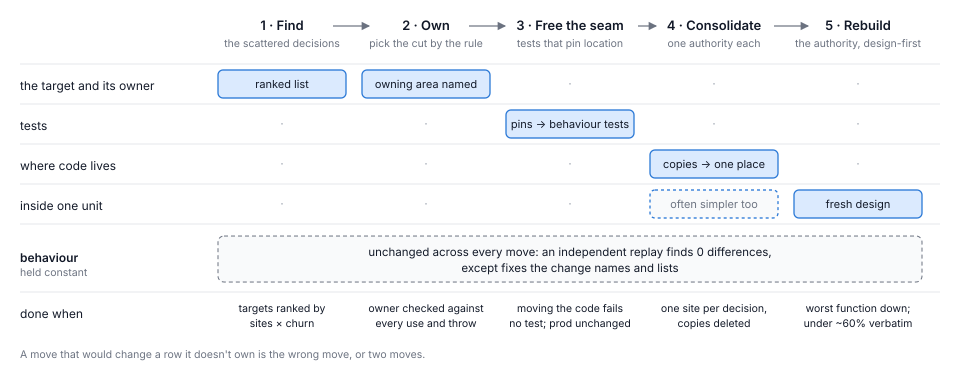
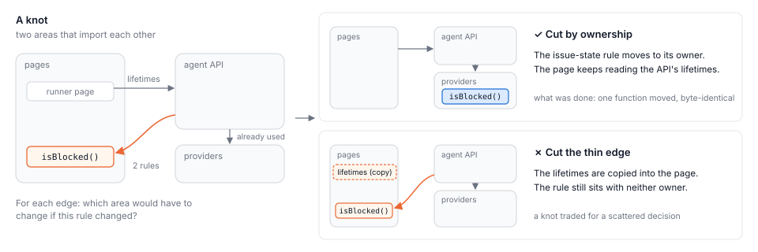

# The Theseus Method

*Gather what is scattered, then rebuild what you gathered*

Prepared for John Kershaw | October 2026

An AI coding agent can now rebuild a module in an hour or two. That changes what is worth doing to a codebase that agents have grown quickly, and it changes it in one direction: towards rebuilding, which used to be the risky and expensive choice, and away from the small, careful edits the old advice prefers. This essay describes a way to rebuild safely. Most of its parts are decades old; what is new is the price, and perhaps the order.

The method in brief:

- **Gather before you rebuild.** A decision written out in many places cannot be rebuilt, because there is no one thing to rebuild. First gather it into the one place that owns it, and delete the copies.
- **Loosen the tests first.** Some tests check where code sits rather than what it does. Replace each with a test of behaviour before anything moves.
- **Then rebuild from a fresh design,** rather than by editing the old code, and measure that the result really is new.
- **Judge by replay, not by the test suite.** Run the old code and the new side by side on the same inputs, and compare everything an outsider could see.
- **Ask people for very little:** a ruling when a review loop will not settle, and answers to open questions when someone has time.

This is the short version. Everything needed to run the method (the runbook, the definitions, the instruments and the full record) is in [the long version](../../theseus-method-long.md) [LONG]. An agent setting out to run the method should start there.

## 1 Two ways a codebase goes wrong

[Plutarch tells](https://www.perseus.tufts.edu/hopper/text?doc=Plut.+Thes.+23.1) of the ship Theseus sailed home from Crete, which the Athenians kept for centuries by replacing each plank as it rotted [PL]. Philosophers argued over whether it was still the same ship. A shipwright would ask something more useful: how do you replace a plank at sea, and which one first?

Harbour, the codebase this method grew out of, has the shipwright's problem. It is a web app that reads a team's issue tracker, writes a prompt for an AI coding agent from each ticket, sends the agent off to do the work and checks what comes back. Its plan for a first public version, [Harbour v1](../../v1.md), sums up the aim as "one person, one task, one proven merge". Each ticket passes through a pipeline of agents, which Harbour calls its [autopilot](../../autopilot.md): they plan the change, review the plan, build it, review the code and merge it. Harbour's own tickets go through the same pipeline. Agents built almost all of it over nine months [H-copy], and quickly: [between June and late September](growth-atlas.md) its production code grew 3.7 times and its tests 9.3 times [H-growth]. It has gone wrong in two different ways.

Some of the code is **tangled inside**. A file grows a function with dozens of branches, and nobody wants to touch it. This kind of mess is easy to see and, it turns out, easy to fix: a rebuild that starts from a fresh design cuts the most complex function in its file (by cyclomatic complexity, roughly the number of paths through it) by a large fraction. Ten such rebuilds on Harbour, over three rounds of experiments in mid-October, cut theirs by between 29% and 88% [H-ladder, H-round, H-consolidate].

Some of it is **scattered between**. One decision ends up written out in several places across several parts of the code, as in Figure 1, and the copies drift. On Harbour, the question of which status marker means an agent's run has stopped to wait for a person was decided in ten places, across eight files and three areas of the code. No single file looks wrong. The bill arrives when the decision changes and the change misses a copy. [Harbour measured that bill](coherence-as-it-grows.md): changes that touched one of these decisions were five times the size of others, review sent them back two and a half times as often, and 45% of the faults that got past review traced to one [H-coherence]. [Research on copied code](https://doi.org/10.1109/ICSE.2009.5070547) found the same, years earlier [J09].

A rebuild cannot fix the second kind, because it works on one place and the decision lives in many. [Seven rebuilds in a row](rebuild-round.md), none of them asked to move anything, left each of the eleven scattered decisions Harbour keeps a count of in exactly as many files as before [H-round]. To fix it, the pieces have to be gathered first.

*Figure 1. The method in one picture. A scattered decision (left) cannot be rebuilt, because there is no one thing to rebuild. Gathering it gives it one place and a boundary (middle). Rebuilding then changes only the inside (right), behind a boundary its callers already use.*

The ship came before the method. On 15 October [a paper](theseus.md) asked which of Harbour's planks to replace first, and [an essay](drawing-the-ship.md) drew the codebase as a ship rebuilt plank by plank [H-theseus, H-ship]. The next day, as the first careful rebuilds passed their checks and before gathering was part of the method, John Kershaw, who owns Harbour, [gave it its name](../../../experiments/rebuild-exp2/NOTES.md?plain=1#L437): "It feels like there's something new here. A Theseus refactor, if you will." [N2]

## 2 Gather first

Gathering a decision does two things. It removes the copies, which is the point. And it leaves behind something a rebuild can work on: one place, with a boundary, that every caller already uses. When the idea was put to John, he agreed and gave the order its clearest form: "I like your idea; 'rebuild' but it's not a lump of code, it's a tangle spread out across multiple areas. It's conceptually for me essentially compact (or consolidated) versus diffuse, dispersed or fragmented. The latter gets targeted first, sets up the seams, then invites the rebuild." [H-consolidate]

Harbour's dispatch entrance shows why the order matters. It is the set of HTTP endpoints that accept requests to start agent runs, and its checks were spread across three route files. A rebuild of those files on its own halved their most complex function, from 122 to 63. But it kept 86% of its lines word for word, which by the measure in section 3 makes it more an edit than a rebuild, and its tests were part of what held it close to the old code. [The third round](consolidate-then-rebuild.md) started from that output. It loosened the tests and gathered the entrance's 24 shared decisions into one module, and that alone took the worst function from 63 to 29. A design-first rebuild of the module then took it to 13 (Figure 2). Nobody tried a second rebuild without the gathering, so the comparison is suggestive, not proven. But gathering did at least as much as the first rebuild had, and it made a real rebuild possible.

*Figure 2. One target, step by step. A rebuild on its own, which kept most of the old lines, halved the worst function; gathering, starting from that output, halved it again; a design-first rebuild of the gathered module more than halved it once more.*

## 3 Five moves

The method is five moves. Each is a step that could be reviewed on its own, and each has one main thing it may change (Figure 3). None changes behaviour: a replay, described in section 4, checks every change to production code, and the one move that changes only tests is checked by moving the code in a scratch copy and by planting faults.

*Figure 3. What each move may change. Production code changes in only two of the five, and gathering often simplifies the inside as a side effect. A move that needs to change another row is usually the wrong move, or two; the exception is a pin or two converted inside a later move, in the order this section describes.*

### Find

First find the scattered decisions, using measures that run on a schedule rather than anyone's sense of where the code hurts. Three kinds earned their place.

A recurring [coherence review](../../reviews/drift-coherence-review-2026-10-12.md) keeps a ledger of decisions held in several places. An import map takes a hand-written [list of which files belong to which area](../../../scripts/code-shape/areas.json) and counts the imports each way between every pair of areas. Harbour has eleven areas, among them the server-rendered pages, the agent API (through which agents read and change tickets) and the providers (its adapters to issue trackers such as Linear, GitHub and Jira). A pair of areas that import each other both ways is a **knot**: two areas that cannot be changed or understood apart. And a census of copies, a scan with a parser, finds the same rule written more than once: restated lists of values, records built the same way, functions copied with their names changed. Each sees what the others miss.

Rank what they find by **places × change**: how many files hold the decision, times how often those files changed lately. A copied rule that nobody touches can wait; a copied rule in the busiest files cannot. That ranking is the method's rule rather than a tested result. On Harbour the census is not yet one of the scheduled measures, and the entrance was chosen by hand, as the natural comparison for the earlier rebuild.

Measures that choose the targets also judge the result, and that brings two cautions. Nobody may move a number by relabelling: editing the map of areas to make a knot vanish changes the measure and not the code. And the measures see less than the code does. The clearest thing the entrance's gathering did, cutting the places that held its decisions from 95 to 26, was a hand count that no scheduled measure takes [H-consolidate].

### Own

Before anything moves, decide where each decision belongs. One sentence settles most cases:

> **A decision belongs to the area that would have to change if its rule changed.**

It descends from [Parnas's argument](https://doi.org/10.1145/361598.361623) that each module should hide one decision likely to change, and from [Martin's principle](https://staff.cs.utu.fi/~jounsmed/doos_06/material/Stability.pdf) that what changes together belongs together [P72, M97]. Its first use is cutting knots. The instinct is to cut the thinner side, the edge with fewer imports. Figure 4 shows a knot where that would have been wrong. The thin edge was a page reading a value the API owns, which is as it should be: the runner setup page, where a workspace's owner turns an agent session of their own into a runner for Harbour's work, shows how long the agent API's credentials last. The thick edge was the API reaching into a page module for rules about issues, such as whether one is blocked by another, which belonged to neither of them but to the providers.

*Figure 4. A knot on Harbour and two ways to cut it. Asking of each edge which area would change if its rule changed keeps the thin edge, which is correct, and moves the misplaced rule to its owner. Cutting the thin edge would have copied the API's credential lifetimes into the page, trading the knot for a scattered decision.*

Using the rule taught two more things. A catch-all area, "utils" or "other", owns nothing: a file lands there because nobody named its owner, not because it has none. And the call has to be checked against every place that uses, throws or catches the thing before it moves. One proposed move on Harbour was dropped at that check, when a second area turned out to throw the same error.

### Free the seam

[Michael Feathers called a seam](https://www.informit.com/articles/article.aspx?p=359417&seqNum=2) "a place where you can alter behavior in your program without editing in that place" [F04]. This method uses the word for a close cousin: a boundary that code can move across without anything outside noticing. Callers are outside. So, it turned out, are tests.

Harbour's tests, mostly written by agents, were full of **pins**: tests that read a source file as text and check that some line appears in it, or that a passage is worded just so. [One count](test-surplus.md) found 146 test files reading production source as text [H-surplus], and [a study of what the tests cost](test-estate.md) found pins cheap to run, their cost paid in friction rather than in failed builds [H-estate]. A pin passes today and fails the moment correct code moves, which is the opposite of what Kent Beck asks of a test, that it should [not care how the code is structured](https://testdesiderata.com/) [BD]. And it can stay green when it should fail: the pinned line is still there when a new route skips the check altogether. Sixty-three pins held the dispatch entrance in place, and an earlier rebuild of it stayed close to the old code partly because of them [H-consolidate, H-round].

So before any code moves, most of the pins come loose, in a fixed order (Figure 5). Find them by tracing which tests read the target as text, and by moving the code in a scratch copy and seeing which tests fail. Then, one at a time: write a test of the behaviour the pin was guarding; land it beside the pin; in a scratch copy, delete the check itself and watch the new test fail; and only then loosen the pin. No pin is loosened before its replacement has caught something.

*Figure 5. One property guarded two ways: a request to start an agent run is refused unless the caller's token carries the dispatch grant, a permission only the server can assign. The pin raises a false alarm when correct code moves and stays silent when a new route skips the check. The behaviour test does neither. Below, the order in which one replaces the other.*

On the entrance this took two and a half hours, nearly an hour of it waiting for one ruling (a person's answer, asked for when a review loop will not settle; section 5), and added 139 behaviour tests while leaving the production code exactly as it was [H-consolidate]. It cost more than the move it made possible. John had expected that: "agreed, but that's kind of what I expected. It's also very cheap, from my perspective."

The rule has to reach everyone who touches the change. Asked to move a function, a worker (the agent building the change) proved the move with a fresh pin, because "it's in the new file" is the obvious proof that something moved. Three plan reviews in a row defended an old pin as though it were the thing it guarded. Both were caught, and both are why the rule now goes to reviewers as well as to workers.

### Consolidate

Gathering gives each decision one **authority**, a single module that every caller asks, in the area that owns it, and deletes the copies in the same change. [Harbour's study of why it keeps several paths for one job](one-job-many-paths.md) had already named that unit: not the file or the endpoint, but the decision [H-paths]. The deleting is the part that usually gets skipped: [a shared helper that callers may adopt later is only one more copy](the-second-copy.md) [H-copy]. The places are counted by a rule written into the ticket, so the result can be checked.

Copies usually disagree somewhere, if not in the value then in what surrounds it, and each difference is sorted before the authority decides anything. A copy that is plainly wrong is fixed, and the fix is named. A difference that one caller needs on purpose becomes a visible parameter of the authority. A difference no real input can reach is allowed, and listed. Anything unclear keeps today's behaviour, and the question goes onto a ticket for a person to answer when they have time. The run never stops to ask, because a question that blocks a run spends the very attention the method exists to save.

One small case taught a distinction worth keeping. Every copy of Harbour's "waiting on a person" marker held the same value, and gathering them took thirty-five minutes. What had drifted was everything around the value: which channel counts as asking a person, and what ends a wait. Those are rules, and rules have owners, so the change gathered the data and wrote the rules up as questions. Scattered data gathers mechanically. Scattered rules need a decision first.

### Rebuild

Now the gathered authority can be rebuilt. [Harbour tried three ways](rebuild-ladder.md), on the same module [H-ladder]. Told to rewrite the module whole, with the old code in front of it, an agent still kept four lines in five. Given only the tests and a description, never the code (a **clean room**), agents wrote simpler code that passed every test, and one of four changed what users saw on a third of real tickets. That is [Joel Spolsky's warning](https://www.joelonsoftware.com/2000/04/06/things-you-should-never-do-part-i/) about rewriting from scratch, that old code holds knowledge nobody wrote down [S00], seen happening. The way that worked is **design-first**: read the old code, write down what it must do, design it afresh, and only then build.

Agents drift back towards editing even when told not to; three of seven did [H-round]. So the definition of done measures it: the share of the new lines found word for word in the old. Design-first rebuilds landed between 37% and 55%, edits above 80%. Above about 60%, a rebuild has to explain itself or start again, and review sends it back (Figure 6); the two edits in the figure merged before the line existed. Two first attempts, in the later rounds, went back that way and returned as real rebuilds.

*Figure 6. Where rebuilds land, by the share of their lines kept word for word. The line sits in the gap between design-first rebuilds and edits.*

## 4 The judge

The test suite cannot be the judge. Parts of it pin where code sits, which the method changes on purpose, and a rebuild is new code the old tests were never written against. So every change to production code is judged by an **independent replay** (Figure 7). The old code and the new, each fixed at its own commit and run in the same frozen world, are given the same tens of thousands of inputs, and everything an outsider could see is compared: replies, stored data, calls to other systems, errors. William McKeeman [called this differential testing](https://dblp.org/rec/journals/dtj/McKeeman98.html) when he used it on compilers [M98]; Twitter [used it](https://github.com/opendiffy/diffy) to compare new versions of its services with old ones on live traffic, and GitHub [to check rewrites](https://github.blog/developer-skills/application-development/scientist/) the same way [D15, S16].

What makes the replay worth trusting is that it is built by someone other than the worker, before the work starts, and that it must pass its own checks first. Run against an exact twin of the old code, it must find nothing. Given small faults planted on purpose, it must find every one, the idea [mutation testing](https://doi.org/10.1109/C-M.1978.218136) has used since the 1970s to test the tests [DLS78]. It must reach nearly all of the old code. Only then does it judge the change, on two different seeds, each of which generates its own reproducible set of inputs.

In round 3, the whole sequence on Harbour, the replay found no differences in any change to production code but one. That was a change in the order of the keys passed to the data store. The replay's comparison sorted keys, so it could not see order, and a rerun built to look for order caught it; the saved data was identical [H-consolidate]. Every judge has a blind spot, and order was this one's.

*Figure 7. The judge, the checks it passes before it may judge, and how it runs.*

## 5 The price, and where people come in

The older methods this one borrows from (section 6) were written for a world where engineering was the expensive part. With agents it is not. A design-first rebuild of a module took an hour or two from kickoff to merge on Harbour. The scarce thing is a person's attention, and the method is arranged around it (Figure 8).

Each move that changes code runs as an ordinary ticket through the codebase's own pipeline, on Harbour the autopilot of section 1. The method adds nothing to that pipeline. It adds work on either side of it: before, a written prediction, a fresh agent reading the ticket for mistakes, and the replay; after, the replay again, a score against the prediction, and the measures read again to choose the next target.

People come in at two points. When a review loop goes round too many times, the pipeline stops and asks a person for a ruling. It arrives as a card in Harbour with an answer already suggested, and the person reads it and presses a button to accept it. Harbour bounds those loops because they are costly: [an earlier study](review-loops.md) found them taking about a third of all session time [H-loops]. And unclear differences wait on tickets until someone has a moment. In round 3, the seven moves and one housekeeping change merged in a day for two presses. That depends on a pipeline that stops itself; where a person reviews every change instead, every change costs their attention, and the sums are different.

*Figure 8. One move, wrapped in checks. People are touched at two points.*

The checks earn their place. Fresh readers found mistakes that mattered in four of nine tickets before launch, and stopped a fifth. Review sent back a rebuild that was really an edit, a move proved with a new pin, and a build made in the wrong repository [H-consolidate].

## 6 Old ideas, a new price

Almost every part of this is borrowed, and the method is stronger for it. Replacing a running system piece by piece is Fowler's [strangler fig](https://martinfowler.com/bliki/StranglerFigApplication.html), named for a fig that grows around a host tree and in time takes its place [F04s]. [Brooks](https://ptgmedia.pearsoncmg.com/images/9780201835953/samplepages/0201835959.pdf), who once advised building one to throw away, came round to building incrementally [B95]. And preparing the code before changing it is Beck's "[make the change easy (warning: this may be hard), then make the easy change](https://martinfowler.com/articles/preparatory-refactoring-example.html)" [B12].

That a scattered decision is the costly thing is Parnas's point, and Fowler and Beck's "[shotgun surgery](https://martinfowler.com/books/refactoring.html)", where one change needs small edits all over the code. It is also the "single, unambiguous, authoritative representation" that [Hunt and Thomas](https://pragprog.com/tips/) ask for under the name DRY, for Don't Repeat Yourself [P72, F99, HT99]. Ranking by change follows Tornhill's [hotspots](https://pragprog.com/titles/atcrime2/your-code-as-a-crime-scene-second-edition/), the files that are both complex and often changed [T15].

The literature also pushes back. [One study of copied code](https://doi.org/10.1145/1081706.1081737) found many copies short-lived, and many long-lived ones hard to merge [K05]. That is an argument for ranking by change and for keeping differences that are deliberate, and the method does both.

What looks new is narrower:

- **The price.** Two of the largest published uses of language models on codebases, [Google's migrations](https://doi.org/10.1145/3696630.3728542) and [Airbnb's test conversion](https://airbnb.tech/?p=366), applied one mechanical change many times and were judged by builds and tests [Z25, A25]. Neither spent cheap agent time on rebuilds.
- **The judge.** The literature search behind this essay found no other replay that must first find nothing against itself and catch planted faults, standing in for the test suite.
- **The verbatim gate.** Nor did it find the verbatim share used as a gate. Git uses [a related share](https://git-scm.com/docs/git-diff), of the old file that survives, as a heuristic for displaying rewrites and detecting renames [GIT].
- **Pins written by agents.** Tests written by agents that pin source text are, as far as the search reached, undocumented.
- **Rebuilds compared.** The search found no study comparing design-first rebuilds with clean rooms and in-place edits. [One benchmark](https://arxiv.org/abs/2412.01769) of agents rebuilding libraries from a specification and its tests is consistent with Harbour's finding that rebuilding without the old code is unreliable [C0].

## 7 What is known

The evidence is three rounds on one codebase over three days of October 2026. The first two were rebuilds alone; the third ran the whole sequence of moves once, on the entrance [H-ladder, H-round, H-consolidate]. That is enough to say the method works on Harbour and costs little attention. It is not enough for more:

- Almost every figure is one run per target.
- The real payoff, later changes in the gathered areas landing smaller and cleaner, has not had time to show. Re-measuring those areas is the test.
- Gathering first looks like what made the difference at the entrance, but nobody ran the comparison that would prove it.
- One agent session, the operator, chose the targets, wrote the tickets and scored the results. It was a long-running conversation with John, of the kind Harbour calls a [Flight Companion](../../flight-companion-session-2026-08-02.md).

One step beyond Harbour has been taken. A fresh agent, given only a draft of this method, [ran the steps that come before the pipeline](../../../experiments/theseus-method-trial/report.md) (finding, owning, and writing a ticket) on simple-dispatcher, a separate codebase that runs the agent sessions Harbour sends out [TR]. It found no knots among the imports at all: that codebase's parts talk through a shared state file, where one field turned up, by a rough count, in eleven files across eight areas, so a count of imports saw nothing. It chose a target, a five-word status vocabulary written out at 44 sites, made the ownership call, caught a test that would have gone quietly hollow, and wrote a full ticket. It also found fourteen places where the draft was thin or shaped too closely to Harbour, most of which the long version now answers. Nothing was filed, so the half of the method that runs through a pipeline was not tried there.

## Annotated reading list

Markers in the text refer to the entries below, and the text links each source where it uses it. Each entry says what the source is, what it supports here, and what it does not. A source from another field or century says so. The outside sources were checked by an in-session subagent on 17 October 2026; fuller entries, and sources this short version does not use, are in the long version's reading list.

### Harbour's record

- **[LONG]** [The Theseus Method: the long version](../../theseus-method-long.md) (`docs/theseus-method-long.md`). Every rule with how far it has been tested, the runbook, definitions, instruments, the fresh readers' corrections and the full reading list. Supports everything here in more detail; it is not independently checked either.
- **[H-ladder]** [Can chunks of Harbour be rebuilt from scratch safely?](rebuild-ladder.md) (round 1). Supports the comparison of informed rewrite, clean room and design-first, and the clean room that changed 345 of 1,037 real tickets. One run per arm.
- **[H-round]** [Is a design-first rebuild a viable, cheap way to improve Harbour's code?](rebuild-round.md) (round 2). Supports seven rebuilds that simplified files and left the tracked decisions where they were, the drift toward editing, and the verbatim line. Location was out of those tickets' scope, so "unchanged" was expected; it does not show that a rebuild could not move a decision.
- **[H-consolidate]** [Does consolidating scattered decisions before a rebuild improve a codebase?](consolidate-then-rebuild.md) (round 3), with its records. Supports the entrance figures, the pins and their conversion, the waiting marker, the replays and the key-order miss, the fresh-reader catches, the two presses, and John's words quoted in sections 2 and 3 and in Next. One run per target, one operator.
- **[H-coherence]** [Does a codebase built by agents lose coherence as it grows?](coherence-as-it-grows.md) Supports the cost of scattered decisions on Harbour (five times the size, 2.5 times the send-backs, 45% of escaped faults) and the eleven named decisions it counts. Says nothing about a trend in the cost of a change before September.
- **[H-copy]** [The Second Copy](the-second-copy.md). Supports Harbour as built almost entirely by agents, and deletion as the step that gets skipped. An essay; its Harbour figures are read from `coherence-as-it-grows.md`.
- **[H-growth]** [The growth atlas](growth-atlas.md). Supports Harbour's production code growing 3.7 times and its tests 9.3 times between 1 June and 28 September 2026. Counts code and tests, not their quality.
- **[H-theseus]** [Can Harbour be rebuilt plank by plank, and which plank first?](theseus.md) (15 October). Supports the ship and the "which plank first" question appearing in Harbour's papers the day before the name. A study of one block's readiness for a rebuild; it does not describe this method.
- **[H-ship]** [Drawing the ship](drawing-the-ship.md) (15 October). Supports the codebase drawn as a ship rebuilt plank by plank. An essay about how to draw a codebase, not about how to renew one.
- **[H-paths]** [Why does Harbour keep several paths for one job?](one-job-many-paths.md) Supports the decision, with one authority reached by every caller, as the unit of consolidation. A source-and-history study of a few decisions; it does not test consolidation.
- **[H-surplus]** [Have Harbour's tests taken on a life of their own?](test-surplus.md) Supports the count of 146 test files that read production source as text. Does not measure location pins as a class.
- **[H-estate]** [Which of Harbour's tests earn their keep?](test-estate.md) Supports pins as a small slice of Harbour's tests, cheap to run, whose cost showed up as friction rather than failed builds. Classes pins by what they read; does not ask whether they held code in place.
- **[H-loops]** [Why does a plan go round plan-review more than once?](review-loops.md) Supports review loops taking about a third of all session time, over the thirty days to 12 September 2026, a month before these rounds.
- **[N2]** [`experiments/rebuild-exp2/NOTES.md`, line 437](../../../experiments/rebuild-exp2/NOTES.md?plain=1#L437). John's words naming the approach, 16 October. A notebook entry, not a finding.
- **[TR]** [The trial on simple-dispatcher](../../../experiments/theseus-method-trial/report.md) (`experiments/theseus-method-trial/report.md`). Supports section 7's account of the trial. Read-only, one operator; nothing filed.

### The method's ancestors

- **[PL]** Plutarch (1st–2nd century CE), *Theseus* 23.1, trans. B. Perrin (1914). https://www.perseus.tufts.edu/hopper/text?doc=Plut.+Thes.+23.1. Supports the ship and its planks. Ancient philosophy; an analogy only, and Plutarch takes no side.
- **[F04s]** Fowler, M. (2004; rewritten 2024). Strangler Fig. https://martinfowler.com/bliki/StranglerFigApplication.html. Supports replacing a system gradually around the edges of the old. Works at the edge of a whole system, not inside one codebase.
- **[B95]** Brooks, F. P. (1995). *The Mythical Man-Month*, anniversary edition, ch. 19. https://ptgmedia.pearsoncmg.com/images/9780201835953/samplepages/0201835959.pdf. From 1995. Supports Brooks withdrawing "plan to throw one away" in favour of incremental building. Read at the chapter headings only.
- **[P72]** Parnas, D. L. (1972). On the criteria to be used in decomposing systems into modules. *CACM* 15(12). https://doi.org/10.1145/361598.361623. From 1972. Supports modules that each hide a decision likely to change. Design-time advice; no rule for moving an existing decision.
- **[M97]** Martin, R. C. (1997). Stability. *C++ Report*; in *Agile Software Development* (2002). https://staff.cs.utu.fi/~jounsmed/doos_06/material/Stability.pdf (not the publisher's copy). From 1997. Supports grouping what changes together, the nearest ancestor of the ownership rule. Package-level design, not a test for one decision.
- **[F99]** Fowler, M., with Beck, K. (1999; 2nd ed. 2018). *Refactoring*. https://martinfowler.com/books/refactoring.html. First published 1999. Supports "shotgun surgery", a change spread "all over the place". Smells are heuristics, with no ranking.
- **[HT99]** Hunt, A., & Thomas, D. (1999). *The Pragmatic Programmer*. https://pragprog.com/tips/. First published 1999. Supports one "single, unambiguous, authoritative representation" of each piece of knowledge. Says nothing about how to get there.
- **[J09]** Juergens, E., et al. (2009). Do code clones matter? *ICSE '09*. https://doi.org/10.1109/ICSE.2009.5070547. Supports inconsistent changes to copies causing a significant number of faults. Textual copies in five systems, not decisions.
- **[K05]** Kim, M., et al. (2005). An empirical study of code clone genealogies. *ESEC/FSE '05*. https://doi.org/10.1145/1081706.1081737. Supports many copies being short-lived, and many long-lived ones "not locally refactorable". Counter-evidence to gathering everything; two Java projects.
- **[T15]** Tornhill, A. (2015; 2nd ed. 2024). *Your Code as a Crime Scene*. https://pragprog.com/titles/atcrime2/your-code-as-a-crime-scene-second-edition/. Supports hotspots, complexity crossed with change. Ranks files, where this method ranks decisions.
- **[F04]** Feathers, M. (2004). *Working Effectively with Legacy Code*, ch. 4. https://www.informit.com/articles/article.aspx?p=359417&seqNum=2. Supports the definition of a seam quoted in section 3. Feathers's seam is a point for substituting behaviour in tests; the word is borrowed.
- **[BD]** Beck, K. (c. 2019). Test Desiderata. https://testdesiderata.com/. Supports tests that are "structure-insensitive". Framed as a trade-off, not a rule.
- **[B12]** Beck, K. (2012). Tweet of 25 September 2012, as quoted by Fowler in "An example of preparatory refactoring" (2015): https://martinfowler.com/articles/preparatory-refactoring-example.html. Supports "make the change easy (warning: this may be hard), then make the easy change". Advice for one programmer's next change, not for rebuilds; the tweet itself could not be loaded.
- **[S00]** Spolsky, J. (2000). Things you should never do, part I. https://www.joelonsoftware.com/2000/04/06/things-you-should-never-do-part-i/. From 2000. Supports the warning that a rewrite from scratch throws away bug fixes nobody wrote down. An opinion essay about a whole product.
- **[M98]** McKeeman, W. M. (1998). Differential testing for software. *Digital Technical Journal* 10(1). Record: https://dblp.org/rec/journals/dtj/McKeeman98.html. From 1998. Supports comparing implementations on the same inputs (paraphrase; neither the record nor the paper could be read during the check). Compared independent compilers, not old and new versions of one program.
- **[D15]** Khanduri, P., Twitter (2015). Diffy. https://github.com/opendiffy/diffy. Supports comparing a new version of a service with the old one on live traffic, using old-against-old runs to measure noise. This method demands zero instead.
- **[S16]** Toth, J. (2016). Scientist: measure twice, cut once. https://github.blog/developer-skills/application-development/scientist/. Supports judging a rewrite against the old code on live traffic. No check of the checker.
- **[DLS78]** DeMillo, R. A., Lipton, R. J., & Sayward, F. G. (1978). Hints on test data selection. *Computer* 11(4). https://doi.org/10.1109/C-M.1978.218136. From 1978. Supports mutation analysis (paraphrase; text not read). It scores tests; using mutants to score the judge is this method's extension.

### What may be new

- **[Z25]** Ziftci, C., et al. (2025). Migrating code at scale with LLMs at Google. *FSE 2025 Companion*. https://doi.org/10.1145/3696630.3728542. Supports large mechanical migrations largely written by a model and judged by build, tests and review. Not a redesign.
- **[A25]** Covey-Brandt, C. (2025). Accelerating large-scale test migration with LLMs. Airbnb. https://airbnb.tech/?p=366. Supports about 3,500 test files migrated in six weeks, gated by the test runner, linter and type checker. A framework migration.
- **[GIT]** Git documentation, `git diff -B`. https://git-scm.com/docs/git-diff. Supports a related share, of the old file surviving, used as a heuristic for displaying rewrites and detecting renames. Not a gate.
- **[C0]** Zhao, W., et al. (2024). Commit0: library generation from scratch. arXiv 2412.01769. https://arxiv.org/abs/2412.01769. Supports agents rebuilding libraries from a specification and its tests passing some tests but none fully reproducing a library. Consistent with Harbour's clean-room result, not the same finding: Harbour's clean rooms passed every test.

## Next

These are options for John to choose from, not decisions; the first three are lines in [`proposals.md`](../proposals.md), the archive's list of studies waiting to be written.

- **Re-measure the gathered areas** after thirty more changes, against the thirty before: files changed, send-backs, escaped faults, and any new copy or knot. It is the test the method has not yet passed.
- **Finish the trial.** File the simple-dispatcher ticket through that codebase's own pipeline, with the replay built first, and score it.
- **Measure whether agent-written tests pin where code sits** more than other tests do, since the literature is silent and Harbour has the record.
- **Decide how Harbour should run the method routinely,** which John set aside until the idea had been tried: "How we specifically _make_ Harbour do these is a task for later, once we've checked if the idea lands well." [H-consolidate]
