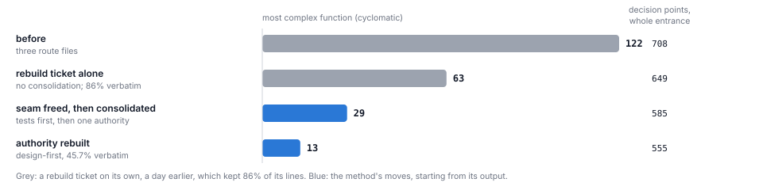

# The Theseus Method: the long version

This is the long version of [the essay](papers/harbour/theseus-method.md), which argues the method in a third of the length. It keeps what the essay leaves out: every rule, marked with how far it has been tested; the runbook an agent can follow on a codebase it has not seen; the definitions of the measures and the instruments behind them; the full reading list; and the trial on a second codebase. Claude wrote it for John Kershaw on 17 October 2026, from the three rebuild papers and their records at commit `509ed3fc`. Two in-session fresh readers checked it and their corrections are applied; it has not been independently checked.

A codebase that agents have grown quickly goes wrong in two ways at once. Some of its units get tangled inside: long functions, deep branching, a file nobody wants to touch. And some of its decisions get scattered between units: the same rule written in several places across several areas, each copy drifting a little from the others. The Theseus method treats these as different problems and takes them in a fixed order. It finds the scattered decisions and gathers each one into the single place that owns it, freeing the tests that pinned the old places on the way, and only then rebuilds the gathered unit from a fresh design. Every step is judged from outside, by replaying the old code and the new on the same thousands of inputs, not by a test suite the change may have edited. Agents do the work through the codebase's ordinary ticket pipeline, and a person answers the occasional ruling. Almost none of the parts is new: Parnas, Fowler, Feathers, McKeeman and Beck described most of them long ago. What is new is the price. An agent rebuilds a module in an hour or two, so the scarce thing is no longer engineering time but a person's attention, and the method is built to spend agents' time freely and people's almost never. On Harbour, where it was worked out, the full sequence ran once, in seven changes on 17 October 2026; every change to production code replayed against the old code with zero differences, apart from one change in the key order of an argument passed to the store, which only an order-aware rerun found, and the round cost two presses of a ruling card. This document describes the method well enough for an agent to run it on another codebase, says where each part comes from, and is plain about what has not yet been shown.

## 1 A ship that keeps sailing

Plutarch tells of the ship Theseus sailed home from Crete, kept by the Athenians for centuries by replacing each plank as it rotted, until philosophers argued over whether it was still the same ship [PL]. The philosophers' question is about identity. The shipwright's is more useful here: how do you replace a plank while the ship is at sea, and which plank first?

Harbour, the codebase this method was worked out on, asked the shipwright's question first. A paper on 15 October looked for the plank to start with, and found the best candidate replaceable only once its contract was written down: the shape it returned had never been specified, its main provider had no fake to test a replacement against, and its credentials were decided outside it [H-theseus]. The name came from the same session, where John Kershaw, who owns Harbour, was trying to visualise the codebase: four experimental views led to a fifth, which drew it as a ship rebuilt plank by plank and was called Theseus [H-ship]. The next day the first design-first rebuilds came back clean, and the idea of rebuilding this way was John's: "It feels like there's something new here. A Theseus refactor, if you will. An ideal way to rebuild." [N2]

A plank is easy to replace when it is a plank: one piece, with clean edges, joined to its neighbours at known points. It is hard when the thing you want to replace is not one piece but a decision whose pieces are nailed into a dozen other planks. You cannot lift it out. You have to gather it first, and the tests that were nailed to it have to come loose too.

*Figure 1. The method in one picture. A scattered decision (left) cannot be rebuilt, because there is no one thing to rebuild. Gathering it gives it one place and a boundary (middle). Rebuilding then changes only the inside (right), behind a boundary its callers already use.*

A few words recur. An **operator** is the agent that runs the method: it picks targets, writes tickets, builds the judge and scores the results, while the codebase's own **pipeline** (agents that plan, review, build and merge each ticket) does the work. A **ruling** is a question the pipeline stops to put to a person; here it arrives as a card with the operator's suggested answer already filled in, and the person reads it and presses. An **area** is a named region of the code (pages, routes, providers), listed in a hand-written **area map**.

## 2 Two kinds of mess, and why the order matters

The first kind of mess is **tangled inside**. One unit, a file or a few, has grown long functions and deep branching. A shape measure shows it: the complexity of each function (one, plus one for each `if`, loop, `&&`, `case` and the like), and the worst function in the unit. A rebuild fixes this kind well. Ten design-first rebuilds on Harbour cut the worst function in their unit by 29% to 88% [H-ladder, H-round, H-consolidate], and the first two rounds of rebuilds took the number of functions in Harbour's server code with a complexity of 50 or more from 21 to 10 [H-ladder, H-round].

The second kind is **scattered between**. One decision (which states count as finished, which marker means a run is waiting on a person, what a refusal looks like) is written in several places, often in several areas, and the copies drift. Nothing about any single file looks wrong. The cost arrives when the decision changes: the change has to find every copy, and the one it misses becomes a fault somewhere nobody was looking. On Harbour, changes that touched a site of a known scattered decision were five times the size of others and sent back by review two and a half times as often, and 45% of escaped defects traced to a decision that had not been reconciled [H-coherence]. Older research on copied code found the same: inconsistent changes to copies are frequent and induce a significant number of faults [J09]. `the-second-copy.md` makes the argument at length [H-copy].

A rebuild does not fix the second kind, because a rebuild works on one unit and the decision lives in many. Harbour saw this in its measures: seven design-first rebuilds in a row, none of them asked to move anything, made every file they touched simpler and left each of the eleven tracked decisions in exactly as many files as before, while the count of tangled area pairs went up by one [H-round]. Gathering fixes the second kind, and it also sets up the first: once a decision has one place, that place is a unit with a clean boundary, which is what a rebuild needs. When the operator proposed gathering first, John agreed and put the order in a sentence: "I like your idea; "rebuild" but it's not a lump of code, it's a tangle spread out across multiple areas. It's conceptually for me essentially compact (or consolidated) versus diffuse, dispersed or fragmented. The latter gets targeted first, sets up the seams, then invites the rebuild." [H-consolidate]

The one target where the whole sequence ran shows the difference. Harbour's dispatch entrance is the set of HTTP endpoints that accept requests to start agent runs, and its shared checks were spread across three route files. A rebuild ticket on its own, a day earlier, took its most complex function from 122 to 63, but kept 86% of its lines word for word: by the measure in section 8, an edit. Freeing the entrance's tests and gathering its 24 shared decisions took that function to 29 with no rebuild at all, and a design-first rebuild of the gathered authority took it to 13 (Figure 2).

*Figure 2. One target, step by step. The rebuild ticket on its own, which came out 86% verbatim, halved the worst function. Freeing the seam and consolidating halved it again before any rebuild, and rebuilding the gathered authority more than halved it once more. Nobody rebuilt the first rebuild's output without consolidating it, so "consolidating first made the difference" is an inference, not a measurement.*

## 3 The five moves

The method is five moves, each a change you could review on its own, and each allowed to change one thing, except that a pin or two may be converted inside a consolidation or a rebuild, in section 6's order.

*Figure 3. What each move is allowed to change. Production code moves in only two of the five, and behaviour in none, except fixes a change names. A move that would change a row it does not own is either the wrong move or two moves; the one exception is converting a pin or two inside a consolidation or rebuild.*

1. **Find** the scattered decisions with measures that run on a schedule, and rank them by places × change (section 4).
2. **Own.** Decide which area each target belongs to, by a written rule, before any code moves.
3. **Free the seam.** Find the tests that pin where the code sits or how it is written; class each one, and replace those that constrain the design with tests of what the code does, before anything moves.
4. **Consolidate.** Give each decision one authority in the area that owns it, delete the copies in the same change, and sort every difference between copies into fix, deliberate variation, harmless or unclear.
5. **Rebuild** the authority from a fresh design, and check by measurement that it really is new.

The same checks wrap every move (section 10). Sections 4 to 9 take the moves and the judge one at a time; section 13 turns them into a runbook.

## 4 Find: let the standing measures choose

The method starts from measures that run on a schedule, whatever anyone happens to think of the code that week. Harbour calls them the Periodicals. Three kinds of instrument did the finding, and any codebase can build all three.

- **A coherence review** that keeps a ledger of decisions held in several places and of how many places each one holds. On Harbour it is a recurring review document with a short list of named decisions and a script that counts their files.
- **An import map over the area map.** A script reads every import at a given commit and counts, for each pair of areas, the imports each way. A pair with imports both ways is a **knot**: the two areas cannot be changed or understood apart. Harbour's version reads committed objects rather than the working tree, so it measures exactly the commit named. Harbour's Seams & Tangles periodical also reads change coupling, the pairs of areas that land in the same change whether or not either imports the other (`scripts/code-shape/cochange.mjs`).
- **A census of copies**: a parser-based scan for the same rule written more than once. It looks for structural clones with identifiers renamed, sets of string literals restated, records built the same way, repeated constants, and text formats such as headings that two files must agree on. The research literature on clone detection is long [RC07, B98]; this one uses an off-the-shelf JavaScript parser, takes about three seconds a commit, and is a candidate for Harbour's review rather than part of it yet.

They see different things, which is why there are three. The census found all nine of the tracked decisions that still had more than one place (one only partly) and eight that nobody tracked, but it cannot see a decision written as a procedure, where the copies are sequences of steps rather than shapes; at the entrance it saw one of the twenty-four shared decisions [H-consolidate]. The import map sees direction and nothing about copies. Untying knots moved the knot count and not the census; consolidating a marker moved the census and not the knots. And the import map sees only imports. Where a codebase's parts talk through a shared state file, a database or a wire protocol, that channel is where its decisions scatter and its knots form, and it needs its own count: which fields or messages are read and written in how many areas. A trial on a second codebase, run from a draft of this document, found no knots at all among its imports while one field of its shared state file appeared, by a rough count, in eleven files across eight areas (section 12).

Rank candidates by **places × change**: the number of files holding a decision times its change, where change counts the commits that touched those files in the ninety days before the measured commit. Harbour's census counts distinct commits across the files, merges included; the trial summed each file's non-merge commits, and found the top of the ranking the same either way. Either will do if it is fixed for the round. A scattered decision costs only when it changes, so a rule copied into eight files nobody has touched in a year can wait, and the same rule in files that changed a hundred and forty times last quarter cannot. This is Tornhill's hotspot idea, complexity crossed with change frequency, applied to decisions instead of files [T15]. File churn flatters a decision that merely sits in busy files, so report beside it the churn of the decision's own lines (commits whose diff touches them, from `git log -G`), and let that break ties.

The census reports groups, not decisions. Turn one into the other by hand: merge groups whose sites share one reader or one writer, drop sites that only consume a value they were given (a comparison against a verdict passed in is a use, not a copy), and then count what is left with the site rule of section 7. Expect about a quarter of the top groups to be borderline or noise (a third on the trial): common words, coincidental numbers. On Harbour the full round's targets were in fact chosen by hand: the entrance because an earlier rebuild of it made a natural comparison, the "waiting on a person" marker because the standing review named it, and the knots because the import map listed them. The ranking is the method's proposal for choosing among many candidates; it has not yet been tested as a way of choosing.

Two cautions. The measures are also the judge: if the method works, they improve, and later changes in the touched areas land smaller and cleaner. So no one may move a measure by relabelling. The round's tickets forbade edits to the area map, and the scorers checked that its contents were unchanged; renaming a function so a signature stops matching is not yet guarded. Moving a file to its owner's path is not relabelling, because the ownership rule chooses the destination and the map is not touched. And the measures register less than the code shows. The clearest result of the entrance consolidation, the places holding its shared decisions falling from 95 to 26, is a hand count no standing measure takes; the census moved by one site for it, and by three over the whole round. A measure that misses what the method does is a gap in the measures, and worth fixing there.

## 5 Own: choose the cut by the rule

Before any code moves, someone decides where each target belongs. The rule is one sentence:

> **A decision belongs to the area that would have to change if its rule changed.**

Its ancestors are Parnas's 1972 criterion, that each module hides a design decision likely to change [P72], and, closer still, Robert Martin's Common Closure Principle, that what changes for the same reasons belongs together [M97]. Here it becomes a question you can ask of a single function, or of each edge in a knot. It settles most cases quickly, and applying it produced these corollaries.

*Figure 4. A knot from Harbour, and two ways to cut it. The usual instinct is to cut the thinner side. Here the thin edge is the correct dependency and stays: a page displaying a lifetime the API owns. The thick edge was wrong, and its rule belonged to neither area. Cutting the thin edge would have traded the knot for a scattered decision.*

- **Choose the cut by ownership, not thinness.** In a knot, the side with fewer imports looks easier to cut. Ask the ownership question of each edge instead; the cheap cut is often the wrong one, and sometimes the owner is a third area (Figure 4).
- **Move the decision to its owner, or invert the dependency.** In one knot still open, a provider applies a limit that belongs to the prompt formatter; the proposed fix is for the provider to return totals and the formatter to slice them. Moving the constants into the provider would untie the knot and leave the decision with the wrong owner, so that cut was rejected.
- **A knot unties only by taking something away**: an import, a function, a direction. Across nine months of Harbour's history, all five knots that disappeared went that way, and 23 of the 24 that appeared came from a single new import [H-theseus].
- **A catch-all area owns nothing.** A file lands in "other" or "utils" because nobody named its owner, not because it has none. Before treating a knot through the catch-all as two real owners, ask which importer's area the file belongs to. One of Harbour's knots was born when a rebuild extracted a helper "so the computation lives here once" and the helper matched no area [H-round].
- **Where only the map is wrong, leave the code alone.** If an import looks like a knot because the area map files a module under the wrong area, the fix is a map edit, made separately and said out loud, never a code move dressed up as a cure.

- **A copy in another repository is a contract, not a second owner.** When a decision is mirrored in a codebase the work does not touch (a protocol both sides speak, a vocabulary one side parses), make the call inside this codebase by the rule, keep the behaviour byte-identical, and write the cross-repository question up as class (d): whether to check one copy against the other, and which side should own the rule. (proposed)

Check the call before launch, against every place that uses, throws or catches the thing being moved. One proposed untie on Harbour, moving an error class to the provider interface, was dropped at this check: a second area also threw the error and defined its codes [H-consolidate]. This document's proposal, untested, is that a call with two real claimants goes to a person rather than to an agent.

## 6 Free the seam: the tests are part of it

Michael Feathers defined a seam as "a place where you can alter behavior in your program without editing in that place" [F04]. His seam is a point at which to substitute behaviour under test. This method borrows the word for a neighbouring idea: a boundary across which code can move, or be rewritten, without anything outside noticing. Callers are outside. So, it turns out, are some of the tests.

Harbour's agent-written suite held two kinds of test that look like guards and act like glue. A **location pin** checks where code sits: it reads a source file as text and asserts that a string such as `requireGrant('dispatch')` appears in it. A **text pin** checks how code is written: an exact passage, indentation included. Both pass today. Both fail the moment correct code moves or is reworded, with behaviour untouched, which is the opposite of Beck's "structure-insensitive" test, one that does not change its result when the structure of the code changes [BD]. And both can miss the failure that matters, when the text survives but stops applying, as when a new route skips the check. The dispatch entrance was guarded by 63 pins in 18 test files, and 35 test files read it as text in all; across the whole suite, 146 test files read production source as text [H-consolidate, H-surplus]. An earlier rebuild of the entrance had kept every route's own checks in place "because the source-text censuses pin them by the route they sit in", and came out 86% verbatim, and 83% even outside the blocks its tests pinned, so the pins explain part of that at most [H-round]. For two rounds the method treated the suite as a fixed oracle. It is not one. As John put it, "I think currently the assumption is the tests are all correct (and necessary), which isn't really true." [H-consolidate]

*Figure 5. One property guarded two ways, and the order in which one replaces the other. The pin raises a false alarm when correct code moves and stays silent when a new route skips the check. The behaviour test does neither.*

**Find the readers by tracing, not searching.** Run the whole suite with a hook in the test runtime that logs every test-side read of the target files. Exclude the module loader's own reads, which in some runtimes (CommonJS, for one) go through the same file API and are recognisable by their stack. On the entrance this found 35 reader files; an earlier count by searching had missed 13 of them, and the first trace itself missed one that spelled the path with a doubled slash [H-consolidate]. Look outside the main suite too: a mutation harness that anchors its mutants on exact source text is a set of text pins the trace will not see.

**Then probe them.**
- The **move probe** serves the tests a moved version of the files, the bodies relocated into the module that will become the authority, while imports still load the real code. Every failure is a location pin, because behaviour did not change. On the entrance: 37 failing tests in 11 files. Confirm with one real move on a scratch copy, which can show constraints the text probe hides.
- The **perturbation probe** applies behaviour-preserving rewrites one at a time and runs the full suite on each: re-indent everything, blank every comment, rename locals, replace a literal with a variable, build an argument before the call, split the file. Every failure pins how the code is written. On Harbour it ran once, on the gathered authority before its rebuild: nine rewrites failed no behaviour test but did fail seven text or location pins and ten source-scanning rules, and turned up four stale entries. Blanking every comment broke nothing, so no test kept the reason comments either [H-consolidate].

Count more than failures. A pin can go vacuous instead of failing: on the second codebase a guard that scanned producer files for a token still passed after the move, matching only comments. And a test generated from the source can vanish instead of failing: blanking comments there removed four tests and failed none. So each probe also compares the number and names of the tests that ran, and records what each source-reading test saw.

"Freed" has degrees: a unit can be free to move and still pinned against rewording. A text pin did survive inside the freed entrance. The next ticket's fresh reader found it first; the move probe could not see it, and the perturbation probe, run later, did. The method's suggestion, not yet tried, is to run the perturbation probe while freeing the seam as well as before the rebuild.

**Class each pin before touching it.** *Convert* a pin that fixes text or location and constrains the design. *Loosen* a count that should judge the unit as a whole: assert at least one call of each kind rather than an exact number, keeping exact counts only for allow-lists such as the set of permitted writers. *Keep* registration-level checks, whole-tree absence scans and vocabulary rules that cost a design nothing. Report *stale* or vacuous ones, and fix them only inside a conversion of the same test. *Re-anchor* a mutation anchor or similar text reference in the same change that moves its line.

**Replace each in a fixed order** (Figure 5), with no exceptions for security guards: land the replacement while the old pin is unchanged and green; in a scratch copy outside the repository, delete the check the pin was guarding, show the replacement fail, restore it and show it pass, and record both runs; only then, in a later commit, loosen or delete the old pin. If a replacement cannot be shown failing, the old pin stays as it is. The entrance's tests-only change landed four additive commits before fourteen loosening ones, recorded 67 such runs, added 139 behaviour tests, left production code byte-identical, and took the move probe from 37 failures to none [H-consolidate].

Four rules keep the replacements honest:
- **At least as strong.** A replacement must fail on every mutation the old pin's witnesses used. A drafted conversion that would have accepted "at least one" writer where the pin demanded the declared set was caught before launch and made exact.
- **Change a mixed pin only in its in-scope part.** One test guarded sites inside and outside the entrance together; replacing it whole would have silently dropped a guard on seven sites outside.
- **Sweeps, not counts, for exhaustiveness.** Enumerate the entry points from the framework's own registry, drive every request through the real interface, fail on any route the sweep cannot classify, and assert how many it enumerated.
- **Give every sweep a positive control.** One new sweep's checks that a request reaches no sink passed vacuously on two routes, because its fixtures stopped at a 404 before the sink; its 403 checks still caught a dropped gate, but half the sweep was blind there. Scoring found it, and the next change closed it. A replacement that stays green with its guard removed is aimed at nothing. And build secret-shaped test values at run time, since a token-shaped literal in a test trips the repository's secret scan.

**Give the conversion rule to everyone who touches the change.** Two failures showed who needs it. A worker asked to move a function proved the move with tests that read the new file's source, because "it is in the new file" is the obvious evidence that something moved; review replaced them. And three plan reviews in a row rejected a conversion the ticket allowed, guarding a text pin as though it were the property, until the loop ran out and a person ruled [H-consolidate]. One sample each, and the remedy is cheap: the ticket names which pins may be converted, the worker and the plan reviewers get the same rule (a pin may go once a behaviour check of the same property has landed and been shown to fail without the guard), and the witness for a move is the replay and the import map, never a check of where the code now sits.

Freeing the seam is its own change when the move probe fails tests, because then the conversions are the work. When it fails none and only a pin or two would go vacuous, the conversions can ride inside the consolidation or the rebuild, in the same order; the authority rebuild on Harbour converted its one surviving text pin that way.

Freeing a seam can cost more than the move it enables. The entrance's took two and a half hours and one ruling, to make room for a consolidation that took an hour and a half. John's view: "agreed, but that's kind of what I expected. It's also very cheap, from my perspective." [H-consolidate] What makes it safe to change the tests at all is that they are not the judge. The replay of section 9 judges behaviour without trusting the suite, so the suite can be improved underneath it.

## 7 Consolidate: one authority per decision

Consolidation gives each decision one home and deletes the rest. The unit is the decision, not the file: several entrances are fine, several answers are not, and a new helper counts as consolidation only when callers stop making the old decision themselves [H-paths].

**Count by a written rule.** A *site* is one place that writes the decision's rule itself; a call to the shared authority is not a site. The ticket gives the rule, a count per decision before and after, and the total. On the entrance the count went from 95 sites to 26, none left in the route files; one decision had been read as 5 sites in the ticket and 14 in the map until a fresh reader made them agree [H-consolidate]. For a single decision, a tested `git grep` of the sites that should remain works as well: the "waiting on a person" ticket predicted 23 hits before and 14 after (the authority, the ten that should stay, and three comment lines), and that is what merged. Treat every starting list as something to verify at the commit the work will branch from; the review's own line numbers for that decision were stale, and two inline checks were missing from every list.

**Delete in the same change.** A helper that callers may adopt later is one more copy. Harbour's history has decisions whose shared helper the callers never adopted, and every migration pattern ends by deleting the old path, which is the step that gets skipped [H-copy]. The authority lands, every caller is routed to it, and the losing copies go, in one change a replay can judge whole. The reasons beside each copy (ticket references, "why" comments) move with it and stay beside the authority, which is why one consolidation predicted to remove ten to twenty-five lines added eight: an eighteen-line comment gathered the reasons [H-consolidate]. Judge a consolidation by sites per decision and the measures, not by lines.

**Give it one home module in the owning area,** and name any new file into an area pattern before it merges, so it cannot fall into the catch-all. Adding a pattern for a new file is allowed, said out loud in the change; relabelling an existing file is not. Model the authority's imports on an exported copy before launch, and write into the ticket that a new knot is not acceptable: if one appears, move that code back and list it as an open question.

**Keep what an outsider can observe.** A consolidation unifies code, not behaviour. Each entry point keeps the order in which it checks things (a request that fails two checks must fail on the same one first), the order of its reads, every log status, its response bytes with their key order, and the key set of anything it stores. A check that belongs to one entry point only stays with it, passed into the authority as that entry point's step, and the authority refuses to run if the step is missing.

**Sort every difference between copies, in order** (Figure 6).

*Figure 6. Sorting differences between copies. The numbers at right are the roughly 43 differences found when the entrance's copies were gathered. The seven fixes were all stale comments; the seven unclear ones produced eight open questions, filed on two standing tickets.*

- **(a) A fix** when one copy is wrong by its own comment, the docs or a test. Inside a consolidation only comments are fixed; a wrong behaviour becomes (d), so the replay's expected result stays at exactly zero and any difference at all is a regression.
- **(b) A named parameter** when the difference is deliberate: one caller needs its own answer for a stated reason. The authority takes a visible knob, such as a mode, with the reason beside it; never a silent branch on who is calling.
- **(c) Bounded fuzz** when no real input reaches the difference, or it is harmless (message wording with the same status and code, console wording). Listed with its reason. Never for a successful reply's status or body, a write to another system and its arguments, a stored-data operation, permission or middleware order, or a named security boundary. Where unsure, it is not fuzz.
- **(d) Keep today's answer and write it up** when it is unclear. Each caller keeps exactly what it does now, the replay confirms it byte for byte, and the question, its options and a recommendation go onto a standing ticket for a later ruling. The run never stops to wait for a person: a blocking question would spend the attention the method exists to save, and a ticket that told the worker to raise one was caught before launch for that reason.

These are the consolidation's classes. A plain rebuild, with no consolidation in it, uses a variant: a fix (each proved by patching it alone into the old copy and showing nothing else differs), a regression (sent back; two key-order regressions in the second round merged and were found only after), bounded fuzz, and unclear.

**Replay per caller.** A consolidation joins code that may have drifted, so the replay covers every caller separately, with mutants planted at each old site and expected to be caught at exactly that caller. Where callers disagree today, a divergence probe records, on production-shaped inputs, which callers say yes and where they differ; the report must be identical before and after. On the "waiting on a person" marker, callers disagreed on up to 693 of 3,000 such inputs under today's rules, some deliberately and some still open questions, and the report did not change by a byte [H-consolidate].

Behind the classes is a distinction worth stating on its own: **scattered data consolidates mechanically; scattered rules need a decision first.** On that marker every copy held the same set, `{'blocked'}`. Gathering the set was safe and took thirty-five minutes. What had drifted was what surrounds it: which channel counts as a question, what ends a wait, when a question goes stale. Those are rules, and rules have owners, so the change kept today's behaviour and posted two questions instead of guessing. It is one case, so it is an inference, but it predicts where consolidation stalls: wherever the copies agree on the data and disagree on the rule.

Expect the authority to come out as the most complex of the files it replaced. The entrance's held 268 decision points (complexity summed over its units, less one per unit) and a function of complexity 29. That is the point: the complexity that was spread across three files is now in one place, where a rebuild can reach it.

## 8 Rebuild: design-first, and measurably new

Once a decision has one home, the home is a unit with a boundary, and its callers already use that boundary. Now it can be rebuilt.

**Design-first is the only kind of rebuild that was both clearly cleaner and safe.** The agent reads today's code, writes down what it must do, designs afresh, and only then builds. Harbour tried the alternatives first, on the same module [H-ladder]. An **informed rewrite**, told to rewrite the module whole with the old code in front of it, kept the old shape anyway: 82% of its lines were the old lines. A **clean room**, where the agent never sees the old code and works from the tests and a written description, simplified the code but was a lottery: four attempts on identical inputs all passed every test, and one of them changed what users see on 345 of 1,037 real tickets. This is Spolsky's warning, that the old code holds knowledge nobody wrote down [S00], seen happening. Design-first keeps that knowledge because the rebuilder reads it, and still gets a new shape because it designs before it types. The records' reading of the difference is worth keeping: what anchors an agent to the old code is the instruction, not the sight of it.

The ticket fixes the order of work:
1. **Requirements**, for every entry point: the checks in order, every read and write with its arguments, the stored data's key set, the reply's layout and key order, failures in order, every log line, what happens when a client hangs up. Taken from the code, the docs and the tests.
2. **Design**: the simplest structure that serves every entry point, each function with one line saying what it owns. Where today's structure really is simplest, say so and why. Decide the structure before opening the old file again, as review asked of one rebuild.
3. **Conversions** of the pins the ticket names, in the order of section 6.
4. **Build**: replace the file as a whole. Don't copy functions or blocks; reason comments, and lines a kept constraint requires, are exempt. No production line changes before step 3 is done.
5. **Replay** (the worker's own, lighter one) and **measure**.

**Say what the plan must contain, and what the plan reviewer judges.** Six items: the requirements; the design, one line per function and where each check runs; each conversion with its replacement and the scratch mutation that shows it failing; the commit order; how behaviour will be shown unchanged; what is out of scope. The reviewer approves a plan that covers the six and breaks no constraint in the ticket, and leaves helper names, parameter shapes and line-level design to code review. The list was added after a plan hit the review loop's bound and needed a ruling. Of the two tickets that carried it, one plan was approved on its third round and the other still ran out [H-consolidate], so it helps less than hoped, or not reliably.

**Agents drift back toward editing, so measure whether the rebuild is new.** Asked for a rebuild of a large file, an agent will often edit it in place: it is easier, and the tests pass. Three of seven rebuilds in the second round drifted that way under an instruction that said not to [H-round]. The check is the **verbatim share**: the share of the new code's non-trivial lines (trimmed; not blank, not only punctuation, not comments or imports) found word for word in the code it replaces. Design-first rebuilds landed between 37% and 55%, clean rooms between 13% and 19%, and edits above 80%. The definition of done carries the line as a prompt for one question, not a gate: *report the verbatim share; above about 60%, the change says whether a better structure was available and skipped.* Review sends the change back only when there is a sign one was skipped; old code may be kept where it is already clean or is the contract. Two first attempts came back at 79% and 73%, were sent back under the line as it then stood, a gate, and merged at 51% and 46% (Figure 7). One earlier rebuild, run before the line existed and with a ticket that allowed no test to be converted, merged at 86%: by this measure, an edit.

A high share is not by itself a failure, and the reason is a rebuild that came out mostly the same. LIN-3742 (#2079, merged 24 October) rebuilt the dashboard router's structure: the worst cyclomatic complexity went from 29 to 15 and in-scope decision points from 426 to 375, and the replay found no code difference (one environmental class, explained in the pull request). Yet 69% of its lines were verbatim, because the moved derivation logic is pure and its reply shapes are the contract. John Kershaw's comment on it, 24 October: "if it's better, the "how different should it be" metric doesn't make much sense. Eg let's say we already rebuilt a section, then rebuilt again after a couple of patches - I'd expect it to be mostly the same? We want to get a clean design, but no need to bounce it on reuse unless there's a sign a better solution was skipped." The share was added to catch an agent quietly editing a tangled file (round 2); shape, the design written down first and the replay say whether the rebuild is good, and the share only prompts the question.

Those bands are unnormalised. Trailing semicolons alone moved one rebuild by six points: normalised, the 51% becomes 58%. Pick one convention, and calibrate your own bands on one known rewrite and one known edit before trusting the 60% line in another language.

*Figure 7. Where rebuilds land. The Done-when line sits in the gap between design-first rebuilds and edits. For a multi-file change, read the share per region as well as overall: one sent-back attempt had a new design but carried the bodies of its entry points across at 81–90%, and the merged version was 69% in the tables that are the contract, 29% in the table of entry points and 11% in the pipeline.*

**Measure the shape, and expect to trade lines for small units.** Complexity per function, the worst function, total decision points, and the number of functions over ten, before and after, with one tool and its definitions written down. The count rewards splitting and counts every `case`, so read several measures together. A good rebuild shortens the worst function a great deal and may lengthen the file: the entrance authority went from 106 functions to 163 and from 878 code lines to 937, while its longest function fell from 256 lines to 74 and its worst complexity from 29 to 13 [H-consolidate].

**Keep the reasons, and treat comments as part of the contract.** The ticket says: keep every ticket reference and every reason comment beside the code it governs; drop one only with its code, and list the drops; `scripts/code-shape/retention.mjs <repo> <base> <head>` lists them. One rebuild without that line cut its comment lines from 967 to 409 and dropped 17 of 51 ticket references [H-round]. Comments steer rebuilds as well as describe them: a wrong comment led two clean rooms into the same display bug, and a clean room given the tests but not the comments broke headings and lists on 317 real texts [H-ladder].

**Tell the pipeline it is one change.** "This is one PR. Don't split it into child tickets." A pipeline that decomposes work will split a rebuild into parts that each make sense and together take five hours, as one did whose ticket lacked the line [H-ladder].

Rebuilds also find bugs. Writing requirements from the code and replaying old against new found nine bugs and two missing features in the first round and twelve in the second; nineteen bugs and both features have been fixed, and two bugs went to the backlog [H-ladder, H-round]. In one rebuild, the single handler that did not follow the shared pattern held both of its bugs.

## 9 The judge: replay the old code against the new

Classic refactoring leans on the test suite [F99]. This method cannot, because the suite pins location and text, is edited by the change it would judge, and was never written against a rebuild's new code. So behaviour is judged by an **independent differential replay**: run the old code and the new on the same inputs and compare everything an outsider can see. The idea is McKeeman's differential testing, which judged compilers by running several on the same programs [M98]. What the method adds is who builds the replay, when, and how it earns trust.

*Figure 8. The judge. It is built outside the pipeline, by a different agent from the one doing the work, before the work starts; it judges the merged result after.*

- **Inputs, in three tiers, and a fourth where text is involved.** Every call the existing tests make, captured. At least 3,000 generated inputs per seed, stratified so every entry point and input form is covered, with a share deliberately malformed. Targeted cases for every validation in order and every listed difference. And, where the code handles text people wrote, a sample of real text, rendered the way users see it and reported as counts only.
- **Two pinned copies, one frozen world.** The old code from an export of the base commit and the new from the change, isolated from each other: in Harbour, each side loads its own private copy of every module, fresh for each scenario; elsewhere, two processes or containers pinned at the two commits do the same job. One clock, frozen or virtual; time zone UTC; a scrubbed environment; seeded random numbers and ids; network, DNS and outbound fetches blocked and counted. Nothing in a replay calls a real service.
- **Every channel an outsider can see.** For an HTTP entrance: status; body, parsed and as bytes; headers; calls to each dependency, in order, with their arguments; stored writes, judged as they would be persisted; issued credentials; log and audit events; console output; what the server does after a client hangs up; for text, the display. Elsewhere, derive the list from the same principle: for a worker process, the verdicts it returns, what it prints and its exit code, the bytes of any state file it writes, the processes it starts and the messages it sends, all in order. Normalise only what the contract allows, and report each normalisation as information, because each is a place the replay is blind.
- **Self-checks before it is trusted.** Old against an independently pinned twin of old: zero differences on two seeds. Planted mutants, each a single exact text change, caught on exactly the targets expected and nowhere else; equivalent mutants silent. At least 95% of the old code's lines covered; where the target is a few dozen sites spread through large files, every site line and at least 95% of the functions that hold them.
- **After merge, again**: the merge's parent against the merge, on two seeds. Each difference is grouped and named: a listed fix, listed fuzz, or a regression. Where merging deploys, as it does for a service that follows its main branch, run the full replay on the change before it merges as well; after merge is too late.

On Harbour each replay ran thousands to tens of thousands of inputs per seed (51,046 for one consolidation), in seconds to a couple of minutes a seed. For every production change in the full round they found zero differences, apart from that key-order change in an argument to the store (the saved row was identical), and for the earlier rebuilds no regression that matters [H-ladder, H-round, H-consolidate]. The tests-only move changed no production code and was judged by its probes and mutation runs instead.

**Two replays catch more than one.** The worker inside the pipeline runs a lighter replay of its own (about a thousand inputs, one seed, the old side from an export of the base, with a guard so that no check can pass by testing nothing), and the full unit suite once before opening the change. In the second round the operator's replay caught two key-order changes the workers' replays missed, and one worker's replay caught a privacy leak on a public page that the operator's generator never exercised [H-round].

**Know the blind spots.** A comparison that ignores or sorts keys cannot see an order change; one replay sorted the keys of a stored argument and missed exactly that, until an order-aware rerun found it. A generator that only makes numbers will never show a field leaking text, so plant recognisable canary values in every field type. Fakes are modelled on the real dependencies, so a mistake in the model is shared by both sides. Requests run one at a time, so interleavings are untested. A virtual clock cannot show real socket timing. And a replay judges behaviour, not design: a change can replay perfectly and still be an edit, which is what the verbatim share is for.

Planted mutants are the method checking its own checker, the idea mutation testing has used since 1978 to ask whether tests can see faults at all [DLS78, JH11].

## 10 Around every ticket, and where people come in

Each move runs as one ticket through the codebase's own pipeline: plan, plan review, build, code review, merge. The method adds no stage to that pipeline. It adds work before the ticket is filed and after it merges, and it keeps people to two narrow points (Figure 9).

*Figure 9. One move, wrapped. The pipeline in the middle is the codebase's own and unchanged. People are touched at two points.*

**Before launch.**
1. **The ticket**, built from the clause list in section 13.
2. **A prediction**, committed before filing: ranges and probabilities for the run (whether it splits, merges, needs a ruling, how long it takes) and for each measure, with what would falsify it. Revised after the fresh reader, saying what changed. It limits the bias of an operator who also scores the result. Scored line by line afterwards, four tickets' predictions hit 20 to 36 items and missed 2 to 6 each: mostly right on the measures and wrong on effort.
3. **A fresh reader**: an agent that did not write the ticket re-reads it and every line it cites, at the base commit. It checks that every claim about the code is true, that no words are put in anyone's mouth, that every step can be run by the worker as written, that baselines are current, that each test conversion is at full strength, that the ownership call holds against every use, throw and catch, that the repository is named, and that the open-question and out-of-scope lists are complete. Findings come by severity, each re-checked before it is applied. On the last round fresh readers found must-fix problems in four of nine drafts and killed a fifth [H-consolidate], among them a stale baseline, a missing repository name, a test change that would have weakened a guard without any test failing, and a line that would have stopped the run to wait for a person.
4. **The replay**, built and self-checked.

**After merge.** The replay runs on two seeds. A scorer, again a separate agent, checks the prediction line by line and the change's own claims; scorers caught a change that said no ticket reference was dropped when one was, and a complexity reported as "about 25" where the tool said 48. Then the standing measures are read again, and the next target comes from them.

**People.** The method asks a person for two things. When a review loop in the pipeline reaches its bound (three send-backs, here), the pipeline asks for a ruling; the operator fills in the suggested answer and its reason, and the person reads it and presses. And unclear differences, class (d), become questions on standing tickets, answered whenever someone has time. The person also sets the frame: what success means, what to work on, what not to touch, when to pause. On the full round that came to two presses for eight merges (the seven moves and a fix to the test runner's concurrency), one 54 minutes after it was raised and one after 4 [H-consolidate]. The records show what else costs attention: review-loop rulings on heavy tickets, escalation lines written into tickets, requests for live checks at the end of a ticket, rulings that change nothing but hold up the next change, slips such as a build in the wrong repository, and an overloaded runner. Most now have a counter in the method. The plan-review loop and the ruling that holds up the next change do not yet, and the wrong-repository slip has only a stopgap: the ticket names the repository on its first line. When a better approach to a running ticket emerged mid-run, John's instruction was not to touch it: "Don't update the work in progress. We can always redo this part with an improved process." [H-consolidate]

## 11 What is old here, and what may be new

Most of the method is borrowed, and it is better for it: each borrowed part has decades of use behind it. The table sets each part beside its ancestors and says where the method departs from them.

| Part of the method | Its ancestors | Where the method departs |
| --- | --- | --- |
| Replace the system piece by piece while it runs | Plutarch's ship [PL]; Fowler's Strangler Fig, growing a new system around the edges of the old [F04s]; the reengineering patterns' incremental migration [OORP]; Brooks, who by 1995 had withdrawn "plan to throw one away" in favour of building incrementally [B95] | The strangler works at the edge of a whole system; here the unit is one decision's authority inside one codebase |
| A scattered decision is what costs | Parnas's modules that each hide a decision likely to change [P72]; Fowler and Beck's Shotgun Surgery, "when the changes are all over the place" [F99]; DRY's "single, unambiguous, authoritative representation" [HT99]; inconsistent changes to clones causing faults [J09]; Lehman's law that complexity grows unless work is done to reduce it [L80] | The unit is the decision, not the text: copies written as different procedures count, and a clone detector alone cannot see them [RC07] |
| Find and rank | Clone detection [RC07, B98]; Tornhill's hotspots [T15]; the Acyclic Dependencies Principle [M97] | Ranks decisions by places × change rather than files by complexity × change, and targets two-way pairs of areas rather than every cycle |
| The ownership rule | Parnas [P72]; Martin's Common Closure Principle [M97]; Brooks's "Parnas was right, and I was wrong" [B95] | A test for an existing decision, applied edge by edge in a knot, with the catch-all owning nothing |
| Free the seam | Feathers's seams and characterization tests [F04]; Beck's structure-insensitive tests [BD]; Khorikov's resistance to refactoring [K20] | Feathers's seam is a point for substituting behaviour under test; the pins this method frees read source text, which none of these sources discusses |
| Prepare, then change | Beck: "make the change easy (warning: this may be hard), then make the easy change" [B12]; preparatory refactoring [F15]; the Mikado method [EB14]; *Tidy First?* [B23] | Applied to rebuilds, across areas: consolidate first, rebuild second |
| Consolidate | DRY [HT99]; parallel change and branch by abstraction [PC14, BA07]; Google's large-scale changes [W20]; the reengineering patterns, which tie duplication to misplaced responsibility [OORP] | Deletion in the same change, deliberate variants as named parameters, unclear differences kept and written up, behaviour held exactly |
| Rebuild | Spolsky's warning against rewriting from scratch [S00]; clean-room reimplementation [SS02], as distinct from the Cleanroom process [MDL87]; agents rebuilding libraries from specifications [C0] | Design-first: the rebuilder reads the old code, then designs, and the result is measured for newness |
| The verbatim share | Git's rewrite heuristic, which calls a change a total rewrite only when less than about 40% of the old file survives [GIT] | Measures the other direction, new lines found in the old, and is used as a review prompt; no precedent for that use was found |
| The judge | Differential testing [M98]; Twitter's Diffy, which runs old code against old code to measure noise [D15]; GitHub's Scientist, which judged rewrites against the old path on live traffic [S16]; mutation testing [DLS78, JH11]; differential fuzzing of LLM code translations [E24] | Old against old must give exactly zero (Diffy subtracts noise instead), planted mutants check the judge rather than the suite, and the replay, not the suite, is the acceptance test |

The literature also argues back in two places. Kim and colleagues followed clone genealogies and found that many copies are short-lived and diverge soon after they are made, and that many long-lived ones are not locally refactorable [K05]: an argument against consolidating everything, and for ranking by change and keeping deliberate variants, which the method does. And the name is not unique: "Git of Theseus" is an existing tool that measures how long lines of code survive [GT], a different thing that a reader searching will find.

What looks new is narrower than the method:

1. **The price.** Every ancestor above assumes a rebuild is expensive and risky, so it counsels small steps and warns against rewriting. With agents a design-first rebuild of a module costs an hour or two of machine time, and the scarce resource is a person's attention. The method is the classic advice re-weighted for that. The large published uses of language models on codebases, Google's migrations and Airbnb's test conversion, were mechanical changes applied many times and judged by builds, tests and review [Z25, A25].
2. **A self-checked judge in place of the suite.** Differential judging of model output is established for translations [E24]; a judge that must itself give exactly zero old against old and catch planted mutants, used as the acceptance test for agent rebuilds, was not found. A study of model refactorings found about one suggestion in fourteen unsafe [L25], which is the case for a judge the agent does not write.
3. **Counters for agent-specific failures.** The verbatim review prompt, and tests that read source text or pin location, written by agents and then defended by agent reviewers, were not found documented; the nearest work shows model-written oracles pinning what code does rather than what it should do [KDP24], and agents deleting failing tests to pass [IB25].
4. **Consolidation as a fixed step before a rebuild,** with its classes of difference. The pieces are published [OORP, F15]; the sequence was not found.
5. **Design-first against the alternatives.** Published results on agents rebuilding or migrating code from a specification are thin, recent preprints [AM26, RD26, AL26], none clearly design-first, and none compares design-first, clean room and in-place editing head to head. Harbour's clean-room result agrees with a benchmark in which no agent could fully rebuild a library from its specification [C0].

## 12 What has been shown, and what has not

The evidence is three rounds on one codebase over three days in October 2026, each written up as a paper with its records [H-ladder, H-round, H-consolidate]. What it does not yet show:

- **A rate.** Every figure is one run per target. The entrance is one decision cluster in one codebase, built by one fleet of agents. Most of the rules in section 13 were used once; a few, such as the verbatim line, have caught something more than once.
- **The payoff.** The reason to gather scattered decisions is that later changes in those areas land smaller and get sent back less. None has had time to show it. A delayed re-measure of the touched areas is the real test, and it has not run.
- **That consolidating first is what made the difference** (Figure 2).
- **Why plan review sometimes runs out.** Two of the three heavy tickets in the full round hit the plan-review bound and needed a ruling; of the two that listed what the plan must contain, one converged and one did not.
- **Independence.** One operator chose the targets, wrote the tickets and the replays, and scored the results, with predictions committed first. An outside team running the method from this document alone would be a stronger test.
- **Other codebases.** Harbour is JavaScript without a build step, with an area map written by hand and a suite written mostly by agents, unusually full of tests that read source as text. A typed codebase, or one with a human-written suite, may need less of section 6 and more of something else.
- **"No regression that matters"** in the earlier rounds glosses two rebuilds that changed the key order of successful replies, which their own tickets counted as regressions [H-round].

**A first trial on another codebase.** Before this version, a fresh agent given only a draft of this document ran the read-only half of one loop on simple-dispatcher, a separate repository that runs Harbour's agent sessions [TR]. It built its own area map, import map, shape measure and census, chose a target (a vocabulary of five status tokens written at 44 sites in 8 files), made the ownership call, ran the read trace and the move probe, and wrote a full ticket, a prediction and a replay design; it filed nothing. The ownership rule, the site-counting rule, the classes of difference and the ticket clauses worked as written, and every clause found something real. It also found fourteen places where the draft was thin or shaped by Harbour, and listed what it could not exercise: the ranking formula, turning census groups into decisions, coupling that runs through shared state rather than imports, a decision mirrored in another repository, probes that miss a vacuous test, a codebase where merging deploys, and measures without definitions. This version answers most of them; whether the verbatim share belongs in a consolidation's measures is still open (here it is for rebuilds only). The trial did not exercise the fresh reader, the scorer, a ruling or a merge.

## 13 Running it: a runbook for an agent

This section is written for an agent asked to run the method on a codebase it has not seen, working as the operator. Harbour's instruments and records are named as worked examples; nothing here depends on them. The operator's step-by-step for a whole improvement cycle is `docs/runbooks/improvement-cycles.md`. Each rule carries how far it has been tested: **(tested)** where it caught or held more than once, **(used)** where it was used once, with a note where it did not fully hold, **(proposed)** where it has not been run.

### What it assumes

A ticket pipeline whose agents plan, review and build, with a bounded review loop that stops to ask a person. Without one, a person reviews each change, and every change then costs that person's attention; the method still works, but the economics in section 10 do not hold. Also: the ability to check out any two commits side by side, and a test suite that can run with the network blocked.

**Find the pipeline before the first ticket.** Where tickets go and what runs them; the review stages and their loop bound; who answers rulings, and how; whether CI blocks a merge or only reports; whether merging deploys; where standing questions live. On the trial codebase, merging restarted the production service and a red CI check could not block a merge, which moved the full replay to before the merge [TR].

### What to build first

| Instrument | What it does | Build notes |
| --- | --- | --- |
| **Area map** | Assigns every source path to an area by pattern, first match wins | Write it by hand, from the docs and file headers, before running any measure. Harbour's has eleven areas, each a name and a list of path patterns, with a catch-all last; aim for the regions a newcomer would name, roughly ten to twenty, which on a flat repository means one row per file. Keep the catch-all small and treat it as owning nothing. Have a fresh reader write a second map blind and compare the knot counts before relying on either (proposed). Freeze it during a round: a new file may get a pattern, said out loud; an existing file may not be relabelled. (`scripts/code-shape/areas.json`) |
| **Import map and knots** | For a commit: imports between areas, the two-way pairs (knots), the groups of areas tangled together | Read committed objects, not the working tree, so commit before measuring. Know which constructs count as edges (re-exports did here; count imports made inside functions too). Blind to copies, to calls over the network, and to data shared through a database or a state file; where those are the codebase's real coupling, add a count of which fields or messages each area reads and writes. (`scripts/code-shape/seams.mjs`) |
| **Shape** | Per file and function: code lines, complexity, worst function, functions over ten, total decision points | Any complexity tool, with its definitions written down. It rewards splitting and counts each `case`. (`scripts/code-shape/shape.mjs`) |
| **Verbatim share** | Share of new non-trivial lines found word for word in the old | A two-commit command; choose a normalisation (trailing semicolons, or tokens) and keep it; report per region as well as overall. Calibrate the bands on one known rewrite and one known edit in your language. (`scripts/code-shape/verbatim.mjs`) |
| **Replay kit** | Old against new on the same inputs, every channel compared | The largest build: two isolated sides (separate module graphs, processes or containers), a hermetic world (clock, time zone, random numbers, network), recording fakes, a harness that sends each input to both sides, a comparison that records key order, coverage, a captured-tests tier, and mutant self-checks. Per target, someone writes the generator, the fakes and the edge cases, several hundred lines each. (`experiments/replay-kit/`) |
| **Read trace and move probe** | Which tests read the target as text, and which fail or go vacuous when it moves | A file-read hook in the test runtime that excludes the module loader's own reads, plus a script that builds the moved text; compare the tests that ran and what each source-reading test saw, not only the failures. (Harbour's were not committed; `experiments/consolidate-4-entrance/inventory.md` describes them, and `experiments/theseus-method-trial/` has a CommonJS version.) |
| **Perturbation probe** | Which tests fail when the code is reworded | A rewriter with a handful of behaviour-preserving rewrites, and a loop that runs the suite on each. (`scripts/code-shape/probe.mjs`) |
| **Census of copies** (optional) | Groups of sites that restate one decision | A parser-based clone, set, record and constant detector, ranked by files × change. Expect about a quarter of its top groups to be borderline or noise. (`scripts/code-shape/census.mjs`) |

Also set up a notebook, written at every step with facts kept apart from labelled inferences, and a standing ticket per target for its open questions.

**If the codebase has no coherence review and no list of named decisions,** start one. Harvest the docs' and comments' own "this lives in one place" claims and check each against the code (on the trial codebase three of five held); then take the census's top groups by places × change, turn them into decisions as section 4 describes, and name them. That list is the first edition of the review. (proposed)

### Definitions the measures use

- **Complexity** of a function: 1, plus one for each `if`, `?:`, loop, `case` with a test, `catch`, `&&`, `||`, `??`, logical assignment (`&&=`, `||=`, `??=`) and default value (of a parameter or in destructuring); optional chaining (`?.`) does not count, and module-level code is its own unit. **Decision points** for a file: the sum of complexity over its units, less one per unit. These are Harbour's definitions, written into `scripts/code-shape/shape-core.mjs`; any tool will do if its definitions are written down and kept for the round.
- **Census detectors**, with Harbour's thresholds: structural clones with identifiers renamed (at least 5 statements and 40 syntax nodes); near clones (shingle overlap of 0.7 or more); browser ports of server code (overlap of property names, calls and strings of 0.6 or more, at least 8 names, sizes within twice each other); tiny rules (functions of 1 to 4 statements in 3 or more files); string sets, and switch or if-chains over them (sets merged at two-thirds overlap); records built the same way (3 or more derived keys); named constants (same name and value in 2 or more files); text contracts (headings or bracketed markers in literals in 2 or more files). The trial added single comparisons (one subject compared with the same literal across files), which found two of its six decisions. Details: `scripts/code-shape/README.md`.
- **Verbatim share**: the share of the new code's non-trivial lines found word for word in the old, matched as a multiset; lines trimmed; blank lines, punctuation-only lines, comments and imports excluded.

### Worked examples

From Harbour's records at `509ed3fc`, each a real artefact of the full round:
- Ownership calls for every knot: `experiments/consolidate-3-untie/knots.md`.
- A decision map for a consolidation: `experiments/consolidate-4-entrance/4b/decisions.md`.
- Tickets: an untie, `experiments/consolidate-lanes/ticket-K1.md`; a one-decision consolidation, `experiments/consolidate-2-waiting/ticket-2.md`; freeing the seam, `experiments/consolidate-4-entrance/ticket-4a.md`; consolidating the entrance, `experiments/consolidate-4-entrance/4b/ticket-4b.md`; rebuilding the authority, `experiments/consolidate-4-entrance/4c/ticket-4c.md`.
- A prediction: `experiments/consolidate-4-entrance/4c/prediction-4c.md`.
- Scores after merge: the `arm*/score.md` files beside each ticket.

### The loop

1. **Measure** at the current main: knots, shape, census, the review's list. Record the commit.
2. **Pick a target** by places × change, with the decision's own churn beside it. Among the top few, prefer, in this order: a knot that hangs on one import; a decision whose copies hold the same data; a decision cluster at a busy entrance. Look at the next target too: two decisions that share one reader are better gathered into one authority in consecutive changes, designed together. Before planning a from-scratch rebuild of a whole block, check that it has a contract you can check by running it. (the order is proposed)
3. **Make the ownership call** (section 5) and have a fresh reader check it against every use, throw and catch. (used)
4. **Choose the move.** If the target's tests pin it (run the trace and the move probe) and the probe fails tests, the next move is *free the seam*; if it fails none and only a pin or two would go vacuous, convert them inside the move. If its copies are scattered, *consolidate*. If it is one unit with a clean boundary and a complex inside, run the perturbation probe and *rebuild*. A knot is a small consolidation: move the decision to its owner, byte-identical, or invert the dependency.
5. **Model the change** on an exported copy where you can: make it by hand, rerun the import map, the census and the named tests, and predict every row that will move, including rows outside the target. Where the change cannot run in isolation, model it as text for the probes; on the trial that one suite run found a guard that would have gone vacuous. (used)
6. **Write the ticket** (clauses below), the **prediction**, and the **replay**; self-check the replay; run the **fresh reader**; apply its findings. File the ticket and start it. (tested)
7. **Wait without steering.** Don't amend a running ticket; redo the step later if the process improves. If a review loop reaches its bound, pre-fill the ruling with a recommendation and its reason, and ask the person to press. Never answer a ruling yourself. (used)
8. **Score after merge**: replay on two seeds, shape, verbatim, measures; the prediction line by line; the change's own claims. File what review missed. (tested)
9. **Re-measure** and return to step 2. A consolidation is usually followed by a rebuild of its authority.

Keep the machine usable: rebuilds and consolidations are heavy, so run one at a time beside at most a couple of light changes; no parallel forks inside a ticket; the worker runs the tests for the files it changes while it works and the full unit suite once before opening the change, and leaves end-to-end tests to CI. (used)

### Done-when, by move

| Move | Done when |
| --- | --- |
| Untie a knot | The knot is gone from the import map at the merge; no new pair; the area map unchanged; the moved code byte-identical; the moved function replayed with zero differences |
| Free the seam | Only tests changed; the move probe fails no test; every replacement was shown failing without its guard before its pin was loosened; no guard weakened |
| Consolidate | Sites per decision at the ticket's target count by its rule; losing copies deleted; no new knot; per-caller replay with zero differences; every difference classed, and each (d) written up |
| Rebuild | Judged by shape (worst function and total decision points down), by the design written down first, and by the replay: zero differences, or only listed fixes, each proved alone; reasons kept. A verbatim share above about 60% by your calibration is a prompt to say whether a better structure was available and skipped, not a gate |

### Ticket clauses

Each was added because something went wrong without it.
- **Where**: the repository named on the first line; branch from a freshly fetched main; check the base before starting; compare against that base, not against numbers in the ticket. (tested; naming the repository is a stopgap, used once)
- **Shape of the work**: one change, not a tree of child tickets (tested); one part at a time; no live calls to outside services and no paid model calls (tested).
- **What**: the target, its owner and the reasoning; the counting rule with a count column, or a tested grep of the sites that should remain (used); "deleting the losing copies is part of done"; the starting list marked "verify it, don't trust it", with its commit (tested).
- **Order of work**: requirements, design, conversions, build, replay, measures; no production line before the design is written; don't copy functions or blocks (used; on its own it did not hold).
- **Tests**: which pins may be converted, and the conversion rule (used); the order of work for every security pin (used); never weaken a guard, with each guard listed by location (used); change only the in-scope part of a mixed pin (used); build secret-shaped test values at run time (used).
- **Differences**: the classes (the consolidation's four in section 7, or the rebuild's variant); the never-fuzz list; "where unsure, it is not fuzz"; (d) kept and written up, never an escalation that blocks the run (used); open questions carried forward word for word from earlier changes (used).
- **Behaviour to keep**: each entry point's observable order (first failure, reads, logs, reply bytes and key order, stored key sets). (used)
- **Measures**: commit before measuring; the import map at base and head with the same map; no new pair; no edits to the area map; expected changes outside the target listed (used); shape per file; for a rebuild, the verbatim share, reported as a prompt for one question (was a better structure skipped?) and not as a pass line; the rebuild is judged by shape, the prior design and the replay (tested).
- **The worker's replay**: old from an export of the base, about a thousand seeded inputs, frozen clock, UTC, named channels, expected result zero, every difference explained by class; kept out of the unit tests. (used)
- **The plan**: the six things it must contain, and what the plan reviewer judges. (used; one of two converged)
- **Reasons**: keep every ticket reference and reason comment beside its code; list any dropped. (used; one slipped)
- **Scope**: an explicit out-of-scope list. (used)
- **Words**: quote people only verbatim, and say which rules are the ticket's own. Remove the operator's own working rules before filing. (used)

### What goes to a person, and what never does

A person is asked only for: the frame (success, scope, when to pause); a ruling when a review loop reaches its bound, pre-filled; and, at leisure, the open questions on the standing tickets. This document also proposes sending them any ownership call where two areas both have a real claim. Never: an unclear difference in the middle of a run; a request to check something live; a question a fresh reader or the code could answer.

### Stop and say so

Stop the move, and record why, if: the replay's self-checks fail; a new knot appears and moving the code back does not remove it; a pin's replacement cannot be shown failing; the area map turns out to be wrong for the target (fix the map as its own decision); or the fresh reader finds the ownership call has two real claimants.

## Annotated reading list

Markers in the text refer to the entries below. Each says what the source is, what it supports here, and what it does not. A source from another field or century says so; an analogy is a mechanism to consider, never an estimate. The outside sources were checked by an in-session subagent on 17 October 2026: each link was reached unless the entry says otherwise, quotations were seen on the page reached, and paraphrases are marked. Sources from the twentieth century, and Plutarch, say so.

### Harbour's own record

All at `509ed3fc` unless noted.

- **[H-ladder]** [`docs/papers/harbour/rebuild-ladder.md`](papers/harbour/rebuild-ladder.md) (round 1, 15–16 October). Supports the comparison of informed rewrite, clean room and design-first; the clean room that changed 345 of 1,037 real texts; the comments-as-contract findings; the nine bugs and two missing features; the five-hour split rebuild. One run per arm; the clean-room comparison is four samples on one module.
- **[H-round]** [`docs/papers/harbour/rebuild-round.md`](papers/harbour/rebuild-round.md) (round 2, 16–17 October). Supports seven design-first rebuilds with no regression that matters, the worst function falling 40–88%, twelve fixes, knots 19 → 20 and every named decision in as many files, three of seven drifting toward editing, the verbatim Done-when line, the dropped ticket references and the key-order changes the workers' replays missed. Does not support any claim about decision location improving; it found the opposite.
- **[H-consolidate]** [`docs/papers/harbour/consolidate-then-rebuild.md`](papers/harbour/consolidate-then-rebuild.md) (round 3, 17 October), with `experiments/consolidate-exp3/NOTES.md` and the `experiments/consolidate-*` folders. Supports every round-3 figure: the eight tickets, the entrance trajectory, sites 95 → 26, knots 20 → 16, the 63 pins, the probes, the 139 behaviour tests and 67 mutation runs, the divergence classes and their counts, the fresh-reader catches, the two rulings, and John's words quoted in sections 2, 6 and 10 and in Next. Its own Limits apply: one run per target, one operator, the delayed outcome untested.
- **[H-theseus]** [`docs/papers/harbour/theseus.md`](papers/harbour/theseus.md) (15 October). Supports the first "which plank" question, the Providers contract finding, and the history of knots: 23 of 24 born from one new import, all five that died taking something away. Measured from static imports only; it cannot see calls between browser and server, or copies.
- **[H-ship]** [`docs/papers/harbour/drawing-the-ship.md`](papers/harbour/drawing-the-ship.md) (15 October). Supports where the name came from: four boards drawn as experiments, then a fifth, Theseus, that drew the codebase as a ship rebuilt plank by plank, in the session that wrote `theseus.md`. An essay about how to draw a codebase, not about how to renew one.
- **[H-copy]** [`docs/papers/harbour/the-second-copy.md`](papers/harbour/the-second-copy.md). Supports the argument that a scattered decision costs when it changes, that shared helpers go unadopted, and that deletion is the step that gets skipped. An essay; its own reading list carries the research behind it.
- **[H-coherence]** [`docs/papers/harbour/coherence-as-it-grows.md`](papers/harbour/coherence-as-it-grows.md) (version 3). Supports the cost figures in section 2: changes touching a known scattered decision five times the size and sent back 2.5 times as often; 45% of escaped defects tracing to an unreconciled decision.
- **[H-paths]** [`docs/papers/harbour/one-job-many-paths.md`](papers/harbour/one-job-many-paths.md). Supports "several entrances are fine, several answers are not" and that a helper counts as consolidation only when callers stop making the old decision. A source-and-history study of a few decisions; it does not test consolidation.
- **[H-surplus]** [`docs/papers/harbour/test-surplus.md`](papers/harbour/test-surplus.md). Supports the count of 146 test files that read production source as text. Does not measure location pins as a class.
- **[TR]** [`experiments/theseus-method-trial/report.md`](../experiments/theseus-method-trial/report.md) (17 October): the trial of a draft of this document on simple-dispatcher, with its scripts. Supports section 12's account of the trial and the runbook's additions it prompted. Read-only, one operator, one codebase; nothing was filed, so the pipeline-facing half of the method was not tried.
- **[N2]** [`experiments/rebuild-exp2/NOTES.md`, line 437](../experiments/rebuild-exp2/NOTES.md?plain=1#L437). John Kershaw's words on the approach, 16 October, quoted in section 1, using the name the ship view already had. A notebook entry, not a finding.

The instruments named in section 13 are in the same commit: `scripts/code-shape/seams.mjs` and `areas.json`; `experiments/rebuild-exp1/kit/shape.mjs`; `experiments/verbatim/verbatim.mjs`; `experiments/replay-kit/`; `experiments/consolidate-1-census/census.mjs`; `experiments/consolidate-4-entrance/4c/probe/`. The move-probe scripts were not committed.

### The frame

- **[PL]** Plutarch (1st–2nd century CE), *Theseus* 23.1, in *Plutarch's Lives*, vol. I, trans. B. Perrin, Loeb Classical Library (1914). https://www.perseus.tufts.edu/hopper/text?doc=Plut.+Thes.+23.1. Supports the ship, its planks replaced as they decayed, and its use as "a standing illustration for the philosophers in the mooted question of growth". Ancient philosophy, used as an analogy only; Plutarch's planks are like-for-like, and he takes no side.
- **[GT]** Bernhardsson, E. (2016). The half-life of code & the ship of Theseus. https://erikbern.com/2016/12/05/the-half-life-of-code.html. Supports only the naming note in section 11: "Git of Theseus" measures how long lines survive in a repository's history. Unrelated to this method.
- **[L80]** Lehman, M. M. (1980). Programs, life cycles, and laws of software evolution. *Proc. IEEE* 68(9). https://doi.org/10.1109/PROC.1980.11805. From 1980. Supports the law that an evolving program's complexity increases "unless work is done to maintain or reduce it". Drawn from 1970s release data on large systems; says nothing about where the complexity lives.
- **[B95]** Brooks, F. P. (1995). *The Mythical Man-Month*, anniversary edition, ch. 19. https://ptgmedia.pearsoncmg.com/images/9780201835953/samplepages/0201835959.pdf (table of contents). From 1995. Supports that Brooks withdrew 1975's "plan to throw one away" ("Don't Build One to Throw Away") in favour of incremental building, and conceded "Parnas Was Right, and I Was Wrong about Information Hiding". Read at the headings only.
- **[S00]** Spolsky, J. (2000). Things you should never do, part I. https://www.joelonsoftware.com/2000/04/06/things-you-should-never-do-part-i/. Supports the objection the method has to answer: old code's ugliness is often "bug fixes", lost in a rewrite from scratch. An opinion essay about a whole-product rewrite, not a measurement.
- **[F04s]** Fowler, M. (2004; rewritten 2024). Strangler Fig. https://martinfowler.com/bliki/OriginalStranglerFigApplication.html (2004, first titled "StranglerApplication") and https://martinfowler.com/bliki/StranglerFigApplication.html (2024). Supports replacing a system gradually, "around the edges of the old". System-level routing around a legacy system; not consolidation inside one codebase.
- **[OORP]** Demeyer, S., Ducasse, S., & Nierstrasz, O. (2003). *Object-Oriented Reengineering Patterns*. Morgan Kaufmann; republished under CC BY-SA. https://www.oscar.nierstrasz.org/oorp. Supports duplicate detection as part of reengineering, the link between duplication and misplaced responsibility, and incremental migration. A pattern catalogue for human teams: no judge, no ordering of consolidation before rebuild.

### Scattered decisions, finding and ranking

- **[P72]** Parnas, D. L. (1972). On the criteria to be used in decomposing systems into modules. *CACM* 15(12). https://doi.org/10.1145/361598.361623. From 1972. Supports beginning "with a list of difficult design decisions or design decisions which are likely to change", each hidden in one module. Design-time decomposition; gives no rule for moving an existing scattered decision.
- **[M97]** Martin, R. C. (1997). Stability. *C++ Report* (Engineering Notebook), restating the Acyclic Dependencies and Common Closure principles; book form in *Agile Software Development* (2002). Copy reached: https://staff.cs.utu.fi/~jounsmed/doos_06/material/Stability.pdf (not the publisher's). From 1997. Supports "the classes in a package should be closed together against the same kinds of changes", the closest published ancestor of the ownership rule, and the rule that package dependencies form no cycles. Package-level, from C++; forbids every cycle where the method targets two-way pairs of areas.
- **[F99]** Fowler, M., with Beck, K. (1999; 2nd ed. 2018). *Refactoring*. https://martinfowler.com/books/refactoring.html; chapter 3 excerpt: https://www.informit.com/articles/article.aspx?p=2952392. First published 1999. Supports Shotgun Surgery, "when the changes are all over the place, they are hard to find", and Duplicated Code (quoted from the 2nd edition). The book's practice of refactoring under a solid test suite, cited in section 9, is paraphrased, not read here. Smells are heuristics, with no detection rule or ranking.
- **[HT99]** Hunt, A., & Thomas, D. (1999; 20th anniversary ed. 2019). *The Pragmatic Programmer*, DRY. https://pragprog.com/tips/. First published 1999. Supports "every piece of knowledge must have a single, unambiguous, authoritative representation within a system" (seen in the 2019 edition). Says what the end state is, not how to reach it or handle deliberate variants.
- **[J09]** Juergens, E., Deissenboeck, F., Hummel, B., & Wagner, S. (2009). Do code clones matter? *ICSE '09*. https://doi.org/10.1109/ICSE.2009.5070547. Supports that inconsistent changes to clones are "very frequent" and induce "a significant number of faults". Textual clones in five systems; not decisions spread across different code.
- **[K05]** Kim, M., Sazawal, V., Notkin, D., & Murphy, G. (2005). An empirical study of code clone genealogies. *ESEC/FSE '05*. https://doi.org/10.1145/1081706.1081737. Supports the caution in section 11: "refactoring may not benefit many clones", because short-lived clones diverge and long-lived ones "are not locally refactorable". Counter-evidence to consolidating everything; two Java projects.
- **[RC07]** Roy, C. K., & Cordy, J. R. (2007). A survey on software clone detection research. Queen's University TR 2007-541. https://research.cs.queensu.ca/TechReports/Reports/2007-541.pdf. Supports the types of clone, and that fragments performing "the same computation but implemented through different syntactic variants" are hard to detect. A survey of detectors, not of repair.
- **[B98]** Baxter, I. D., et al. (1998). Clone detection using abstract syntax trees. *ICSM '98*. https://doi.org/10.1109/ICSM.1998.738528. From 1998. Supports AST-based clone detection as an aid to restructuring (paraphrase; text not read). Finds syntactic clones, not decisions written differently.
- **[T15]** Tornhill, A. (2015; 2nd ed. 2024). *Your Code as a Crime Scene*. https://pragprog.com/titles/atcrime2/your-code-as-a-crime-scene-second-edition/. Supports hotspots, the overlap of complicated code with code "we also have to work with often" (publisher's page). Ranks files by complexity; ranking decisions by places is this method's substitution.

### Seams and tests

- **[F04]** Feathers, M. (2004). *Working Effectively with Legacy Code*, ch. 4. https://www.informit.com/articles/article.aspx?p=359417&seqNum=2. Supports the definition of a seam, quoted in section 6, and characterization tests. Feathers's seam is a point for substituting behaviour in tests, not the boundary this method frees; the word is borrowed.
- **[BD]** Beck, K. (c. 2019). Test Desiderata. https://testdesiderata.com/. Supports "structure-insensitive: tests should not change their result if the structure of the code changes", paired with "behavioral". Framed as trade-offs, with no conversion procedure.
- **[K20]** Khorikov, V. (2020). *Unit Testing Principles, Practices, and Patterns*, ch. 4. https://www.manning.com/books/unit-testing. Supports "resistance to refactoring" as a property of a good test (paraphrase; the book's text was not read). About implementation coupling through mocks, not tests that read source text.
- **[B12]** Beck, K. (2012). Tweet, 25 September 2012 (date from the post's id and Fowler's link to it), restated in his newsletter in 2025: https://newsletter.kentbeck.com/p/tidy-first-example. Supports "make the change easy (warning: this may be hard), then make the easy change". The tweet itself could not be loaded, and the wording varies between versions. Advice for one programmer's next change, not for rebuilds.
- **[B23]** Beck, K. (2023). *Tidy First?* O'Reilly. https://www.oreilly.com/library/view/tidy-first/9781098151232/ (not reached; the book was confirmed from catalogue listings). Supports separating structure changes from behaviour changes (paraphrase from the catalogue; text not read). A single programmer's practice.
- **[F15]** Fowler, M. (2015). An example of preparatory refactoring. https://martinfowler.com/articles/preparatory-refactoring-example.html. Supports "first I refactor the code into the structure that makes it easy to add the feature". One worked example.
- **[EB14]** Ellnestam, O., & Brolund, D. (2014). *The Mikado Method*. Manning. https://www.manning.com/books/the-mikado-method. Supports discovering prerequisites and doing them first. Relies on the existing tests as its judge.

### Consolidation and rebuild

- **[PC14]** Sato, D. (2014). Parallel change. https://martinfowler.com/bliki/ParallelChange.html. Supports expand, migrate, contract for a changing interface. Spread across several changes, where the method deletes in one.
- **[BA07]** Hammant, P. (2007). Introducing branch by abstraction. https://paulhammant.com/blog/branch_by_abstraction.html. Supports swapping an implementation behind an abstraction gradually. Keeps old and new side by side for a time.
- **[W20]** Wright, H. (2020). Large-scale changes. In *Software Engineering at Google*, ch. 22. https://abseil.io/resources/swe-book/html/ch22.html. Supports sharded, independently reviewed changes across a large codebase. Mostly mechanical, judged by tests and review.
- **[SS02]** Samuelson, P., & Scotchmer, S. (2002). The law and economics of reverse engineering. *Yale Law Journal* 111(7), n. 353. https://doi.org/10.2307/797533. Supports the sense of "clean room" used here: one team describes, another builds without seeing the original. A legal and economic source; says nothing about whether clean-room rebuilds are reliable.
- **[MDL87]** Mills, H. D., Dyer, M., & Linger, R. C. (1987). Cleanroom software engineering. *IEEE Software* 4(5). https://doi.org/10.1109/MS.1987.231413. From 1987. Cited only to say it is a different idea: a development process certified by statistical usage testing.
- **[C0]** Zhao, W., et al. (2024). Commit0: library generation from scratch. arXiv 2412.01769; ICLR 2025. https://arxiv.org/abs/2412.01769. Supports that agents rebuilding libraries from a specification and tests "can pass some unit tests" but "none can yet fully reproduce full libraries", consistent with Harbour's clean-room result. A generation benchmark, with no old code to read.
- **[AM26]** Ahmed, S. N., & Galib, M. (2026). AgentModernize: preserving business logic in legacy modernization with multi-agent LLMs and behavioral specification graphs. arXiv 2605.17535. https://arxiv.org/abs/2605.17535. Supports a specification that "forces extracted business logic to be explicit and inspectable before any code is generated". Eight synthetic scenarios, small gains, "inversely correlated with model capability"; a translation between languages.
- **[RD26]** Fawcett, P. (2026). Rebuild Dossier: mechanically-enforced specs for agentic app rebuilds. arXiv 2608.23616. https://arxiv.org/abs/2608.23616. Supports locking an application's exact inputs and outputs "before any code is written". Single author, small apps, mixed results; closer to this method's judge than to its design step.
- **[AL26]** Alves, I. da S. R., Politowski, C., & Montandon, J. E. (2026). Legacy system modernization with coding agents: a case study. arXiv 2608.28972. https://arxiv.org/abs/2608.28972. Supports agents migrating twelve features of a Visual Basic 6 system to C#, with measured equivalence averaging 70% (92% for simple features, 47% for complex ones). One company; a migration between languages; does not say whether the work was design-first.
- **[GIT]** Git documentation, `git diff -B` and `diffcore.h`. https://git-scm.com/docs/git-diff and https://github.com/git/git/blob/master/diffcore.h. Supports that Git treats a change as a total rewrite only when less than about 40% of the original survives by default. A display heuristic over bytes per file, not a quality gate.

### The judge

- **[M98]** McKeeman, W. M. (1998). Differential testing for software. *Digital Technical Journal* 10(1). Records: https://dblp.org/rec/journals/dtj/McKeeman98.html and https://www.semanticscholar.org/paper/Differential-Testing-for-Software-McKeeman/fc881e8d0432ea8e4dd5fda4979243cac5e4b9e3. From 1998. Existence only: neither the record pages nor the journal's PDF host could be read during the check. Supports running the same inputs through comparable implementations and treating disagreement as a bug signal (paraphrase from secondary sources). McKeeman compared independent compilers, not an old and a new version of one program.
- **[D15]** Khanduri, P., Twitter (2015). Diffy. https://github.com/opendiffy/diffy. Supports old against old as a baseline: two copies of "the same known-good code" measure noise, subtracted from old-against-new. The method instead requires zero, which works because its replay is deterministic.
- **[S16]** Toth, J. (2016). Scientist: measure twice, cut once. https://github.blog/developer-skills/application-development/scientist/. Supports judging a human-written rewrite against the old path on live traffic. No mutant self-check.
- **[DLS78]** DeMillo, R. A., Lipton, R. J., & Sayward, F. G. (1978). Hints on test data selection. *Computer* 11(4). https://doi.org/10.1109/C-M.1978.218136. From 1978. Supports mutation analysis (paraphrase; text not read). It scores test data; using mutants to score the judge is this method's extension.
- **[JH11]** Jia, Y., & Harman, M. (2011). An analysis and survey of the development of mutation testing. *IEEE TSE* 37(5). https://doi.org/10.1109/TSE.2010.62. Supports the field's breadth and the equivalent-mutant problem: a planted mutant the replay misses may be equivalent, so the self-check needs equivalent mutants identified (paraphrase from summaries of the abstract; text not read).
- **[E24]** Eniser, H. F., et al. (2024). Towards translating real-world code with LLMs: a study of translating to Rust. arXiv 2405.11514. https://arxiv.org/abs/2405.11514. Supports differential fuzzing to check that a model's translation is input-output equivalent to the original. Translation between languages, with no self-check of the fuzzer.

### Agents and language models on codebases

- **[Z25]** Ziftci, C., et al. (2025). Migrating code at scale with LLMs at Google. *FSE 2025 Companion*. https://doi.org/10.1145/3696630.3728542. Supports 74% of a migration's changes generated by a model and an estimated halving of time, validated by build, tests and review, with no replay. A mechanical migration.
- **[A25]** Covey-Brandt, C. (2025). Accelerating large-scale test migration with LLMs. Airbnb. https://airbnb.tech/?p=366. Supports about 3,500 test files migrated in six weeks against the team's own estimate of a year and a half, gated by the test runner, linter and type checker. A framework migration; the estimate is not a measured baseline.
- **[L25]** Liu, B., et al. (2025). An empirical study on the potential of LLMs in automated software refactoring. *Automated Software Engineering* 32(1). https://arxiv.org/abs/2411.04444. Supports 13 of 176 and 9 of 137 model-suggested refactorings being unsafe. Method-level Java refactorings with 2023–24 models.
- **[KDP24]** Konstantinou, M., Degiovanni, R., & Papadakis, M. (2024). Do LLMs generate test oracles that capture the actual or the expected program behaviour? arXiv 2410.21136 (retitled in version 2). https://arxiv.org/abs/2410.21136. Supports that model-written tests "mainly capture the actual program behavior", the nearest documented relative of the source-text pin. Oracle values in Java tests, not tests that read source.
- **[IB25]** Zhong, Z., Raghunathan, A., & Carlini, N. (2025). ImpossibleBench. arXiv 2510.20270. https://arxiv.org/abs/2510.20270. Supports that "an LLM agent with access to unit tests may delete failing tests rather than fix the underlying bug", a reason the judge must not be the agent's own tests. About gaming tests, not writing pins.

## Next

These are options for John to choose from, not decisions.

- **Run the delayed re-measure.** It is the real test of everything above, and it is already proposed: over the next thirty merged changes that touch the consolidated and untied areas, count files changed, send-backs and escaped faults against the thirty before, and look for new copies or knots (`proposals.md`, "Do changes land cleaner where decisions were consolidated?").
- **Finish the trial on another codebase.** The trial did the read-only half of a loop on simple-dispatcher and drafted a ticket for its terminal-status vocabulary [TR]. Filing that ticket through that repository's own pipeline, with the replay built first and the result scored, would test the half the trial could not (`proposals.md`, "Can an agent run the Theseus method from the essay alone, on a codebase it has not seen?").
- **Measure whether agent-written tests pin where code sits more than other tests do.** The literature search found the failure undocumented, and Harbour has the record to answer it (`proposals.md`, "Do agent-written tests pin where code sits more than other tests do?").
- **Fold the census into the coherence review,** with the detector for repeated single comparisons, which the trial showed earns its place.
- **Fix the instruments the rounds and the trial found wanting:** an order-aware comparison in the replay; a per-region verbatim table; probes that compare which tests ran, not only which failed.
- **Decide how Harbour should run the method routinely.** John set that aside until the idea had been tried: "How we specifically _make_ Harbour do these is a task for later, once we've checked if the idea lands well." [H-consolidate]

## About this document

It rests on these sources; the outside ones carry their links in the reading list above.

- docs/papers/harbour/rebuild-ladder.md@509ed3fc, rebuild-round.md@509ed3fc, consolidate-then-rebuild.md@509ed3fc (the three rounds, their findings and limits)
- experiments/rebuild-exp2/NOTES.md@509ed3fc:437 (the name) and experiments/consolidate-exp3/NOTES.md@509ed3fc (round 3's notebook)
- experiments/verbatim/verbatim.md@509ed3fc:5-17, experiments/rebuild-rung6b/arm/score.md@509ed3fc:70, experiments/rebuild-rung7/arm/score.md@509ed3fc:77-89, experiments/consolidate-4-entrance/arm-4c/score.md@509ed3fc:75-77 (verbatim shares, Figure 7)
- docs/papers/harbour/consolidate-then-rebuild.md@509ed3fc:71-76 (the entrance trajectory, Figure 2)
- experiments/consolidate-4-entrance/@509ed3fc (inventory.md, 4b/decisions.md, 4c/constraints.md, the tickets and arm scores), experiments/consolidate-2-waiting/@509ed3fc, experiments/consolidate-3-untie/knots.md@509ed3fc, experiments/consolidate-lanes/@509ed3fc
- docs/papers/harbour/theseus.md@509ed3fc, drawing-the-ship.md@038526d8:8 (where the name came from), the-second-copy.md@509ed3fc, coherence-as-it-grows.md@509ed3fc, one-job-many-paths.md@509ed3fc, test-surplus.md@509ed3fc
- scripts/code-shape/seams.mjs@509ed3fc, scripts/code-shape/areas.json@509ed3fc, experiments/rebuild-exp1/kit/lib/shape-core.mjs@509ed3fc, experiments/verbatim/verbatim.mjs@509ed3fc, experiments/replay-kit/@509ed3fc, experiments/consolidate-1-census/census.mjs@509ed3fc, experiments/consolidate-4-entrance/4c/probe/@509ed3fc (the instruments)
- experiments/theseus-method-trial/report.md (this commit; the trial on simple-dispatcher at 0d54b97)
- Outside sources: each entry in the annotated reading list carries its DOI or URL; the markers in the text are the reading list's.
